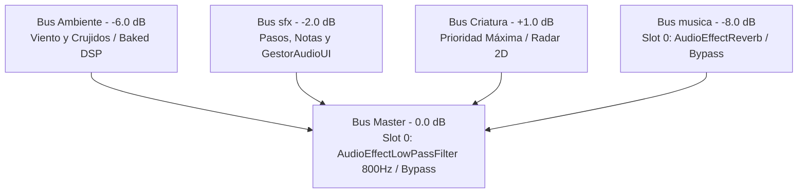
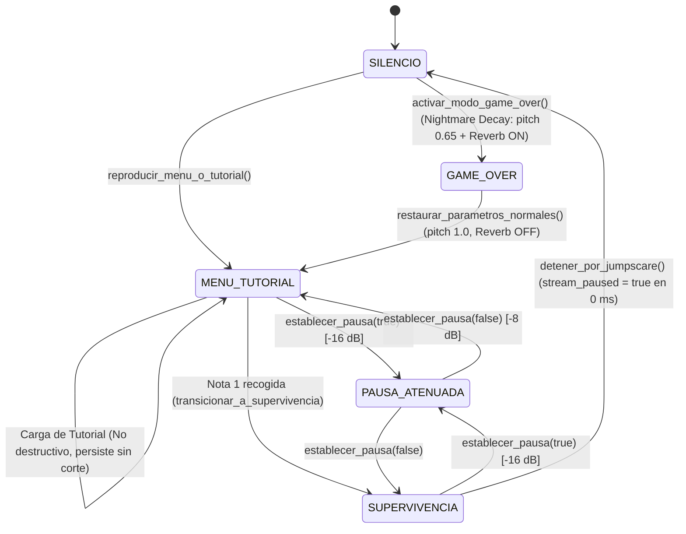

# Vosque Audio & Music Architecture

Esta skill centraliza la arquitectura de audio y música interactiva de **Vosque**. Detalla la configuración de los buses de audio en Godot 4.7, la máquina de estados musicales reactiva basada en `AudioStreamInteractive`, la interacción con el ciclo de juego y las interfaces, los contratos de sincronización con persistencia y las salvaguardas para plataformas WebAudio.

---

## 1. Directiva 0: Uso Obligatorio del MCP `godot-ai` y Utilidad Canónica

Siguiendo las normas estrictas del proyecto (`GEMINI.md`) y el protocolo operativo de `vosque-mcp-workflow`:

* **Prohibición absoluta:** NUNCA crees ni edites archivos `.tscn`, `.tres` (`default_bus_layout.tres`, `musica_interactiva.tres`, recursos de configuración) modificando directamente archivos de texto plano en disco.
* **Inspección y manipulación:**
  * Usa las herramientas MCP (`audio_manage`, `resource_manage`, `scene_manage`, `scene_open`, `scene_save`).
  * Para generar o restaurar programáticamente el layout de buses y el recurso interactivo con las clases nativas de Godot, apóyate en la utilidad canónica `ConfiguradorBusesYMusica` (`scripts/audio/configurador_buses_y_musica.gd`):
    * `ConfiguradorBusesYMusica.configurar_bus_layout(true)`
    * `ConfiguradorBusesYMusica.configurar_musica_interactiva()`

---

## 2. Invariante 1: Arquitectura de los 5 Buses Canónicos y DSP (`default_bus_layout.tres`)

El archivo `res://default_bus_layout.tres` define la jerarquía acústica del juego. Todos los buses secundarios enrutan directamente a `Master`.



### Tabla de Buses de Audio

| Bus | Volumen Base | Envío (`send`) | Efecto Slot 0 | Estado por Defecto | Propósito en Vosque |
| :--- | :---: | :---: | :--- | :---: | :--- |
| **`Master`** | `0.0 dB` | N/A | `AudioEffectLowPassFilter` (`cutoff_hz = 800.0`) | Deshabilitado (Bypass) | Mezcla general. Se activa al caer la estamina a 0 (pánico/fatiga auditiva). |
| **`Ambiente`** | `-6.0 dB` | `Master` | Ninguno (*Baked DSP*) | N/A | Bucle de viento sibilante y crujidos con reverberación pre-procesada. |
| **`sfx`** | `-2.0 dB` | `Master` | Ninguno | N/A | Pasos, salto, rasgado de notas y efectos de interfaz (`GestorAudioUI`). |
| **`Criatura`** | `+1.0 dB` | `Master` | Ninguno (*Baked DSP*) | N/A | Zumbido, respiración y pasos del monstruo. Prioridad auditiva más alta. |
| **`musica`** | `-8.0 dB` | `Master` | `AudioEffectReverb` (`ReverbGameOver`) | Deshabilitado (Bypass) | Pistas interactivas. El Reverb **solo** se activa en la pantalla de Game Over. |

> [!NOTE]
> **Compatibilidad WebAudio (`threads = false`):** En exportaciones HTML5, procesar reverbs en tiempo real sobrecoge la CPU del navegador. Por ello, el Reverb del bus `musica` permanece apagado durante todo el gameplay y únicamente se enciende en `GameOver`, cuando el mundo 2D está inactivo.

---

## 3. Invariante 2: Prevención de Colisión Autoload vs `class_name` y Patrón `@tool` Reactivo

Para evitar el error de Godot 4 *"Class 'X' hides an autoload singleton"*, los scripts de los servicios de audio utilizan nombres diferenciados para su clase y su registro en `project.godot`:

| Singleton Autoload (`project.godot`) | Escena (`.tscn`) | `class_name` en GDScript | Script (`.gd`) | Recurso Reactivo `@tool` | Preset por Defecto |
| :--- | :--- | :--- | :--- | :--- | :--- |
| `GestorMusica` | `res://escenas/gestor_musica.tscn` | `ControladorMusica` | `res://scripts/core/gestor_musica.gd` | `ConfiguracionMusica` | `res://recursos/audio/config_musica_defecto.tres` |
| `GestorAudioUI` | `res://escenas/gestor_audio_ui.tscn` | `ControladorAudioUI` | `res://scripts/core/gestor_audio_ui.gd` | `ConfiguracionAudioUI` | `res://recursos/audio/config_audio_ui_defecto.tres` |

### Reactividad en Vivo en el Inspector de Godot
Ambos recursos (`ConfiguracionMusica` y `ConfiguracionAudioUI`) son scripts `@tool`. Cada variable exportada emite `emit_changed()` y `changed.emit()` en su `set(val)`:
```gdscript
@export_range(-40.0, 6.0, 0.5, "suffix:dB") var volumen_base_db: float = -8.0:
	set(val):
		volumen_base_db = val
		emit_changed()
		changed.emit()
```
Tanto `ControladorMusica` como `ControladorAudioUI` conectan la señal `config.changed` a métodos de recarga en caliente (`_on_config_changed`), permitiendo calibrar sliders desde el Inspector o el Menú Debug (<kbd>F3</kbd>) escuchando cambios inmediatamente.

---

## 4. Invariante 3: Máquina de Estados Musicales y `AudioStreamInteractive`

La música de *Vosque* se orquesta mediante el recurso `res://sonido/musica/musica_interactiva.tres` asignado a un nodo hijo `ReproductorInteractivo` (`AudioStreamPlayer`) dentro de `GestorMusica` (`process_mode = Node.PROCESS_MODE_ALWAYS`).



### Configuración Canónica de Transiciones en `musica_interactiva.tres`
Valores obligatorios validados por `tests/test_gestor_musica.gd`:
* **Clip 0 (`&"menu_tutorial"`):** `Pac Man World 2 - Night Crawling` (112 BPM, compás 4/4).
* **Clip 1 (`&"supervivencia"`):** `Pac Man World 2 - Haunted Boardwalk` (100 BPM, compás 4/4).
* **Transición `0 -> 1` (`menu_tutorial` $\to$ `supervivencia`):**
  * `from_time`: `TRANSITION_FROM_TIME_IMMEDIATE`
  * `to_time`: `TRANSITION_TO_TIME_START`
  * `fade_mode`: `FADE_DISABLED`
  * `fade_beats`: `0.0`
* **Transición `CLIP_ANY (-1) -> 0`:**
  * `from_time`: `TRANSITION_FROM_TIME_IMMEDIATE`
  * `to_time`: `TRANSITION_TO_TIME_START`
  * `fade_mode`: `FADE_DISABLED`
  * `fade_beats`: `0.0`

### Reglas de Transición de Estados
1. **Continuidad Menú $\to$ Tutorial (`reproducir_menu_o_tutorial`):**
   * Es **no destructiva**. Si `reproductor.playing` es verdadero y el clip activo ya es `&"menu_tutorial"`, no reinicia la pista al segundo 0 ni interrumpe la reproducción al hacer clic en "Jugar".
2. **Disparo en Nota 1 (`transicionar_a_supervivencia`):**
   * Al recolectar la primera nota en `Maain._on_nota_recolectada()`, se invoca diferidamente `musica.transicionar_a_supervivencia()`.
   * Conmuta mediante `reproductor.set("parameters/switch_to_clip", &"supervivencia")`.
3. **Atenuación Aditiva en Pausa (`establecer_pausa`):**
   * En `_process(delta)`, calcula el objetivo sumando la base de diseño, el offset del jugador y la atenuación de pausa:
     $$\text{volumen\_objetivo} = \text{config.volumen\_base\_db} + \text{\_offset\_usuario\_db} + (\text{config.atenuacion\_pausa\_db si en\_pausa else } 0)$$
   * Suaviza la ganancia hacia el objetivo usando `move_toward` a razón de `config.velocidad_suavizado_db` ($12.0\text{ dB/s}$).
4. **Congelamiento en Jumpscare y Nightmare Decay (`detener_por_jumpscare` y `activar_modo_game_over`):**
   * **Jumpscare ($0\text{ ms}$):** Cuando el monstruo captura al jugador (`Maain._on_jugador_capturado`), se llama inmediatamente a `detener_por_jumpscare()`. Si el reproductor estaba activo, fija `reproductor.stream_paused = true` (en vez de `stop()`) para retener el compás y segundo exacto de la pista.
   * **Game Over:** Al abrirse `game_over.tscn`, se llama a `activar_modo_game_over()`. Fija `reproductor.pitch_scale = config.pitch_game_over` ($0.65$), habilita el Reverb en el bus `musica` (`set_bus_effect_enabled(idx, 0, true)`) y despausa el reproductor (`stream_paused = false`), reanudando desde el punto congelado con atmósfera espectral y ralentizada.
5. **Restauración (`restaurar_parametros_normales`):**
   * Al pulsar *Reintentar* o *Volver al Menú*, restablece `pitch_scale = 1.0`, desactiva el Reverb, restaura el volumen base y conmuta a `&"menu_tutorial"`.

---

## 5. Invariante 4: Sincronización Obligatoria con Persistencia y Opciones (Arquitectura Dual)

El subsistema de volumen separa estrictamente el **bus default del juego** del **perfil persistente del jugador**:

1. **Capa 1 — Bus Default Inmutable (`res://`):**
   * Definido en `res://default_bus_layout.tres` (`Master: 0.0 dB` = `100%`, `musica: -7.9588 dB` $\approx$ `40%`, `sfx: -1.9382 dB` $\approx$ `80%`, `Ambiente: -6.0 dB`, `Criatura: +1.0 dB`) y `res://recursos/audio/config_musica_defecto.tres` (`volumen_base_db = -8.0 dB`).
   * **Nunca** se debe sobrescribir `config.volumen_base_db` al mover sliders en `MenuOpciones` ni al cargar `GestorPersistencia`.
2. **Capa 2 — Perfil del Jugador (`user://configuracion.cfg` + `localStorage`):**
   * Almacena los porcentajes reales del usuario (`master`, `musica`, `sfx` en `0..100%`) junto con la bandera `usar_audio_usuario: bool`.
   * Al pulsar **Restablecer Valores**, se vuelve al bus default (`restaurar_volumen_predeterminado(true)` y `usar_audio_usuario = false`).

> [!WARNING]
> **No modificar únicamente el `AudioServer` para el bus `musica`:**
> Como `ControladorMusica._process(delta)` interpola en cada fotograma el volumen del bus `&"musica"` hacia `_calcular_volumen_objetivo()`, cualquier cambio realizado directamente con `AudioServer.set_bus_volume_db(idx_musica, db)` será **sobrescrito en el siguiente frame**.

Para ajustar el volumen de música desde `MenuOpciones`, `GestorPersistencia` o código de juego sin mutar el recurso predeterminado:
```gdscript
# 1. Ajustar AudioServer
var idx_musica := AudioServer.get_bus_index(&"musica")
if idx_musica >= 0:
	AudioServer.set_bus_volume_db(idx_musica, db)

# 2. Notificar SIEMPRE a GestorMusica mediante offset relativo al predeterminado:
var offset_db: float = db - base_musica_predeterminada_db
if has_node("/root/GestorMusica"):
	var gm: Node = get_node("/root/GestorMusica")
	if gm.has_method("establecer_offset_usuario_db"):
		gm.establecer_offset_usuario_db(offset_db)
	elif gm.has_method("establecer_volumen_base"):
		gm.establecer_volumen_base(db)
```

---

## 6. Invariante 5: Audio de Interfaz Zero-Cutoff (`GestorAudioUI`)

* Toda reproducción sonora de menús debe realizarse mediante `GestorAudioUI` (`ControladorAudioUI`), operando bajo `process_mode = Node.PROCESS_MODE_ALWAYS` en el bus `sfx`.
* **Prohibido colocar nodos `AudioStreamPlayer` sueltos en botones.**
* **Canales especializados:**
  * `PlayerCursor`: Maneja navegación y foco con *Pitch Jitter* aleatorio (`0.96..1.04`) para evitar fatiga.
  * `PlayerAccion` y `PlayerAccionAux`: Manejan confirmaciones, retrocesos y pausas alternando reproductores para evitar cortes de audio abruptos (*Zero-Cutoff*).
* **Disparo estático seguro (recomendado en pantallas y menús):**
  ```gdscript
  ControladorAudioUI.emitir_seguro(self, ControladorAudioUI.EventoUI.PAUSA_NAVEGAR)
  ControladorAudioUI.emitir_seguro(self, ControladorAudioUI.EventoUI.PAUSA_ACEPTAR)
  ```
* **Silenciamiento Preventivo en Foco Inicial:** Al inicializar un menú con `grab_focus()`, activar previamente `_silenciar_audio_ajustes = true` y reponer a `false` tras el foco para evitar sonidos espurios. Para detalles de botones y foco, consulta `../vosque-ui-menus-architecture/SKILL.md`.

---

## 7. Invariante 6: Audio Diegético 2D y Radar Acústico

* **Radar del Monstruo (`AudioStreamPlayer2D`):**
  * La respiración y estática del monstruo actúan como radar diegético:
    * `max_distance`: `1400.0 px`
    * `attenuation`: `1.8` (curva logarítmica para presencia inmersiva en los últimos $400\text{ px}$).
* **Límite de Polifonía en WebAudio:**
  * En todos los nodos `AudioStreamPlayer2D` de gameplay (pasos, salto, rasgado de nota), fijar siempre `max_polyphony = 2` o `3` para prevenir acumulación de voces y caídas de framerate en navegadores.
* **Formatos de Sonido:**
  * `.ogg`: Loops de ambiente y pistas musicales interactivas.
  * `.wav` (16-bit mono): Pasos, saltos, impactos, interfaz y jumpscare (latencia cero).

---

## 8. Referencias Técnicas y Suites de Prueba

* Consulta recetas de código GDScript y checklist de comandos MCP en [audio-contracts-and-recipes.md](./references/audio-contracts-and-recipes.md).
* **Suites de prueba automatizadas en Godot (`godot-ai` MCP):**
  * `tests/test_gestor_musica.gd` (Buses, `AudioStreamInteractive`, máquina de estados, Nightmare Decay, F3).
  * `tests/test_gestor_audio_ui.gd` (Reproductores, buses, pitch jitter, vinculación de botones).
