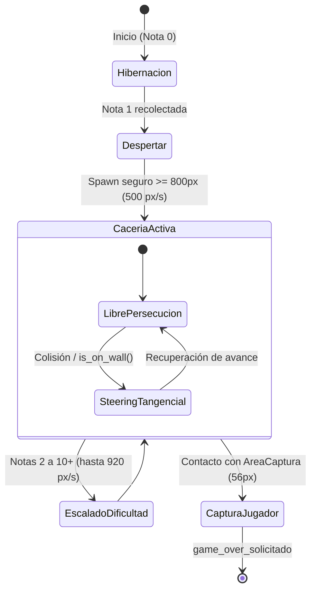

# Vosque Gameplay Architecture

Esta skill centraliza la arquitectura técnica, los contratos y los invariantes del gameplay de **Vosque** establecidos en el GDD. Aplica estas directrices al modificar o diseñar entidades del bucle de partida, spawners, el monstruo antagonista o los controladores de escena.

---

## 1. Patrón del Game Director y Subcontroladores (Call Down, Signal Up)

Para evitar antipatrones de *God Object* y mantener el desacoplamiento:

* **Fachada de Escena (`Node2D`):** [`Maain`](../../../scripts/core/maain/maain.gd) es el único nodo director en el árbol. Gestiona el ciclo macro (`partida_terminada`, `notas_recolectadas`) y delega la lógica de dominio en subcontroladores especializados que heredan de `RefCounted` (por ejemplo, [`SpawnerNotas`](../../../scripts/core/maain/spawner_notas.gd) y [`ControladorAmenazaMonstruo`](../../../scripts/core/maain/controlador_amenaza_monstruo.gd)).
  * Este mismo patrón se replica en [`Escenario`](../../../scripts/mundo/escenario.gd) (`GestorSectores`, `MutadorSectores`, `ResolutorAtascamiento`, etc.), en [`EfectoNieblaMutacion`](../../../scripts/mundo/efecto_niebla/efecto_niebla_mutacion.gd) y en [`TutorialCabeza`](../../../scripts/ui/tutorial_cabeza/tutorial_cabeza.gd).
* **Call Down (Llamadas Hacia Abajo):** El director orquesta invocando métodos públicos e inyectando dependencias en `_ready()`:
  * Inyección: `enemigo.objetivo = jugador`, `escenario.objetivo_jugador = jugador`.
  * Invocación explícita: `amenaza_monstruo.procesar_nota_recolectada(...)`, `hud.actualizar_contador(...)`, `jugador.detener_por_captura()`, `escenario.mutar_con_neblina()`.
* **Signal Up (Señales Hacia Arriba):** Los hijos y entidades nunca alteran ni buscan directamente al director. Emiten señales desacopladas:
  * [`Nota`](../../../scripts/entidades/items/nota.gd) emite `recolectada(posicion_global)`.
  * [`Enemigo`](../../../scripts/entidades/enemigo/enemigo.gd) emite `jugador_capturado(posicion_global)`.
  * [`Escenario`](../../../scripts/mundo/escenario.gd) emite `sectores_mutados(cuadrante_jugador, variantes)`.
  * `Maain` conecta y procesa estas señales y emite `game_over_solicitado` hacia `GestorDeEscenas`.
* **Guardas de Autoloads e Invariante de Fin de Partida:**
  * Siempre validar `is_inside_tree()` antes de buscar `/root/GestorMusica` o `/root/GestorPersistencia` para no quebrar suites unitarias o ejecuciones `@tool`.
  * Si `partida_terminada == true`, ignorar cualquier contacto posterior o callback asíncrono y abortar de inmediato `generar_nota()`.

---

## 2. Entidad Nota, Spawner Espacial y Balance Progresivo

### Recolección Atómica en [`Nota`](../../../scripts/entidades/items/nota.gd)
1. **Idempotencia:** La recolección se controla con la bandera `_recolectada: bool = false`. Cualquier verificación externa debe realizarse a través del método público:
   ```gdscript
   func esta_recolectada() -> bool:
       return _recolectada
   ```
2. **Desactivación de Físicas:** Inmediatamente al colisionar con el jugador, desactivar la colisión de forma diferida:
   ```gdscript
   $CollisionShape2D.set_deferred("disabled", true)
   ```
3. **Apagado de Luces (WebGL 2.0):** Apagar `_luz_baliza.visible = false` y `_visual_papel.visible = false` en el mismo frame para liberar el pase del presupuesto de luz puntual (máximo 2 `PointLight2D` activas en simultáneo).
4. **Emisión y Limpieza:** Emitir `recolectada.emit(global_position)` y llamar a `queue_free()` tras expirar las partículas (`ParticulasRecogida`, $0.4\text{ s}$).

### Filtros Espaciales en [`SpawnerNotas`](../../../scripts/core/maain/spawner_notas.gd)
* **Invariante de Nota Única:** `hay_nota_activa()` comprueba `is_instance_valid(nota_activa)`, `not is_queued_for_deletion()` y `not nota_activa.esta_recolectada()`.
* **4 Filtros Obligatorios:**
  1. $\text{Sector}(M) \ne \text{Cuadrante}(\text{Jugador})$ (excluir sector activo).
  2. $\text{distancia}(M, \text{Jugador}) \ge 600.0\text{ px}$ (`DISTANCIA_SEGURA_JUGADOR_DEFECTO`).
  3. $\text{distancia}(M, \text{Monstruo}) \ge 800.0\text{ px}$ (`DISTANCIA_SEGURA_MONSTRUO_DEFECTO`).
  4. $\|\mathbf{p}_M - \mathbf{p}_{\text{desatasco}}\|^2 \ge 1.0\text{ px}^2$ (`TOLERANCIA_DESATASCO_SQ`).
* **Fallback:** Si ningún marcador cumple los filtros, seleccionar el marcador con la distancia máxima al jugador dentro de los sectores mutados (nunca en el cuadrante del jugador).

### Progresión Cuantitativa ($500 \to 920\text{ px/s}$)
La velocidad del monstruo escala de forma estricta según `Enemigo.VELOCIDADES_MONSTRUO`:
* **Nota 0:** $0\text{ px/s}$ (Monstruo en hibernación fuera de mapa).
* **Nota 1:** $500\text{ px/s}$ (`VELOCIDAD_DESPERTAR_DEFECTO`, despertar).
* **Nota 2:** $580\text{ px/s}$ | **Nota 3:** $620\text{ px/s}$ | **Nota 4:** $680\text{ px/s}$
* **Nota 5:** $730\text{ px/s}$ | **Nota 6:** $770\text{ px/s}$
* **Nota 7:** $800\text{ px/s}$ (Punto de inflexión: iguala exactamente la caminata del jugador).
* **Nota 8:** $840\text{ px/s}$ | **Nota 9:** $880\text{ px/s}$
* **Nota 10+:** $920\text{ px/s}$ (`VELOCIDAD_MAXIMA`, tope estricto).
* **Aceleración:** Fija en $3500.0\text{ px/s}^2$ (`ACELERACION_CONSTANTE`), lo que le da un radio de giro más amplio que el jugador ($5000.0\text{ px/s}^2$).
* **Ventaja del Jugador:** El sprint del jugador ($1000\text{ px/s}$) conserva siempre un margen de $+80\text{ px/s}$ sobre el tope máximo ($920\text{ px/s}$).
* **Ralentización en Niebla:** Durante los $0.4\text{ s}$ de oscuridad total tras mutación, la velocidad del monstruo se modula al $50\%$ (`FACTOR_RALENTIZACION_NIEBLA = 0.5`).

---

## 3. FSM, Percepción y Steering de la Criatura ([`Enemigo`](../../../scripts/entidades/enemigo/enemigo.gd))



### 1. Hibernación (Nota 0)
* Para prevenir caídas de frames o compilación de shaders tardía en WebGL, el enemigo preexiste en escena:
  * `hibernando = true`, `visible = false`.
  * `process_mode = Node.PROCESS_MODE_DISABLED`.
  * `global_position = Vector2(-99999.0, -99999.0)` (`POSICION_HIBERNACION`).
  * `speed = 0.0`.

### 2. Despertar (Nota 1)
* `ControladorAmenazaMonstruo.despertar_monstruo()` elige un marcador seguro a $\ge 800\text{ px}$ del jugador.
  * Fallbacks de spawn: Si no hay candidatos, el más lejano; si no hay marcadores, `POSICION_FALLBACK_ORIGEN` (`Vector2(1080, 1080)`) o vector opuesto a `DISTANCIA_MINIMA_FALLBACK` ($1000\text{ px}$).
* Activa al enemigo con `enemigo.despertar(500.0)`: `hibernando = false`, `visible = true`, `process_mode = PROCESS_MODE_INHERIT`.

### 3. Geometría Concéntrica y Detección
* **Cuerpo Físico Sólido:** Radio de $42.0\text{ px}$ (`RADIO_COLISION_CUERPO`) colisionando con Capa 1 (`Mundo_Alto`) y Capa 2 (`Obstaculos_Bajos`). El monstruo **no** puede atravesar troncos bajos.
* **Área de Captura:** Radio de $56.0\text{ px}` (`RADIO_AREA_CAPTURA`) con máscara en Capa 3 (`Jugador`). Si el jugador no tiene `god_mode`, emite `jugador_capturado`.
* **Línea de Visión:** `RayCastVision` colisiona solo contra Capa 1 (`Mundo_Alto`). Si colisiona con un obstáculo antes del jugador, `tiene_linea_vision = false`.
* **Orientación Visual:** El sprite rota de forma continua en $360^\circ$ según `velocity.angle()` cuando `velocity.length_squared() > 1.0`.

### 4. Steering Tangencial y Desatasco
* **Steering Tangencial:** Si `tiene_linea_vision == false`, `is_on_wall()` y la velocidad decae significativamente frente a un obstáculo, el movimiento proyecta vectores tangenciales a $\pm 45^\circ$ respecto a la normal del muro, eligiendo la rama que minimice la distancia al jugador.
* **Desatasco Post-Mutación:** Si al mutar sectores el monstruo queda solapado (`ResolutorAtascamiento.verificar_solapamiento_solido()`), se reubica al `Marker2D` (`puntos_nota`) libre más cercano a $\ge 600\text{ px}$ del jugador y se anota en `ultimo_marcador_desatasco` para que el spawner no genere una nota encima.

---

## 4. Referencias y Verificación

* Para contratos de métodos completos, detalles matemáticos y diagramas de flujo ampliados: consulta [contracts-and-math.md](./references/contracts-and-math.md).
* **Suites de prueba en motor:**
  * `tests/test_nota.gd` (`suite_name() -> "nota"`)
  * `tests/test_spawner.gd` (`suite_name() -> "spawner"`)
  * `tests/test_ia_monstruo.gd` (`suite_name() -> "ia_monstruo"`)
  * `tests/test_escenario.gd` (`suite_name() -> "escenario"`)
