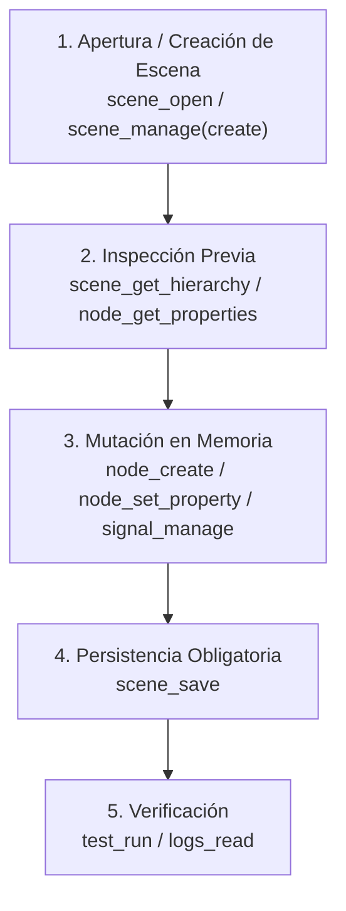

# Vosque MCP Workflow: Manipulación de Escenas y Recursos

Esta skill establece el protocolo operativo obligatorio para interactuar con el editor de **Godot** en el proyecto **Vosque**. En cumplimiento estricto de la regla de proyecto en [GEMINI.md](../../../GEMINI.md), **nunca** se deben manipular archivos `.tscn`, `.tres` ni `project.godot` con herramientas directas de escritura de archivos. Toda mutación estructural debe ejecutarse a través de las herramientas del servidor MCP `godot-ai`.

---

## 1. Reglas Cardinales e Invariantes del Editor

1. **Memoria vs. Disco:**
   * Las mutaciones de nodos y propiedades (`node_create`, `node_set_property`, `node_manage`, etc.) modifican la escena **en la memoria del editor**.
   * Ningún cambio persiste en disco hasta llamar explícitamente a `scene_save` (o `scene_manage(op="save_as")`). Si olvidas guardar, el trabajo se pierde al cambiar de escena o cerrar el editor.
2. **Rutas de Escena (Editor) vs. Rutas de Árbol (Runtime):**
   * Las herramientas de nodo (`node_create`, `node_set_property`, `signal_manage`, etc.) esperan rutas relativas a la raíz de la escena abierta (ej. `"/Maain"`, `"/Maain/Jugador"`, `"/Maain/HUD/Panel"`).
   * **NUNCA** uses rutas de runtime con prefijo `"/root/..."` (ej. `"/root/Maain"`). El editor las rechazará con error de nodo no encontrado.
3. **Validación de Sintaxis GDScript en Vivo:**
   * Para código GDScript (`.gd`), utiliza `script_create` o `script_patch`. Ambas herramientas compilan y validan el script en tiempo real con el analizador de Godot (`diagnostics_status="checked"`), recargando el código en caliente.

---

## 2. Flujo de Trabajo Estándar



### Paso 1: Abrir o Crear la Escena

* **Para una escena existente:**
  Llama a `scene_open`:
  ```json
  {
    "path": "res://escenas/maain.tscn",
    "force_reload": false
  }
  ```
  *Nota:* Verifica que la respuesta reporte `switched: true`. Si devuelve `switched: false` con `settle: "timeout"` o `"not_waited"`, revisa `editor_state` antes de escribir. Usa `force_reload: true` únicamente si deseas descartar modificaciones en memoria no guardadas para recargar el archivo en disco.

* **Para una escena nueva:**
  Llama a `scene_manage(op="create")`:
  ```json
  {
    "op": "create",
    "params": {
      "path": "res://escenas/menu_pausa.tscn",
      "root_type": "Control",
      "root_name": "MenuPausa"
    }
  }
  ```

### Paso 2: Inspeccionar Antes de Mutar

Evita fallos por conjeturas de nombres de propiedades o jerarquías:
* **Jerarquía actual:** Ejecuta `scene_get_hierarchy(depth=5)` para ubicar los nodos padres y sus rutas exactas.
* **Propiedades disponibles:** Ejecuta `node_get_properties(path="/Maain/Jugador", fields=["speed", "collision_layer"])` para comprobar nombres de propiedades y tipos exactos.

### Paso 3: Mutación de Nodos y Propiedades

* **Crear nodo nativo:**
  ```json
  {
    "type": "PointLight2D",
    "parent_path": "/Maain/Nota",
    "name": "LuzBaliza"
  }
  ```
* **Modificar propiedades:**
  ```json
  {
    "path": "/Maain/Nota/LuzBaliza",
    "property": "energy",
    "value": 1.2
  }
  ```
  *Formatos de valor comunes:*
  * `Vector2`: `{"x": 1080.0, "y": 720.0}`
  * `Color`: `"#ffffff"` o `{"r": 1.0, "g": 1.0, "b": 1.0, "a": 1.0}`
  * `NodePath`: `"/Maain/Jugador"` o `"../Jugador"`

### Paso 4: Guardar la Escena en Disco

Una vez terminadas todas las mutaciones del paso 3:
```json
// Tool: scene_save
{}
```

---

## 3. Patrones de Instanciación, Recursos y Señales

### Instanciación de Escenas (`PackedScene`)

Para instanciar una subescena ya empaquetada (ej. `personaje.tscn` dentro de `maain.tscn`):
* En `node_create`, usa el parámetro `scene_path` en lugar de `type` (son mutuamente excluyentes):
  ```json
  {
    "parent_path": "/Maain",
    "scene_path": "res://escenas/personaje.tscn",
    "name": "Jugador"
  }
  ```
* **Regla de Nodos Hijos de Instancias:**
  No puedes modificar, eliminar ni reordenar nodos internos de una escena instanciada directamente. Para hacer overrides de propiedades de nodos internos, activa previamente Editable Children:
  ```json
  {
    "op": "set_editable_children",
    "params": {
      "path": "/Maain/Jugador",
      "editable": true
    }
  }
  ```
  Si los cambios son estructurales (agregar o quitar nodos), abre y edita la escena fuente (`res://escenas/personaje.tscn`).

### Recursos: Embebidos vs. Compartidos (.tres)

* **Sub-recursos Embebidos (`[sub_resource]` en el `.tscn`):**
  Para crear formas de colisión, materiales o mallas que pertenecen exclusivamente a este nodo:
  ```json
  // Via node_set_property
  {
    "path": "/Maain/AreaCaptura/CollisionShape2D",
    "property": "shape",
    "value": {
      "__class__": "CircleShape2D",
      "radius": 56.0
    }
  }
  ```
  O mediante `resource_manage(op="create")`:
  ```json
  {
    "op": "create",
    "params": {
      "type": "CircleShape2D",
      "path": "/Maain/AreaCaptura/CollisionShape2D",
      "property": "shape",
      "properties": {
        "radius": 56.0
      }
    }
  }
  ```
* **Recursos Compartidos (.tres independientes):**
  Para recursos que se reutilizan en múltiples escenas:
  1. Crear y guardar en disco:
     ```json
     {
       "op": "create",
       "params": {
         "type": "PhysicsMaterial",
         "resource_path": "res://recursos/fisicas/material_suelo.tres",
         "properties": { "friction": 0.8 }
       }
     }
     ```
  2. Asignar al nodo:
     ```json
     {
       "op": "assign",
       "params": {
         "path": "/Maain/Suelo",
         "property": "physics_material_override",
         "resource_path": "res://recursos/fisicas/material_suelo.tres"
       }
     }
     ```

### Conexión de Señales (`signal_manage`)

* **Listar señales disponibles en un nodo:**
  ```json
  {
    "op": "list",
    "params": {
      "path": "/Maain/Nota"
    }
  }
  ```
* **Conectar señal a método de otro nodo:**
  ```json
  {
    "op": "connect",
    "params": {
      "path": "/Maain/Nota",
      "signal": "recolectada",
      "target": "/Maain",
      "method": "_on_nota_recolectada"
    }
  }
  ```
* **Criterio de Arquitectura Vosque:**
  * Conecta en la escena vía MCP las señales de nodos fijos y vistas permanentes (UI, botones de menú, nodos presentes desde el arranque).
  * Conecta dinámicamente en código GDScript (`_ready()` o fábrica) las entidades que se crean y destruyen en tiempo de ejecución (ej. notas generadas por `SpawnerNotas`).

---

## 4. Resolución de Errores Típicos del MCP

| Error / Síntoma | Causa Raíz | Solución Inmediata |
| :--- | :--- | :--- |
| `EDITOR_NOT_READY (state=playing)` | El proyecto sigue en ejecución o la caché de estado del MCP está desfasada. | 1. Detener con `project_manage(op="stop", params={})`.<br>2. Llamar a `editor_state()` para forzar la sincronización de la caché.<br>3. Reintentar la operación. |
| `game_status.status == "break"` | El juego pausó en un breakpoint o error de compilación inicial del debugger. | Llamar a `project_manage(op="stop", params={})` e inspeccionar `logs_read`. |
| `EDITED_SCENE_MISMATCH` | El comando intentó mutar una escena diferente a la que está abierta en la pestaña activa. | Verificar con `editor_state()`, abrir la escena correspondiente con `scene_open(path="res://...")` y repetir la mutación. |
| `PROPERTY_NOT_ON_CLASS` | El nombre de la propiedad no existe en la clase Godot (ej. usar `field_of_view` en vez de `fov`, o `image` en vez de `texture`). | Inspeccionar con `node_get_properties(path="...", fields=[...])` antes de modificar. |
| Error al editar hijos de instancia | Intentando alterar nodos internos de una subescena sin permisos. | Activar `node_manage(op="set_editable_children", params={"path": "...", "editable": true})` para modificar propiedades, o usar `scene_open` en la subescena para cambios estructurales. |
| `switched: false` en `scene_open` | El cambio de escena tardó más del umbral de espera síncrono. | Consultar `editor_state()` para confirmar que la escena activa ya es la solicitada antes de continuar. |
| Fallos espurios en `test_run` con `scene_warning` | Tests de integración asumen que la escena principal está cargada en el viewport del editor. | Abrir la escena principal con `scene_open(path="res://escenas/maain.tscn")` y volver a lanzar `test_run`. |

---

## 5. Referencia Rápida de Payloads

Para consultar ejemplos de código JSON listos para copiar y usar en cada una de las herramientas del MCP, revisa [mcp-tool-cheatsheet.md](./references/mcp-tool-cheatsheet.md).
