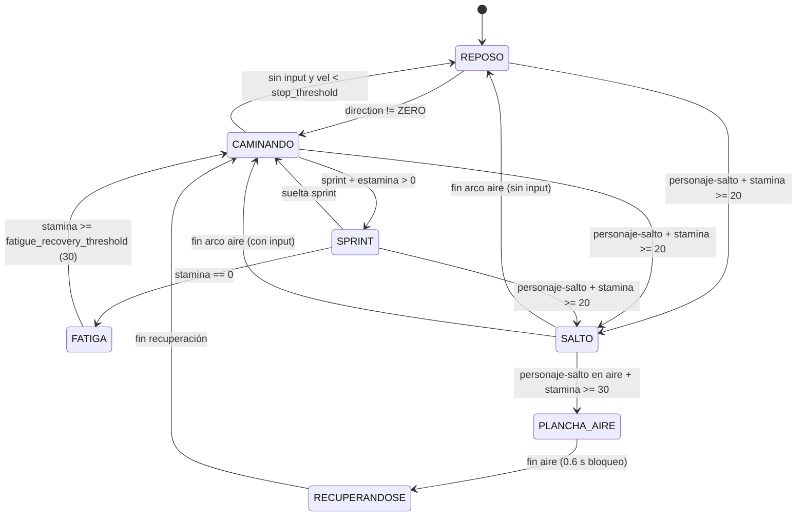

# Vosque Player, Camera & Game Feel

Esta skill centraliza los contratos técnicos, invariantes matemáticos y *gotchas* reales del protagonista, su feedback diegético, la cámara 2D, los shaders de post-procesamiento/menú y el tooling de editor en **Vosque**.

---

## 1. Uso del MCP `godot-ai` y Fronteras entre Skills

* **Escenas y recursos:** Toda edición de `escenas/personaje.tscn`, `escenas/camara.tscn`, `escenas/ui/indicador_estamina.tscn`, `escenas/ui/tutorial_cabeza.tscn` o `.tres` debe ejecutarse vía MCP `godot-ai` siguiendo [`vosque-mcp-workflow`](../vosque-mcp-workflow/SKILL.md).
* **Fronteras (no duplicar):**
  * **Linterna y presupuesto WebGL:** `ControladorLinterna` (`PivoteLinterna`) y el límite de 3 `PointLight2D` pertenecen a [`vosque-world-mutation-lighting`](../vosque-world-mutation-lighting/SKILL.md).
  * **Pausa híbrida y `GestorEscenas`:** El flujo de pausa y deshabilitación de cámaras ocultas pertenece a [`vosque-ui-menus-architecture`](../vosque-ui-menus-architecture/SKILL.md).
  * **Orquestación (`Maain`) y `Enemigo`:** Pertenecen a [`vosque-gameplay-architecture`](../vosque-gameplay-architecture/SKILL.md).

---

## 2. FSM del Personaje, Locomoción y Eje Z Simulado

[`Personaje`](../../../scripts/entidades/personaje/personaje.gd) (`@tool`, `CharacterBody2D`, grupo `"jugador"`) actúa como fachada modular que coordina [`PersonajeEstaminaController`](../../../scripts/entidades/personaje/componentes/personaje_estamina_controller.gd), [`PersonajeLocomocionController`](../../../scripts/entidades/personaje/componentes/personaje_locomocion_controller.gd), [`PersonajeVistaController`](../../../scripts/entidades/personaje/componentes/personaje_vista_controller.gd) y [`PersonajeAudioController`](../../../scripts/entidades/personaje/componentes/personaje_audio_controller.gd), operando en `MOTION_MODE_FLOATING` con `Input.get_vector("personaje-izquierda", "personaje-derecha", "personaje-arriba", "personaje-abajo")`.

### Invariantes Obligatorios de `Personaje`
1. **Eje Z simulado y Capa 2 (`Obstaculos_Bajos`):**
   * En `SALTO` ($4u(1-u)$) y `PLANCHA_AIRE` ($(1-u)\cdot h_{\text{despegue}}$) se desactiva la máscara de Capa 2 (`set_collision_mask_value(2, false)`) manteniendo Capa 1 (`Mundo_Alto`) activa.
   * Al aterrizar (`_finalizar_salto_libre` / `_impactar_plancha`), **siempre** restaurar Capa 2 (`_restaurar_mascara_colision_suelo()`) y resetear visuales (`_restaurar_visuales_eje_z()`).
2. **Anti-salto fantasma, impulso por nota y captura:**
   * `NOTIFICATION_UNPAUSED` y `consumir_buffer_salto()` activan `_bloquear_salto_un_frame = true` para evitar saltos residuales al despausar con <kbd>Espacio</kbd>.
   * `aplicar_impulso_nota()` (invocado por `Maain._on_nota_recolectada()`) restaura `+50%` de `max_stamina`, limpia `fatigado`, reinicia `_regen_timer = 0.0` y activa durante `1.5 s` un boost temporal de velocidad (`1.20x` en caminata, sprint y `SALTO`, sin alterar `dive_speed` ni `@export` base) junto con una ventana sin gasto de estamina (`note_no_stamina_drain_duration = 1.5 s`) para sprint, salto y plancha.
   * `detener_por_captura()` fija `velocity = Vector2.ZERO`, limpia el boost/feedback visual y `set_physics_process(false)`.
3. **Modo `@tool` y debug:**
   * `_physics_process()` debe retornar de inmediato si `Engine.is_editor_hint()`.
   * Respetar `god_mode` y `sin_gasto_estamina` (sin reiniciar `_regen_timer` ni drenar barra).
4. **Animaciones seguras:** `_reproducir_animacion_con_fallback()` comprueba `has_animation(anim)` y `get_frame_count(anim) > 0` antes de llamar `play()`.

---

## 3. Estamina Diegética y Tutorial Flotante

### [`IndicadorEstamina`](../../../scripts/ui/indicador_estamina.gd) (`@tool`, `Node2D`, `z_index = 2`)
* Anclado en `Vector2(0, -60)` sobre `Personaje`; se auto-conecta a la señal `estamina_cambiada(actual, maxima, fatigado)` del padre.
* **Visibilidad:** Inicia invisible (`modulate.a = 0.0`) al `100%` y reaparece al consumir; al recargar al `100%` ejecuta pulso elástico + fade-out.
* **Feedback:** Usa Tween ante caídas bruscas (`caida >= 0.05`) con *micro-punch* (`1.08`), ante recargas bruscas parciales (`subida >= 0.05`) con pulso/flash hacia `color_destello`, y titileo a `16.0 Hz` cuando `esta_fatigado` o `ratio_estamina < 0.30`.

### [`TutorialCabeza`](../../../scripts/ui/tutorial_cabeza/tutorial_cabeza.gd) (`@tool`, `Node2D`, `z_index = 3`)
* Sigue el patrón fachada + subcontroladores `RefCounted`: [`TutorialEstadoController`](../../../scripts/ui/tutorial_cabeza/tutorial_estado_controller.gd) y [`TutorialVistaController`](../../../scripts/ui/tutorial_cabeza/tutorial_vista_controller.gd).
* **Progresión:** `PASO_1_MOVIMIENTO` (WASD + ratón $\ge 30\text{ px}$ + gracia `0.35 s`) $\to$ `PASO_2_SALTO` $\to$ `PASO_3_PLANCHA_DIVE` $\to$ `PASO_4_SPRINT` $\to$ `COMPLETADO`.
* **Atajos y ciclo de vida:**
  * *Fast-path* veteranos: `Shift` + movimiento en Paso 1 cierra el tutorial de inmediato.
  * Cierre forzado: se conecta a `Maain.nota_recogida` y llama `forzar_salida_nota()` si `total >= 1`.
  * Persistencia de sesión: `static var tutorial_visto` evita repetirlo en reintentos (resetear con `TutorialCabeza.reiniciar_tutorial()`).
  * Limpiar Tweens en `NOTIFICATION_PREDELETE` (`vista_ctrl.limpiar()`).

---

## 4. Cámara 2D, Shaders y `personaje_tools`

* **Configuración activa ([`camara.tscn`](../../../escenas/camara.tscn)):** `process_callback = 0` (`CAMERA2D_PROCESS_PHYSICS`), `position_smoothing_speed = 8.0`, límites `±2160` alineados con `VallaPerimetral`. `CamaraDios` pertenece al grupo `"camaras_debug"`.
* **Contrato objetivo de trauma:** [`ControladorLinterna`](../../../scripts/entidades/personaje/controlador_linterna.gd) ya invoca `cam.call("agregar_trauma", tasa * delta)` si `cam.has_method("agregar_trauma")`. **Estado actual:** `camara.tscn` aún no tiene script adjunto; al implementarlo, usar el modelo cuadrático ($\text{Trauma}^2$) documentado en la referencia.
* **Shaders de cámara y menú:**
  * [`motion_blur_vertical.gdshader`](../../../shaders/motion_blur_vertical.gdshader): desenfoque direccional sobre `screen_texture` (`intensidad`, `direccion`, `muestras`).
  * [`crossfade_arboles.gdshader`](../../../shaders/crossfade_arboles.gdshader): mezcla directa `textura_anterior` $\to$ `TEXTURE` vía `progreso` sin caída de opacidad intermedia.
* **Plugin [`addons/personaje_tools/`](../../../addons/personaje_tools/character_bar.gd):** Sincroniza `speed`, `acceleration` y `friction` con presets (`Sigilo`, `Normal`, `Sprint`) y Undo/Redo; mantener esas propiedades con `@export_range` en `Personaje`.

---

## 5. Referencias y Suites de Prueba

* **Cuándo leer la referencia técnica:** Abre [player-camera-contracts.md](./references/player-camera-contracts.md) antes de ajustar constantes físicas, fórmulas de eje Z, contratos de `IndicadorEstamina`/`TutorialCabeza`, implementar `agregar_trauma()` en `Camera2D` o revisar *gotchas* conocidos entre escenas y scripts.
* **Suites de prueba en motor (`godot-ai`):**
  * `tests/test_personaje.gd` (`suite_name() -> "personaje"`)
  * `tests/test_indicador_estamina.gd` (`suite_name() -> "indicador_estamina"`)
  * `tests/test_tutorial_cabeza.gd` (`suite_name() -> "tutorial_cabeza"`)
