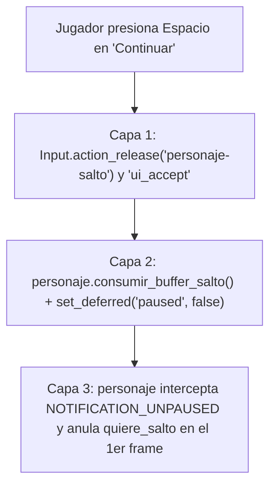

# Vosque UI & Menus Architecture

Esta skill centraliza la arquitectura técnica, los contratos, los estándares visuales e interactivos y las directivas de creación para las pantallas, menús y sistemas de audio de interfaz en **Vosque**. Aplica rigurosamente estas reglas para mantener la integridad de la arquitectura desacoplada y diegética del proyecto.

---

## 1. Directiva 0: Uso Obligatorio del MCP `godot-ai` para Escenas y Recursos

Siguiendo las normas estrictas del proyecto ([`GEMINI.md`](../../../GEMINI.md)) y el protocolo operativo de [`vosque-mcp-workflow`](../vosque-mcp-workflow/SKILL.md):

* **Prohibición absoluta:** NUNCA crees ni edites archivos `.tscn`, `.tres` ni configuraciones de motor modificando directamente archivos de texto plano en disco con herramientas de escritura de archivos.
* **Flujo MCP estricto:** Consulta y sigue al pie de la letra las firmas y esquemas de parámetros definidos en [`vosque-mcp-workflow`](../vosque-mcp-workflow/SKILL.md) para la apertura/creación de escenas, mutación de nodos, fijación de propiedades, persistencia obligatoria con `scene_save` y validación de sintaxis en caliente con `script_create` / `script_patch`.

---

## 2. Invariante 1: Contrato "Call Down, Signal Up" y Autonomía de Pantalla

Cada pantalla debe ser un componente aislado y autónomo, testeable por separado (ej. con <kbd>F6</kbd> o en tests de GUT sin requerir el árbol completo de ejecución).

* **Prohibido acoplamiento descendente a ascendente:** Ningún menú o pantalla debe llamar rutas absolutas del orquestador (como `get_node("/root/GestorEscenas")`) para su flujo normal de navegación.
* **Signal Up (Pantallas $\to$ Orquestador):** Las pantallas comunican intenciones mediante señales semánticas limpias:
  * `MenuInicio`: `jugar_solicitado`, `opciones_solicitado`, `creditos_solicitado`.
  * `MenuPausa`: `continuar_solicitado`, `reiniciar_solicitado`, `menu_solicitado`.
  * `GameOver`: `reintentar_solicitado`, `menu_solicitado`.
  * Subpaneles (`MenuOpciones`, `MenuCreditos`): `volver_solicitado`.
* **Call Down (Orquestador $\to$ Pantallas):** [`GestorDeEscenas`](../../../scripts/core/gestor_escenas.gd) administra:
  * Visibilidad (`visible = true/false`).
  * Modo de proceso (`process_mode = PROCESS_MODE_INHERIT` para pantalla activa, `PROCESS_MODE_PAUSABLE` para `Maain`, `PROCESS_MODE_DISABLED` para aparcadas).
  * Apagado de cámaras (`_fijar_camaras`) para que una `Camera2D` oculta no arrastre el viewport.
  * Invocación diferida de foco: `pantalla.call_deferred("enfocar")`.
* **Protección Anti-Spam:** Toda transición de pantalla debe activar inmediatamente la bandera local `_bloqueado = true` para evitar pulsaciones dobles o llamadas concurrentes mientras ocurre el fundido (`_fundir(true)`).

---

## 3. Invariante 2: Jerarquía de Capas (`CanvasLayer`) y Estrategia de Pausa Híbrida

El menú de pausa **no** se aloja en el contenedor de pantallas intercambiables (`$Contenedor`), ya que ocultaría la partida y apagaría la cámara del jugador. Se monta como una capa superpuesta persistente.

### Jerarquía de Capas en `GestorEscenas`:
| Capa / Nodo | Layer | Script / Tipo | `process_mode` | Propósito |
| :--- | :--- | :--- | :--- | :--- |
| `HUD` | `10` | `CanvasLayer` en `Maain` | `PAUSABLE` | Indicadores de estamina, notas y tutorial. |
| `EfectoNieblaMutacion` | `15` | `CanvasLayer` en `Escenario` | `PAUSABLE` | Shaders de niebla y ceguera. |
| `MenuPausa` | `50` | `CanvasLayer` en `GestorEscenas` | `ALWAYS` | Menú suspendido con fondo translúcido (`Color(0, 0, 0, 0.65)`). |
| `Transicion` | `100` | `CanvasLayer` en `GestorEscenas` | `ALWAYS` | Fundido a negro / shader de iris entre pantallas. |
| `DebugMenu` | `100` | `CanvasLayer` Autoload | `ALWAYS` | Panel de depuración (<kbd>F3</kbd>). |

### Modelo de Pausa Híbrida:
1. `get_tree().paused = true` suspende instantáneamente físicas, lógica, partículas y corrutinas de `SceneTreeTimer` (`process_always = false`).
2. `process_mode = PROCESS_MODE_ALWAYS` en `MenuPausa` y `GestorAudioUI` permite navegar y escuchar el audio de menú sin latencia.
3. **Las 6 Salvaguardas Obligatorias:**
   1. **Guardia de estado estricto (`puede_pausar()`):** Solo permite pausar si `_ruta_actual == RUTA_JUEGO`, no hay cambio de pantalla en curso (`not _cambiando`) y el jugador no ha sido capturado.
   2. **Congelación de `SceneTreeTimer` y corrutinas asíncronas:** Al pausar el árbol, timers de niebla, notas y monstruo quedan detenidos sin avanzar en segundo plano.
   3. **Despausa diferida y blindaje robusto anti-salto fantasma (<kbd>Espacio</kbd>):** Limpieza de buffers en `Input`, consumo de buffer en el personaje y restauración diferida de pausa (`set_deferred("paused", false)`).
   4. **Limpieza atómica en transiciones (`ir_a()`):** Ejecución forzada de `_limpiar_pausa_forzada()` para garantizar que `get_tree().paused = false` al reiniciar, ir al menú o transicionar a Game Over.
   5. **Jerarquía de precedencia con `DebugMenu` (<kbd>F3</kbd>):** Si el menú F3 está abierto en modo completo, intercepta y consume <kbd>Escape</kbd> para cerrarse sin abrir el menú de pausa.
   6. **Auto-pausa por pérdida de foco en navegadores Web:** Escucha de notificaciones de foco (`NOTIFICATION_APPLICATION_FOCUS_OUT` / `NOTIFICATION_WM_WINDOW_FOCUS_OUT`) para suspender partidas vivas automáticamente.

---

## 4. Invariante 3: Blindaje Anti-Salto Fantasma (<kbd>Espacio</kbd>) y Linterna

En *Vosque*, <kbd>Espacio</kbd> salta en gameplay pero confirma en la UI. Al pulsar *"Continuar"* con <kbd>Espacio</kbd>, se activa la solución en 3 capas para evitar que el personaje salte y malgaste $-20\text{ pts}$ de estamina:



* **Salvaguarda de Linterna:** Al salir de la pausa o cerrar menús, limpiar/ignorar el movimiento relativo acumulado del ratón para prevenir giros bruscos (*mouse snap*) de la linterna.
* **Minimapa del HUD (`MinimapaHUD`):** Dibujado nativamente con `_draw()` en `escenas/hud.tscn` (`MargenSeguridad/ContenedorSuperiorIzquierdo/Minimapa`, `mouse_filter = MOUSE_FILTER_IGNORE`); muestra la posición normalizada del jugador y el cuadrante objetivo sin revelar al monstruo.

---

## 5. Invariante 4: Integración de Audio Desacoplada (`GestorAudioUI`)

> 🔊 **Arquitectura completa de audio y música:** Para la especificación de los 5 buses, `AudioStreamInteractive`, `GestorMusica` y contratos de volumen, consulta `../vosque-audio-architecture/SKILL.md`.

* **Prohibido colocar nodos `AudioStreamPlayer` sueltos en cada botón.**
* Toda reproducción de UI se canaliza mediante el Autoload `GestorAudioUI` (`ControladorAudioUI`) con `process_mode = PROCESS_MODE_ALWAYS` en el bus `sfx`:
  ```gdscript
  # Disparo estático seguro (recomendado en pantallas, compatible con @tool y tests sin árbol)
  ControladorAudioUI.emitir_seguro(self, ControladorAudioUI.EventoUI.PAUSA_NAVEGAR)
  ControladorAudioUI.emitir_seguro(self, ControladorAudioUI.EventoUI.PAUSA_ACEPTAR)
  ```
* **Canales especializados (Zero-Cutoff):**
  * `PlayerCursor`: Sonidos rápidos de foco/desplazamiento con *Pitch Jitter* (`0.96` a `1.04`).
  * `PlayerAccion` y `PlayerAccionAux`: Confirmaciones, retrocesos o cierres sin cortes abruptos entre llamadas inmediatas.
* **Silenciamiento Preventivo en Foco Inicial:** Al abrir una pantalla o activar un panel, asignar `grab_focus()` programático dispararía un sonido espurio. Debe usarse siempre una bandera (`_silenciar_foco_inicial` o `_silenciar_audio_ajustes = true` antes de enfocar, y restaurar a `false` inmediatamente después).

---

## 6. Invariante 5: Animación Cinemática vs Bucle `_process`

* **Menú Principal (`MenuInicio`):**
  * Desacoplamiento por subcontroladores: `MenuCinematica`, `MenuParallax`, `MenuSeleccion`, `MenuParticulas`.
  * **Suma no destructiva de transformaciones:** El `Tween` interpola variables intermedias (`_offset_base` y `_rotacion_base`), mientras `_process` calcula las oscilaciones senoidales armónicas (*sway*). La posición final suma ambas:
    $$\text{offset\_total} = \text{offset\_base} + \text{sway}$$
    Evita totalmente que un `Tween` y `_process` compitan sobrescribiendo `position`.
  * **Shader `crossfade_arboles.gdshader`:** Mezcla fragmento a fragmento (`mix`) sobre un único `Sprite2D` para prevenir caídas de alfa o texturas superpuestas.
* **Pantalla de Game Over (`GameOver`):**
  * Orquestación determinista por `AnimationPlayer` (`jumpscare_derrota`): audio sincronizado, flash carmesí, sacudida de cámara, y posterior activación de música con efecto *Nightmare Decay* (`pitch_scale = 0.65` + reverb en bus `musica`).

---

## 7. Invariante 6: Navegación Híbrida, Aislamiento de Foco y Botones

### Especificación Visual de Botones de Menú:
* `custom_minimum_size`: `Vector2(400, 72)`
* `alignment`: `HORIZONTAL_ALIGNMENT_LEFT` (0)
* `theme_override_fonts/font`: `res://fuentes/raleway_bold.tres` (tamaño 40)
* `theme_override_colors/font_focus_color` y `font_hover_color`: `#e6ffb3` (`Color(0.902, 1.0, 0.702, 1)`)

### Contratos de Foco e Interacción:
1. **Navegación Cíclica:** En listas verticales, enlazar el primero con el último usando `posmod`.
2. **Blindaje Espacial (`focus_neighbor_*`):**
   * En botones aislados (ej. *Volver* en Créditos), fijar las 4 direcciones a sí mismo:
     `focus_neighbor_top = NodePath(".")`, etc.
   * En listas, fijar `focus_neighbor_left` y `focus_neighbor_right` a `NodePath(".")` para que la navegación lateral no salte accidentalmente a otros paneles del mismo viewport.
3. **Aislamiento en Reposo de Subpaneles:**
   * En `_ready()` y `desactivar()`: `mouse_filter = MOUSE_FILTER_IGNORE`, `release_focus()`, `focus_mode = FOCUS_NONE` en controles hijos.
   * En `activar()`: `visible = true`, `mouse_filter = MOUSE_FILTER_STOP`, `focus_mode = FOCUS_ALL`, y foco en botón inicial con audio silenciado.
4. **Sincronización Ratón-Foco:** Conectar `mouse_entered` para ejecutar `grab_focus()` si el elemento no lo tiene.
5. **Captura Global de Cancelación:** Capturar `ui_cancel` (<kbd>Escape</kbd>) en `_input(evento)` marcando el evento como manejado con `get_viewport().set_input_as_handled()`.

---

## 8. Referencias y Plantillas

* Consulta las plantillas de código listas para usar, checklist de comandos MCP y detalles de pruebas en [ui-contracts-and-templates.md](./references/ui-contracts-and-templates.md).
* **Suites de prueba en motor:**
  * `tests/test_menu_inicio.gd`
  * `tests/test_menu_pausa.gd`
  * `tests/test_menu_opciones.gd`
  * `tests/test_menu_creditos.gd`
  * `tests/test_gestor_audio_ui.gd`
  * `tests/test_transicion.gd`
