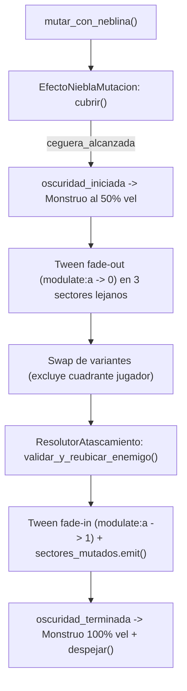

# Vosque World, Mutation & Lighting

Esta skill centraliza la arquitectura técnica, los contratos y los invariantes del escenario 2x2, la mutación espacial de sectores, la niebla geométrica y el sistema de iluminación 2D compatible con WebGL 2.0 en **Vosque**.

---

## 1. Uso del MCP `godot-ai`

Toda edición de escenas de mundo/variantes (`.tscn`) o recursos/tilesets (`.tres`) debe ejecutarse vía MCP `godot-ai` (`scene_open`, `node_create`, `node_set_property`, `scene_save`, `resource_manage`, `tilemap_manage`, `tileset_manage`) siguiendo [`vosque-mcp-workflow`](../vosque-mcp-workflow/SKILL.md).

---

## 2. Invariante 1: Topología de Arena 2x2, Capas y Corredores

`Escenario` (`scripts/mundo/escenario.gd`) actúa como fachada `Node2D` (`y_sort_enabled = true`) delegando en subcontroladores `RefCounted`.

### Dimensiones y Cuadrantes (`GestorSectores` — `scripts/mundo/escenario/gestor_sectores.gd`)
* **Área total:** $4320 \times 4320\text{ px}$ (`[-2160, 2160]` en X e Y), centrada en `(0, 0)`.
* **Cuadrantes:**
  * `NO`: $x < 0, y < 0$ | `NE`: $x \ge 0, y < 0$
  * `SO`: $x < 0, y \ge 0$ | `SE`: $x \ge 0, y \ge 0$
* **Perímetro y Cámara:**
  * `VallaPerimetral` (`StaticBody2D`, Capa 1 `Mundo_Alto`, `collision_mask = 0`) con 4 `CollisionShape2D` en `±2160` (`4320x64` horizontal, `64x4320` vertical).
  * `Camera2D` (`escenas/camara.tscn`): límites `±2160` y `process_callback = CAMERA2D_PROCESS_PHYSICS` para evitar temblores (*jitter*).

### Contrato de Variantes de Sector
Todas las variantes (`variante_claro_rocoso.tscn`, `variante_bosque_denso.tscn`, `variante_sendero_troncos.tscn`) deben cumplir:
* **`ObstaculosAltos` (`StaticBody2D`, Capa 1):** Árboles y rocas altas. Bloquean al jugador, al monstruo y al `RayCastVision`.
* **`ObstaculosBajos` (`StaticBody2D`, Capa 2):** Troncos bajos. Bloquean al monstruo siempre, pero el jugador los ignora durante `SALTO` y `PLANCHA_AIRE` (`set_collision_mask_value(2, false)`).
* **`PuntosDeNota` (`Node2D`):** Debe contener al menos `2` `Marker2D` en el grupo `"puntos_nota"`.
* **Corredor de seguridad:** Todo `CollisionShape2D` de obstáculos altos o bajos debe ubicarse dentro de `[-960, 960]` en X e Y locales para garantizar pasillos transitables en los bordes del sector.

---

## 3. Invariante 2: Mutación Espacial, Anti-Atascamiento y Warmup Web

### Reglas de Mutación (`MutadorSectores` — `scripts/mundo/escenario/mutador_sectores.gd`)
1. **Exclusión del jugador:** El cuadrante activo del jugador **nunca** muta. Solo mutan los 3 cuadrantes restantes.
2. **No repetición:** Cada sector mutado selecciona aleatoriamente una variante distinta a `variantes_activas[sector]`.
3. **Soporte Web (`OS.has_feature("web")`):** En el punto medio del fade, Web ejecuta `mutar_sectores_lejanos_progresivo()` (1 sector por frame con `await arbol.process_frame`) para evitar picos de CPU.
4. **Aborto limpio:** `abortar_mutacion()` cancela tweens, restaura `modulate.a = 1.0` en los 4 sectores y llama a `efecto_niebla.abortar_inmediato()`.

### Desatasco Post-Mutación (`ResolutorAtascamiento` — `scripts/mundo/escenario/resolutor_atascamiento.gd`)
* Tras el *swap*, si el monstruo no está hibernando, `verificar_solapamiento_solido()` evalúa `test_move(global_transform, Vector2.ZERO)` e `intersect_point` (`collision_mask = 3`).
* Si hay solapamiento, reubica al monstruo al `Marker2D` (`puntos_nota`) más cercano dentro de su sector que esté a $\ge 600\text{ px}$ del jugador, y guarda la posición en `ultimo_marcador_desatasco` (para que `SpawnerNotas` en `scripts/core/maain/spawner_notas.gd` no genere una nota encima).

### Precalentamiento WebGL (`PrecargaRecursosWeb` — `scripts/mundo/escenario/precarga_recursos_web.gd`)
* En `_ready()`, `Escenario` difiere `precalentar_recursos_web()` creando un nodo temporal `WarmupSectores` (`modulate.a = 0.01`, `z_index = -4096`, `PROCESS_MODE_DISABLED`) que instancia todas las variantes durante 1 frame para compilar shaders en WebGL sin *stuttering* posterior.

---

## 4. Invariante 3: Niebla Geométrica y Sincronización por Tokens

`EfectoNieblaMutacion` (`scripts/mundo/efecto_niebla/efecto_niebla_mutacion.gd`, `CanvasLayer` en `layer = 15`) coordina 3 subcontroladores `RefCounted`:
* `NieblaMaterialController` (`scripts/mundo/efecto_niebla/niebla_material_controller.gd`): Duplica el `ShaderMaterial` en memoria (`duplicate()`) para no mutar el `.tres` en disco y fija `mouse_filter = MOUSE_FILTER_IGNORE`.
* `NieblaFocoController` (`scripts/mundo/efecto_niebla/niebla_foco_controller.gd`): Proyecta la posición del jugador a UV de pantalla (`get_global_transform_with_canvas().origin / vp_size`) y calcula `aspecto = vp_size.x / vp_size.y`.
* `NieblaTransicionController` (`scripts/mundo/efecto_niebla/niebla_transicion_controller.gd`): Gestiona la FSM (`DESPEJADO`, `CERRANDO`, `CEGUERA`, `ABRIENDO`), la acumulación monotónica de `fase_desplazamiento` y la concurrencia mediante `token_transicion`.

### Contratos Obligatorios
* **0% Overhead en reposo:** Tras `_ready()`, debe iniciar con `visible = false` y `set_process(false)`.
* **Protección por tokens:** Cada llamada a `cubrir()`, `despejar()`, `abortar_inmediato()` o cambio a `desactivado = true` incrementa `token_transicion`, invalidando cualquier `await` o callback previo.
* **Anti-deadlock cuando `desactivado = true`:** `cubrir()`, `despejar()` y `ejecutar_transicion()` deben emitir igualmente sus señales (`ceguera_alcanzada`, `oscuridad_iniciada`, `oscuridad_terminada`, `niebla_disipada`) usando `call_deferred()` para no colgar corrutinas en tests ni en gameplay.

---

## 5. Invariante 4: Iluminación Ambiental, Linterna y Presupuesto WebGL 2.0

* **Penumbra progresiva (`GestorIluminacionAmbiental` — `scripts/mundo/escenario/gestor_iluminacion_ambiental.gd`):** Modula `CanvasModulate` interpolando linealmente en `ConfiguracionIluminacion` (`scripts/mundo/configuracion_iluminacion.gd`) desde `Color(0.40, 0.45, 0.60, 1.0)` (Nota 0) hasta `Color(0.18, 0.22, 0.32, 1.0)` (`max_notas_ambiente = 8`).
* **Presupuesto estricto WebGL 2.0:** Nunca superar **3 `PointLight2D` activas** simultáneamente en toda la escena (`LinternaFrontal`, `HaloCorporal` y `LuzBaliza` de la nota activa). Todas deben usar `shadow_enabled = false` y `blend_mode = PointLight2D.BLEND_MODE_ADD`.
* **Cono analítico 360° (`ControladorLinterna` — `scripts/entidades/personaje/controlador_linterna.gd`):**
  * Evalúa objetivos matemáticamente mediante producto punto (`alcance_px = 700.0`, `apertura_grados = 60.0`, `distancia_estres_px = 300.0`).
  * Al enfocar una nota oculta, invoca `nota.revelar()` y emite `nota_revelada`.
  * Al enfocar al monstruo, activa el *flicker* pseudo-armónico ($24\text{ Hz}$, $\pm 10\%$) y aplica trauma a la cámara si `distancia < 300.0 px`.

---

## 6. Referencias y Suites de Prueba

* **Cuándo leer la referencia técnica:** Abre [world-contracts-and-shaders.md](./references/world-contracts-and-shaders.md) antes de editar shaders (`shaders/niebla_mutacion.gdshader`), añadir o modificar `TileSet`s (`tileset_suelo.tres`, `tileset_obstaculos.tres`), ajustar recursos `@tool` de niebla/iluminación o crear variantes de sector desde cero.
* **Suites de prueba en motor (`godot-ai`):**
  * `tests/test_escenario.gd` (`suite_name() -> "escenario"`)
  * `tests/test_niebla.gd` (`suite_name() -> "niebla"`)
  * `tests/test_iluminacion.gd` (`suite_name() -> "iluminacion"`)
  * `tests/test_tileset_suelo.gd` (`suite_name() -> "tileset_suelo"`)
