# Pipeline Artístico Híbrido (Blender ➔ Inkscape ➔ Godot)

Este documento detalla el flujo de trabajo técnico para producir arte 2D consistente y estilizado con estética de novela gráfica oscura mediante asistencia 3D.

---

## Flujo General del Pipeline

```mermaid
flowchart LR
    subgraph Blender [Fase 1: Blender 3D]
        B1[Modelado Base / Bloques 3D] --> B2[Cámara Ortográfica 45°]
        B2 --> B3[Render Base PNG Transparente]
    end

    subgraph Inkscape [Fase 2: Inkscape Vectorial]
        I1[Importar Render como Guía / Plantilla] --> I2[Entintado Vectorial / Línea Estilo Novela Gráfica]
        I2 --> I3[Color Sombrío & Sombras Cel-Shading]
        I3 --> I4[Exportar Spritesheet / PNG Limpio]
    end

    subgraph Godot [Fase 3: Godot 4]
        G1[Importar Texturas Lossless] --> G2[Montaje en Sprite2D / AnimatedSprite2D]
        G2 --> G3[Iluminación con PointLight2D y CanvasModulate]
    end

    B3 --> I1
    I4 --> G1
```

---

## 1. Fase 1: Blender (Estructura y Perspectiva)

* **Función:** Generar la volumetría, perspectiva y proporciones correctas sin tener que calcular escorzos o ángulos complejos a mano alzada.
* **Cámara:** 
  - Modo: `Orthographic`.
  - Inclinación: Cenital inclinada (vista isométrica/top-down de $45^\circ$ o $60^\circ$ tipo 3/4).
* **Gestión de Color (Color Management):**
  - Display Device: `sRGB`.
  - View Transform: **Standard** (evitar *AgX* o *Filmic*, ya que desaturan y alteran los valores requeridos como plantilla de calcado).
* **Salida de Render:** Renders en formato PNG transparente de alta resolución que actuarán como capas plantilla en Inkscape.

---

## 2. Fase 2: Inkscape (Estilo Visual y Acabado Gráfico)

* **Función:** Darle el toque ilustrado, estética de novela gráfica oscura y entintado manual final.
* **Estructura Estándar de Capas en SVG:**
  1. `Capa 1: Guía 3D` ➔ Render de Blender con opacidad fija al $40\%$ para trazar sobre él.
  2. `Capa 2: Entintado (Lineart)` ➔ Trazado vectorial con trazos negros marcados y expresivos.
  3. `Capa 3: Color y Cel-Shading` ➔ Tonos desaturados y sombras duras de alto contraste.
* **Exportación de Sprites:**
  - Formato: PNG optimizado (RGBA).
  - Personajes: $128 \times 128$ px.
  - Obstáculos y elementos grandes (árboles, rocas): $256 \times 256$ px.

---

## 3. Fase 3: Godot 4 (Integración en Motor)

* **Modo de Render:** `Compatibility` (WebGL 1/2) para máximo soporte en navegadores de escritorio.
* **Ajustes de Importación de Texturas:**
  - Compresión: `Lossless` para mantener la nitidez del trazo vectorial.
  - Modo de filtro: `Linear` o `Nearest` según la definición requerida.
* **Sistema de Iluminación 2D:**
  - Nodo raíz `CanvasModulate` con tono azulado/gris oscuro profundo.
  - La visibilidad depende casi exclusivamente del `PointLight2D` asociado a la linterna del jugador.
