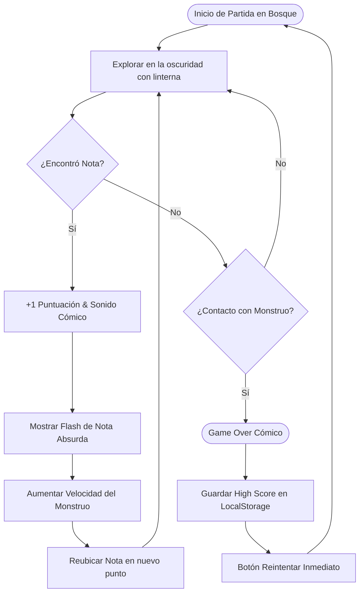
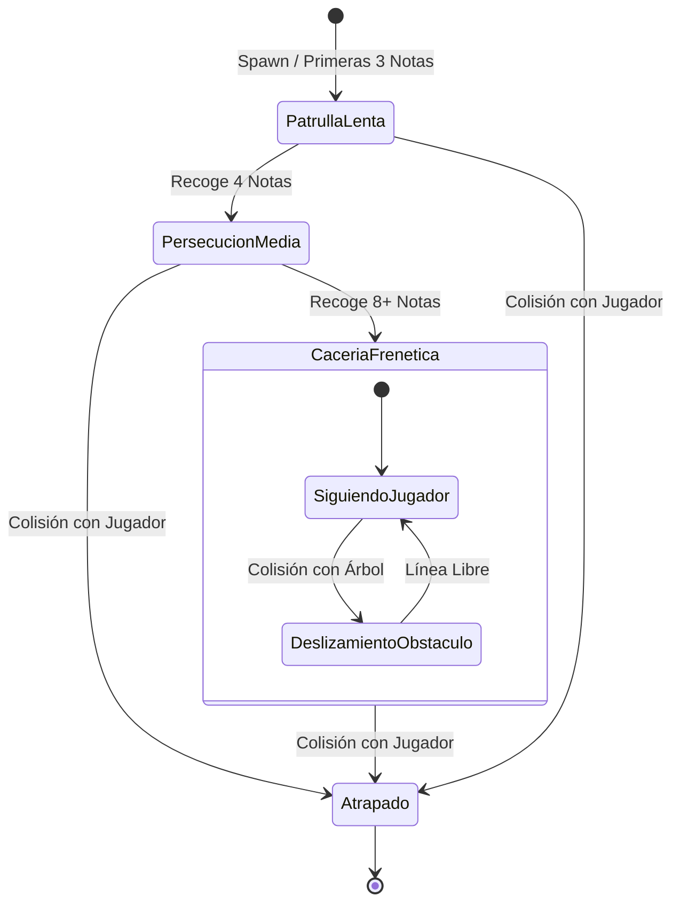
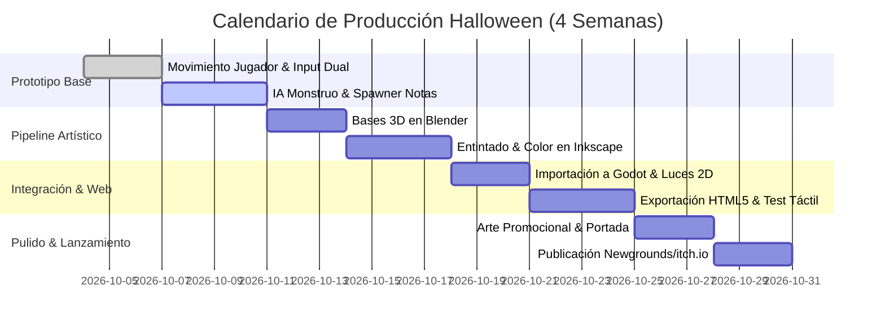

# Game Design Document (GDD)
**Proyecto:** Parodia de Terror en el Bosque (Nombre provisional: *Don't Look At Me, Bro*)  
**Género:** Arcade 2D / Top-Down Survival  
**Plataformas:** Web (HTML5) para Newgrounds e itch.io (compatible con PC y navegadores móviles)  
**Motor:** Godot Engine 4 (Compatibility Renderer)  
**Pipeline Gráfico:** 3D Mockup (Blender) ➔ Vector Inking & Color (Inkscape) ➔ Motor 2D (Godot 4)  
**Ventana de Producción:** 4 semanas (Lanzamiento para Halloween)

---

## 1. Visión General y Resumen Ejecutivo

### 1.1. Elevator Pitch
Un juego arcade de vista cenital que parodia los clichés de terror tipo *Slender*: controlas a un protagonista desorientado en un bosque oscuro armado con una linterna deficiente. El objetivo es recoger tantas notas absurdas como sea posible mientras evitas a una criatura ridícula que se vuelve progresivamente más rápida e insistente con cada página recogida.

### 1.2. Pilares de Diseño
1. **Inmediatez Arcade:** Sesiones de 60 a 120 segundos; controles instantáneos, reintentos rápidos y enfoque en superar la puntuación máxima.
2. **Humor y Subversión:** Contraste cómico entre una atmósfera formalmente tensa (oscuridad, pasos en el bosque) y elementos absurdos (notas que son memes, un monstruo torpe, efectos de sonido exagerados).
3. **Producción Eficiente Asistida:** Alcance acotado a un solo mapa cerrado, pipeline híbrido 3D-Vectorial (Blender + Inkscape) para gráficos rápidos y consistentes, y lógica directa asistida por IA/MCP en Godot.

---

## 2. Bucle de Juego y Flujos del Sistema

### 2.1. Core Gameplay Loop

### 2.2. Diagrama de Estados del Monstruo

### 2.3. Dinámica de Dificultad (Escalado)
* **Notas 1 a 3:** Monstruo lento; el jugador aprende a maniobrar entre los árboles y probar los límites del mapa.
* **Notas 4 a 7:** El monstruo iguala la velocidad del jugador; requiere giros cerrados y uso activo de obstáculos para sacarle ventaja.
* **Notas 8+:** El monstruo es ligeramente más rápido que el jugador en línea recta; obliga a zigzaguear entre árboles para cortar línea de visión y sobrevivir.

---

## 3. Controles e Interfaz

### 3.1. Esquema de Entrada Dual
* **PC (Teclado):**
  * Movimiento: `W, A, S, D` o Teclas de Flecha.
  * Reinicio: Barra espaciadora / `Enter`.
* **Móviles (Navegador Táctil):**
  * Opción A: Cruceta / `TouchScreenButton` semi-transparente en esquinas.
  * Opción B: *Touch & Move* (el personaje camina hacia el punto donde se mantiene apoyado el dedo).
  * Botón de reinicio gigante en pantalla de Game Over.

### 3.2. HUD (Interfaz de Usuario)
* **Durante la partida:** Minimalista. Solo un contador de páginas recogidas en la esquina superior izquierda (ejemplo: `Notas: 0`).
* **Flash de Nota:** Al recoger un papel, se muestra un dibujo/nota cómica en el centro de la pantalla durante 1 segundo sin congelar la amenaza.
* **Pantalla de Game Over:** 
  * Ilustración vectorial cómica de derrota.
  * Puntuación final y récord actual (*High Score*).
  * Botón visible de "Reintentar".

---

## 4. Entidades y Mecánicas del Sistema

### 4.1. Jugador (`CharacterBody2D`)
* **Movimiento:** 8 direcciones con velocidad fija (sin aceleración resbaladiza para control preciso).
* **Iluminación:** Nodo `PointLight2D` con textura de degradado circular simulando el haz de una linterna con poco alcance.
* **Colisión:** `CollisionShape2D` circular pequeño en los pies para evitar atascarse en esquinas.

### 4.2. El Monstruo (`CharacterBody2D` o `Area2D`)
* **IA:** Movimiento vectorial directo hacia las coordenadas del jugador (`global_position.direction_to(player.global_position)`).
* **Comportamiento:** Si choca contra un árbol, se desliza alrededor de él usando la física nativa de Godot.
* **Feedback de proximidad:** Sonido ambiental cómico o temblor leve de cámara cuando está dentro del radio de luz.

### 4.3. Sistema de Notas (`Area2D`)
* Existe **solo una nota en pantalla a la vez** para forzar al jugador a recorrer el mapa.
* Cada vez que se recoge una nota:
  1. Suena un efecto sonoro cómico.
  2. Aumenta el contador de puntuación.
  3. Aumenta la velocidad del enemigo en un multiplicador fijo ($+5\%$ o $+10\%$).
  4. La siguiente nota aparece en uno de varios puntos predefinidos (`Marker2D`) alejados de la posición actual del jugador.

### 4.4. El Bosque (Mapa Único)
* **Dimensiones:** Una arena cerrada de aproximadamente 2 pantallas de ancho por 2 de alto.
* **Límites:** Bordes sellados por una valla de madera rota o una hilera impenetrable de árboles.
* **Obstáculos:** Pequeñas agrupaciones de árboles, rocas y un tronco caído que sirven para cortar la persecución.

---

## 5. Pipeline Artístico Híbrido (Blender ➔ Inkscape ➔ Godot)

```mermaid
flowchart LR
    subgraph Blender [Fase 1: Blender 3D]
        B1[Modelado Base / Bloques 3D] --> B2[Cámara Ortográfica 45°]
        B2 --> B3[Render Base PNG Transparente]
    end

    subgraph Inkscape [Fase 2: Inkscape Vectorial]
        I1[Importar Render como Guía / Plantilla] --> I2[Entintado Vectorial / Línea Estilo Cómic]
        I2 --> I3[Color Plano & Sombras Cel-Shading]
        I3 --> I4[Exportar Spritesheet / PNG Limpio]
    end

    subgraph Godot [Fase 3: Godot 4]
        G1[Importar Texturas Lossless] --> G2[Montaje en Sprite2D / AnimatedSprite2D]
        G2 --> G3[Iluminación con PointLight2D y CanvasModulate]
    end

    B3 --> I1
    I4 --> G1
```

### 5.1. Fase 1: Blender (Estructura y Perspectiva)
* **Función:** Generar la volumetría, perspectiva y proporciones correctas sin tener que calcular escorzos a mano.
* **Cámara:** Modo `Orthographic`, ángulo cenital inclinado (vista clásica $45^\circ$ o $60^\circ$ tipo 3/4).
* **Configuración de Color:** `sRGB` con View Transform en **Standard** (sin desaturación fílmica de AgX).
* **Salida:** Renders en PNG transparente que sirven como "guía de calcado y referencia" para el arte final.

### 5.2. Fase 2: Inkscape (Estilo Visual y Acabado Cómic)
* **Función:** Darle el toque ilustrado, estilo caricatura/parodia y acabado final al juego.
* **Capa 1 (Boceto/Base):** Render de Blender con opacidad al $40\%$ como guía de perspectiva.
* **Capa 2 (Inking / Líneas):** Trazado vectorial con trazos definidos, bordes redondeados y grosores estilo cartoon.
* **Capa 3 (Color y Sombreado):** Paleta de colores vivos y sombras duras (*cel-shading*), lo que combina perfecto con el tono de comedia.
* **Exportación:** Exportar cada objeto/personaje en PNG optimizado a resolución objetivo ($128 \times 128$ px para personajes, $256 \times 256$ px para props grandes).

### 5.3. Fase 3: Godot 4 (Integración y Motor)
* **Modo de Render:** `Compatibility` (WebGL 1/2) para máxima compatibilidad con navegadores y dispositivos móviles modestos.
* **Efecto de Oscuridad:** Nodo `CanvasModulate` con color oscuro (azul profundo/gris casi negro), perforado únicamente por el `PointLight2D` del jugador.
* **Exportación Web:**
  * Sin hilos avanzados para evitar requerir cabeceras `COOP/COEP` en Newgrounds o itch.io.
  * Archivos empaquetados en un `.zip` raíz para carga directa.

---

## 6. Plan de Producción (Meta: 31 de Octubre)

| Periodo | Objetivo Principal | Entregables Clave |
| :--- | :--- | :--- |
| **Semana 1** | Base funcional (Graybox) | Movimiento fluido, IA del monstruo básica, spawn de notas y Game Over funcional en Godot. |
| **Semana 2** | Pipeline Artístico (Blender + Inkscape) | Modelado de volúmenes base en Blender, entintado vectorial en Inkscape, exportación de sprites y efectos de sonido. |
| **Semana 3** | Adaptación Web y Test Móvil | Controles táctiles en pantalla, exportación a HTML5, pruebas directas en navegadores móviles y balanceo de velocidad. |
| **Semana 4** | Pulido, Promo y Lanzamiento | Arte promocional (portada cómica), miniaturas, publicación en Newgrounds e itch.io, y videos cortos (devlogs). |