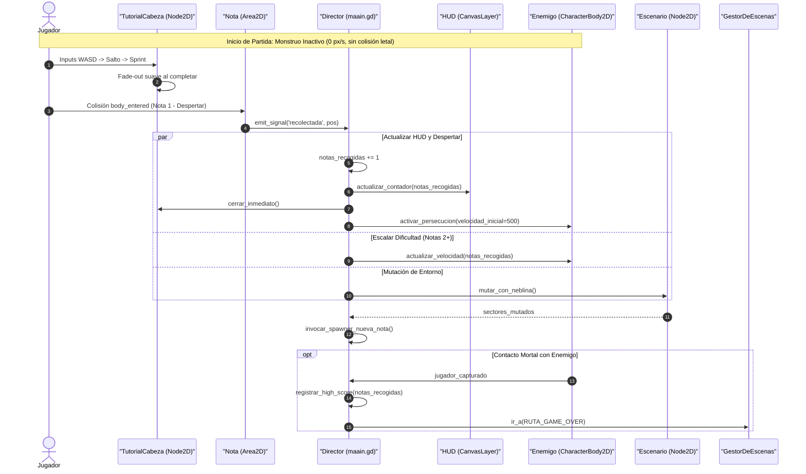

# Arquitectura de Partida y Director de Juego

Este documento define la estructura y responsabilidades del Game Director (`scripts/maain.gd` en `escenas/maain.tscn`), la orquestación de señales entre subsistemas y la persistencia del récord de partida (*High Score*).

---

## 1. El Rol del Game Director (`maain.gd`)

La escena `escenas/maain.tscn` contiene el mundo de juego activo y actúa como el **Director de Juego**. Es el encargado de inicializar las entidades, vincular los buses de señales y coordinar la dificultad en tiempo real sin acoplar directamente el script del jugador con el del monstruo o el escenario.

```text
Maain (Node2D) [scripts/maain.gd]
├── Escenario (Node2D) [escenas/escenario.tscn]
├── Personaje (CharacterBody2D) [escenas/personaje.tscn]
├── Enemigo (CharacterBody2D) [escenas/enemigo.tscn]
├── SpawnerNotas (Node2D)       # Gestor de instanciación de notas
├── HUD (CanvasLayer, layer=10) # Contador de notas y barra de estamina
└── Camara2D (Camera2D)         # Si no está anidada en el personaje
```

---

## 2. Bus de Señales y Flujo de Eventos



---

## 3. Condiciones de Fin de Partida

### 3.1. Condición de Derrota (Game Over)
* **Disparador:** La señal `_on_body_entered` o `_comprobar_captura_continua` del `AreaCaptura` del enemigo hace contacto con el jugador.
* **Manejo de Casos Borde y Cancelación de Corrutinas:**
  - Si el contacto mortal ocurre simultáneamente con la recolección de una nota o durante el ciclo asíncrono de mutación/niebla (`mutar_con_neblina()`), el Game Director interrumpe o descarta inmediatamente el ciclo de mutación y generación de notas, evitando referencias nulas o invocaciones diferidas en escenas destruidas.
* **Efectos:**
  1. La velocidad del jugador y del enemigo se anula a `Vector2.ZERO`.
  2. Se reproduce el sonido de impacto/jumpscare.
  3. Se compara la puntuación actual con el récord persistido.
  4. Se delega la transición a `GestorDeEscenas.ir_a(GestorDeEscenas.RUTA_GAME_OVER)`.

### 3.2. Filosofía de Victoria vs. Supervivencia Arcade Infinita
* **Modo Arcade Infinito (Predeterminado):** La partida continúa mientras el jugador conserve la vida. La dificultad alcanza su meseta máxima en la Nota 10+ ($920\text{ px/s}$), donde el juego se convierte en una prueba de resistencia extrema para alcanzar el récord más alto posible.
* **Meta Opcional de Escape (Hito 8/10 Notas):**
  - Si se habilita el modo narrativa/escape en fases posteriores, al alcanzar la Nota 8 se abre un claro en la valla perimetral o se desbloquea una puerta iluminada en la frontera norte del mapa que permite escapar del bosque y concluir la partida con una pantalla de victoria.

---

## 4. Persistencia del High Score en Web y Desktop

Para garantizar que el récord no se pierda al recargar la pestaña del navegador o cerrar el juego, se utiliza una arquitectura dual:

### 4.1. Persistencia Nativa en Godot (`user://`)
Godot 4 mapea de forma transparente la ruta `user://` a **IndexedDB** en compilaciones Web (HTML5/WASM):
```gdscript
const ARCHIVO_SAVE: String = "user://highscore.save"

func guardar_record(record: int) -> void:
    var file := FileAccess.open(ARCHIVO_SAVE, FileAccess.WRITE)
    if file != null:
        file.store_32(record)

func cargar_record() -> int:
    if FileAccess.file_exists(ARCHIVO_SAVE):
        var file := FileAccess.open(ARCHIVO_SAVE, FileAccess.READ)
        if file != null:
            return file.get_32()
    return 0
```

### 4.2. Fallback Web Directo a `LocalStorage`
Si por políticas del navegador IndexedDB se encontrase restringido en un iframe de terceros (ej. itch.io o Newgrounds), se complementa con una llamada JavaScript directa:
```gdscript
func guardar_record_web(record: int) -> void:
    if OS.has_feature("web"):
        JavaScriptBridge.eval("localStorage.setItem('vosque_high_score', '%d');" % record)
```
