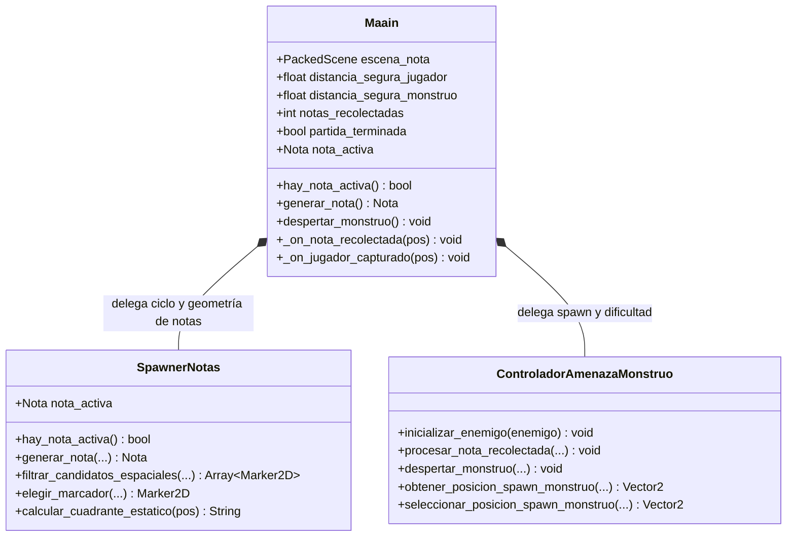
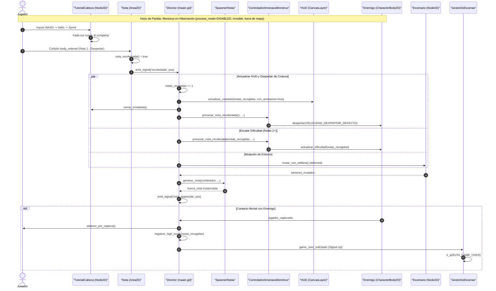

# Arquitectura de Partida y Director de Juego

Este documento define la arquitectura modular del Game Director ([`scripts/core/maain/`](../../scripts/core/maain/) en [`escenas/maain.tscn`](../../escenas/maain.tscn)), la orquestación de señales entre subsistemas y la persistencia del récord de partida (*High Score*).

---

## 1. Arquitectura Modular del Game Director (`scripts/core/maain/`)

La escena `escenas/maain.tscn` contiene el mundo de juego activo y actúa como el **Director de Juego**. Para evitar el antipatrón de *God Object* y cumplir el Principio de Responsabilidad Única (SRP), la lógica de partida se estructura mediante un patrón de fachada con sub-controladores especializados (`RefCounted`):

```text
Maain (Node2D) [scripts/core/maain/maain.gd]
├── Escenario (Node2D) [escenas/escenario.tscn]
├── Personaje (CharacterBody2D) [escenas/personaje.tscn]
├── Enemigo (CharacterBody2D) [escenas/enemigo.tscn]
├── HUD (CanvasLayer, layer=10) [escenas/hud.tscn]
├── DebugMenu (CanvasLayer) [escenas/debug_menu.tscn]
└── CamaraDios (Camera2D) [zoom=0.225]
```

### 1.1. Componentes del Paquete Modular



1. **`Maain` ([`scripts/core/maain/maain.gd`](../../scripts/core/maain/maain.gd)):**
   * Fachada de alto nivel y único nodo en el árbol de escenas (`Node2D`).
   * Gestiona el estado macro de la partida (`partida_terminada`, `notas_recolectadas`), conecta la señal `revelada` de `Nota` y actualiza al `HUD` (contador + **Minimapa 2x2** con posición normalizada del jugador y cuadrante objetivo).
   * Emite las señales de dominio (`nota_aparecida`, `nota_recogida`, `game_over_solicitado`).
   * Provee acceso seguro al autoload `GestorMusica` mediante `_obtener_gestor_musica()` validando previamente `is_inside_tree()`.
2. **`SpawnerNotas` ([`scripts/core/maain/spawner_notas.gd`](../../scripts/core/maain/spawner_notas.gd)):**
   * Mantiene el invariante de nota única activa (`hay_nota_activa()`) sin escaneos paranoicos del árbol y respetando el método público `nota.esta_recolectada()`.
   * Contiene la lógica euclidiana y matemática de filtrado (`filtrar_candidatos_espaciales`, `elegir_marcador`, `calcular_cuadrante_estatico`).
   * Define la constante tipada `TOLERANCIA_DESATASCO_SQ: float = 1.0`.
3. **`ControladorAmenazaMonstruo` ([`scripts/core/maain/controlador_amenaza_monstruo.gd`](../../scripts/core/maain/controlador_amenaza_monstruo.gd)):**
   * Centraliza el ciclo de vida de la amenaza: hibernación inicial, cálculo de coordenadas de spawn seguro y escalado de velocidad por notas recogidas.
   * Utiliza la constante `Enemigo.VELOCIDAD_DESPERTAR_DEFECTO` eliminando números mágicos (`500.0`).
   * Encapsula los fallbacks geométricos de spawn bajo constantes explícitas (`POSICION_FALLBACK_ORIGEN` y `DISTANCIA_MINIMA_FALLBACK`).

---

## 2. Bus de Señales y Flujo de Eventos



---

## 3. Condiciones de Fin de Partida

### 3.1. Condición de Derrota (Game Over)
* **Disparador:** La señal `_on_body_entered` o `_comprobar_captura_continua` del `AreaCaptura` del enemigo hace contacto con el jugador.
* **Encapsulamiento del Jugador:**
  - En lugar de invadir las variables internas del personaje desde el exterior, `Maain` invoca el método público `jugador.detener_por_captura()`, el cual anula `velocity = Vector2.ZERO` y desactiva `set_physics_process(false)` limpiamente.
* **Manejo de Casos Borde y Cancelación de Corrutinas:**
  - Si el contacto mortal ocurre simultáneamente con la recolección de una nota o durante el ciclo asíncrono de mutación/niebla (`mutar_con_neblina()`), el Game Director marca `partida_terminada = true`. Esto descarta de inmediato cualquier spawn de notas o actualización subsecuente.
* **Efectos y Transición Cinemática:**
  1. El Game Director emite la señal `game_over_solicitado` hacia `GestorDeEscenas`.
  2. `GestorDeEscenas` ejecuta la transición con fundido iris hacia `GestorDeEscenas.RUTA_GAME_OVER`.
  3. La pantalla de destino (`escenas/game_over.tscn`) toma el control cinemático ejecutando su nodo **`AnimationPlayer`** (`jumpscare_derrota`), que reproduce simultáneamente el golpe acústico seco, el zoom elástico de la ilustración de la criatura, el flash carmesí y la inyección de trauma de cámara, antes de revelar las estadísticas y habilitar el botón de reinicio.

### 3.2. Filosofía de Victoria vs. Supervivencia Arcade Infinita
* **Modo Arcade Infinito (Predeterminado):** La partida continúa mientras el jugador conserve la vida. La dificultad alcanza su meseta máxima en la Nota 10+ ($920\text{ px/s}$), donde el juego se convierte en una prueba de resistencia extrema para alcanzar el récord más alto posible.
* **Meta Opcional de Escape (Hito 8/10 Notas):**
  - Si se habilita el modo narrativa/escape en fases posteriores, al alcanzar la Nota 8 se abre un claro en la valla perimetral o se desbloquea una puerta iluminada en la frontera norte del mapa que permite escapar del bosque y concluir la partida con una pantalla de victoria.

---

## 4. Persistencia del High Score en Web y Desktop

Para garantizar que el récord no se pierda al recargar la pestaña del navegador o cerrar el juego, se utiliza una arquitectura dual:

### 4.1. Persistencia Nativa en Godot (`user://`)
Godot 4 mapea de forma transparente la ruta `user://` a **IndexedDB** en compilaciones Web (HTML5/WASM):
```gdscript
const ARCHIVO_SAVE: String = "user://highscore.save"

func guardar_record(record: int) -> void:
	var file := FileAccess.open(ARCHIVO_SAVE, FileAccess.WRITE)
	if file != null:
		file.store_32(record)

func cargar_record() -> int:
	if FileAccess.file_exists(ARCHIVO_SAVE):
		var file := FileAccess.open(ARCHIVO_SAVE, FileAccess.READ)
		if file != null:
			return file.get_32()
	return 0
```

### 4.2. Fallback Web Directo a `LocalStorage`
Si por políticas del navegador IndexedDB se encontrase restringido en un iframe de terceros (ej. itch.io o Newgrounds), se complementa con una llamada JavaScript directa:
```gdscript
func guardar_record_web(record: int) -> void:
	if OS.has_feature("web"):
		JavaScriptBridge.eval("localStorage.setItem('vosque_high_score', '%d');" % record)
```
