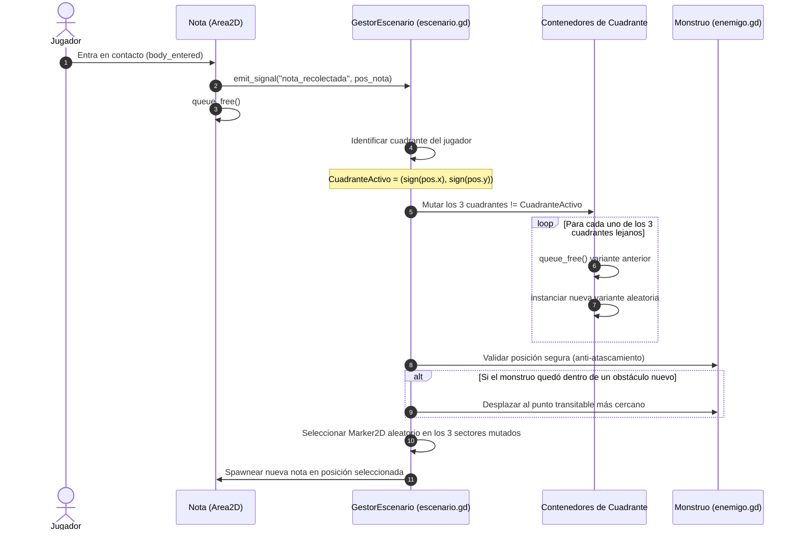

# Mapa y Sectores Mutables

Este documento detalla la topología, el sistema de composición modular, la delimitación física/visual y el algoritmo de mutación dinámica del escenario de **Vosque**.

---

## 1. Topología y Coordenadas del Mundo

El mundo de juego de *Vosque* es una arena cerrada continua de **$2160 \times 2160\text{ px}$** organizada en una cuadrícula $2 \times 2$ simétrica respecto al origen global `(0, 0)`.

```
                  -1080 Y (Límite Norte)
            ┌───────────────────┬───────────────────┐
            │                   │                   │
            │     Sector NO     │     Sector NE     │
            │  Pivote: (-540,-540)  Pivote: (540,-540) │
            │                   │                   │
 -1080 X ───┼───────────────────┼───────────────────┼─── +1080 X
 (Límite    │                   │                   │   (Límite
  Oeste)    │     Sector SO     │     Sector SE     │    Este)
            │  Pivote: (-540,540)   Pivote: (540,540)  │
            │                   │                   │
            └───────────────────┴───────────────────┘
                  +1080 Y (Límite Sur)
```

### Tabla de Cuadrantes

| Cuadrante | Rango Coordenadas $X$ | Rango Coordenadas $Y$ | Coordenada Local Pivote | Dimensiones |
| :--- | :--- | :--- | :--- | :--- |
| **Sector NO** (Noroeste) | $[-1080, 0]$ | $[-1080, 0]$ | `Vector2(-540, -540)` | $1080 \times 1080\text{ px}$ |
| **Sector NE** (Noreste) | $[0, 1080]$ | $[-1080, 0]$ | `Vector2(540, -540)` | $1080 \times 1080\text{ px}$ |
| **Sector SO** (Suroeste) | $[-1080, 0]$ | $[0, 1080]$ | `Vector2(-540, 540)` | $1080 \times 1080\text{ px}$ |
| **Sector SE** (Sureste) | $[0, 1080]$ | $[0, 1080]$ | `Vector2(540, 540)` | $1080 \times 1080\text{ px}$ |

---

## 2. Definición de Límites

El juego asegura que la acción permanezca dentro de la arena y sin artefactos visuales mediante un doble sistema independiente:

### 2.1. Límites Físicos (Colisión Infranqueable)
En la escena raíz del escenario (`escenas/escenario.tscn`), se implementa una barrera estática permanente:
* **Nodo:** `VallaPerimetral (StaticBody2D)`
* **Capa de Colisión:** Capa 1 (`Mundo_Alto` / Bloqueo Total).
* **Geometría de Muros:** 4 nodos `CollisionShape2D` (forma `RectangleShape2D` de $64\text{ px}$ de grosor):
  - **Muro Norte:** Posición `(0, -1080)`, tamaño `Vector2(2160, 64)`.
  - **Muro Sur:** Posición `(0, 1080)`, tamaño `Vector2(2160, 64)`.
  - **Muro Oeste:** Posición `(-1080, 0)`, tamaño `Vector2(64, 2160)`.
  - **Muro Este:** Posición `(1080, 0)`, tamaño `Vector2(64, 2160)`.
* **Propósito:** Esta valla es fija e inmutable; nunca se altera al mutar los sectores interiores, garantizando que ni el jugador ni el monstruo puedan escapar de la arena.

### 2.2. Límites Visuales (Encuadre de Cámara en Godot 4)
Para una resolución base de viewport $1:1$ ($1080 \times 1080\text{ px}$), el nodo `Camera2D` utiliza los límites perimetrales nativos del motor:
```gdscript
limit_left = -1080
limit_top = -1080
limit_right = 1080
limit_bottom = 1080
```
* **Comportamiento dinámico:**
  - En el interior del bosque, la cámara sigue con suavidad al personaje centrándolo en pantalla.
  - Al aproximarse a los extremos exteriores, la cámara amortigua su desplazamiento y se ancla al borde del bosque, permitiendo que el personaje camine hasta la valla sin dejar al descubierto el fondo gris exterior.

### 2.3. Iluminación Ambiental y Penumbra Contrastada (Legibilidad Arcade)
Para compatibilizar la atmósfera de terror con desplazamientos a alta velocidad ($800 - 1000\text{ px/s}$) y maniobras evasivas de salto (*Dive*):
* **Luz Ambiental Base (`CanvasModulate`):** Se aplica un tono azul petróleo / noche americana desaturado (`Color(0.08, 0.10, 0.15, 1.0)`).
* **Ausencia de Oscuridad Ciega:** El bosque nunca es negro absoluto. La silueta de los troncos, rocas y valla siempre es perceptible a media distancia para anticipar desvíos y saltos.
* **Linterna como Contraste Alto:** El cono de luz frontal del jugador actúa como haz revelador de alto brillo que ilumina detalles, texturas y el cuerpo del monstruo.
* **Ojos Reflectantes del Monstruo:** El enemigo cuenta con dos puntos o sprites emisivos (ojos brillantes de brillo retro-reflectante) visibles antes que su silueta completa para alertar su aproximación.
* **Auto-Iluminación de la Nota:** La nota activa proyecta un halo propio de $\approx 200\text{ px}$, funcionando como una baliza luminosa lejana.

---

## 3. Matriz de Capas de Físicas (`Collision Layers`)

Para coordinar la mecánica de locomoción en tierra con el **Salto Libre y Salto de Plancha (*Dive*)**, los objetos del escenario se clasifican en:

| Capa (Layer) | Nombre de Capa | Elementos del Escenario | Máscara del Jugador en Suelo | Máscara del Jugador en Salto/Plancha |
| :---: | :--- | :--- | :---: | :---: |
| **1** | `Mundo_Alto` | Valla perimetral, árboles densos y rocas gigantes impenetrables. | **Activa** (Colisiona) | **Activa** (Colisiona) |
| **2** | `Obstaculos_Bajos` | Troncos caídos, tocones y piedras pequeñas superables. | **Activa** (Colisiona) | **Inactiva** (Pasa por encima) |
| **3** | `Jugador` | Protagonista (`CharacterBody2D`). | — | — |
| **4** | `Monstruo` | Criatura perseguidora (`CharacterBody2D`). | **Activa** (Game Over) | **Activa** (Game Over) |
| **5** | `Interactuables` | Notas coleccionables (`Area2D`). | **Activa** (Recolección) | **Activa** (Recolección) |

---

## 4. Arquitectura de Escenas: Composición Modular

El mapa **no realiza recargas de nivel ni pausas de transición**. Se construye combinando un **Contenedor Maestro** con **Sub-Escenas de Variantes** intercambiables.

### 4.1. Árbol de la Escena Maestra (`escenas/escenario.tscn`)

```text
Escenario (Node2D) [scripts/escenario.gd]
├── SueloContinuo (Sprite2D / TileMapLayer de 2160x2160 px)
├── VallaPerimetral (StaticBody2D)
│   ├── ColisionNorte (CollisionShape2D - Rectángulo 2160x64)
│   ├── ColisionSur (CollisionShape2D - Rectángulo 2160x64)
│   ├── ColisionOeste (CollisionShape2D - Rectángulo 64x2160)
│   └── ColisionEste (CollisionShape2D - Rectángulo 64x2160)
└── Sectores (Node2D)
    ├── SectorNO (Marker2D en [-540, -540]) ──> Instancia de Variante activa
    ├── SectorNE (Marker2D en [ 540, -540]) ──> Instancia de Variante activa
    ├── SectorSO (Marker2D en [-540,  540]) ──> Instancia de Variante activa
    └── SectorSE (Marker2D en [ 540,  540]) ──> Instancia de Variante activa
```

### 4.2. Estructura de Sub-Escena de Variante (`escenas/sectores/variantes/`)

Cada variante de sector es una escena compacta de $1080 \times 1080\text{ px}$ con origen `(0, 0)` en su centro:

```text
VarianteSector (Node2D)
├── ObstaculosAltos (StaticBody2D - Capa 1: Mundo_Alto)
│   ├── Arboles (CollisionShape2D circulares en las bases)
│   └── RocasGrandes
├── ObstaculosBajos (StaticBody2D - Capa 2: Obstaculos_Bajos)
│   └── TroncosCaidos (CollisionShape2D rectangulares orientados)
└── PuntosDeNota (Node2D)
    ├── MarkerNota1 (Marker2D, grupo: "puntos_nota")
    ├── MarkerNota2 (Marker2D, grupo: "puntos_nota")
    └── MarkerNota3 (Marker2D, grupo: "puntos_nota")
```

---

## 5. Reglas de Diseño de Niveles (*Level Design Guidelines*)

Para garantizar una experiencia justa, fluida y sin bloqueos accidentales durante las mutaciones:

### 5.1. Corredores de Conectividad Intersectorial
* Alrededor de los ejes divisores $X = 0$ e $Y = 0$, debe mantenerse una **franja despejada de seguridad de al menos $160\text{ px}$ de ancho** ($80\text{ px}$ a cada lado del borde interior de cada cuadrante).
* **Regla estricta:** Ninguna variante puede posicionar obstáculos sólidos en estos bordes de conexión. Esto asegura que, sin importar qué variante se instancie en un sector vecino, el jugador o el monstruo siempre puedan cruzar la frontera sin toparse con un muro imprevisto.

### 5.2. Proporción de Espacio y Maniobrabilidad
* **Área Transitable:** $\ge 70\%$ de la superficie del cuadrante.
* **Área Ocupada por Obstáculos:** $\le 30\%$.
* Los árboles densos deben agruparse en pequeños clústeres que dejen pasillos libres de al menos $140\text{ px}$ (suficiente para que el jugador a $800\text{ px/s}$ y el monstruo a $500\text{ - }900\text{ px/s}$ naveguen sin fricción excesiva).

---

## 6. Algoritmo de Mutación Espacial Dinámica



### 6.1. Detección del Cuadrante del Jugador
En GDScript:
```gdscript
func obtener_cuadrante_jugador(pos_global: Vector2) -> String:
	var x_str: String = "E" if pos_global.x >= 0.0 else "O"
	var y_str: String = "S" if pos_global.y >= 0.0 else "N"
	return y_str + x_str # Retorna "NO", "NE", "SO" o "SE"
```

### 6.2. Protocolo Anti-Atascamiento del Monstruo
Si el monstruo se encuentra en uno de los 3 sectores que mutan en el momento de recoger la nota:
1. Se consulta su colisión con `test_move()` o `PhysicsDirectSpaceState2D.intersect_point()`.
2. Si se detecta solapamiento con un nuevo obstáculo sólido, se le reposiciona instantáneamente al `Marker2D` libre más próximo dentro de ese mismo sector, manteniendo la coherencia de persecución sin romper la física.
