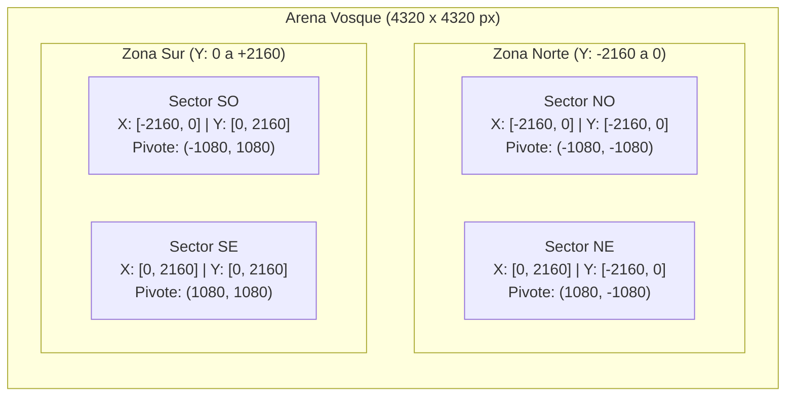
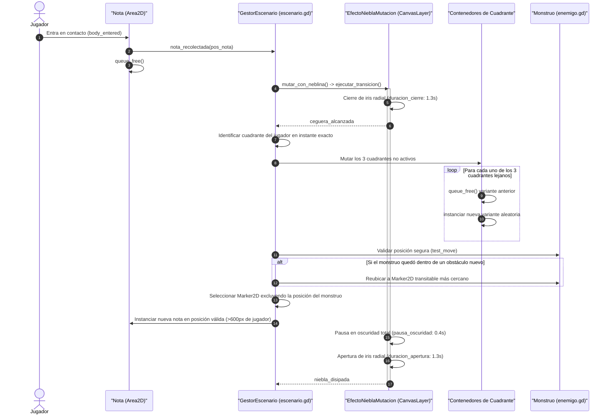

# Mapa y Sectores Mutables

Este documento detalla la topología, el sistema de composición modular, la delimitación física/visual y el algoritmo de mutación dinámica del escenario de **Vosque**.

---

## 1. Topología y Coordenadas del Mundo

El mundo de juego de *Vosque* es una arena cerrada continua de **$4320 \times 4320\text{ px}$** organizada en una cuadrícula $2 \times 2$ simétrica respecto al origen global `(0, 0)`.

```
                  -2160 Y (Límite Norte)
            ┌───────────────────┬───────────────────┐
            │                   │                   │
            │     Sector NO     │     Sector NE     │
            │ Pivote:(-1080,-1080) Pivote:(1080,-1080)│
            │                   │                   │
 -2160 X ───┼───────────────────┼───────────────────┼─── +2160 X
 (Límite    │                   │                   │   (Límite
  Oeste)    │     Sector SO     │     Sector SE     │    Este)
            │ Pivote:(-1080,1080)  Pivote:(1080,1080) │
            │                   │                   │
            └───────────────────┴───────────────────┘
                  +2160 Y (Límite Sur)
```



### Tabla de Cuadrantes

| Cuadrante | Rango Coordenadas $X$ | Rango Coordenadas $Y$ | Coordenada Local Pivote | Dimensiones |
| :--- | :--- | :--- | :--- | :--- |
| **Sector NO** (Noroeste) | $[-2160, 0]$ | $[-2160, 0]$ | `Vector2(-1080, -1080)` | $2160 \times 2160\text{ px}$ |
| **Sector NE** (Noreste) | $[0, 2160]$ | $[-2160, 0]$ | `Vector2(1080, -1080)` | $2160 \times 2160\text{ px}$ |
| **Sector SO** (Suroeste) | $[-2160, 0]$ | $[0, 2160]$ | `Vector2(-1080, 1080)` | $2160 \times 2160\text{ px}$ |
| **Sector SE** (Sureste) | $[0, 2160]$ | $[0, 2160]$ | `Vector2(1080, 1080)` | $2160 \times 2160\text{ px}$ |

---

## 2. Definición de Límites

### 2.1. Límites Físicos (Colisión Infranqueable)
En la escena raíz del escenario (`escenas/escenario.tscn`), se implementa una barrera estática permanente:
* **Nodo:** `VallaPerimetral (StaticBody2D)`
* **Capa de Colisión:** Capa 1 (`Mundo_Alto` / Bloqueo Total).
* **Geometría de Muros:** 4 nodos `CollisionShape2D` (forma `RectangleShape2D` de $64\text{ px}$ de grosor):
  - **Muro Norte:** Posición `(0, -2160)`, tamaño `Vector2(4320, 64)`.
  - **Muro Sur:** Posición `(0, 2160)`, tamaño `Vector2(4320, 64)`.
  - **Muro Oeste:** Posición `(-2160, 0)`, tamaño `Vector2(64, 4320)`.
  - **Muro Este:** Posición `(2160, 0)`, tamaño `Vector2(64, 4320)`.
* **Propósito:** Esta valla es fija e inmutable; nunca se altera al mutar los sectores interiores, garantizando que ni el jugador ni el monstruo puedan escapar de la arena.

### 2.2. Límites Visuales (Encuadre de Cámara en Godot 4)
Para una resolución base de viewport $1:1$ ($1080 \times 1080\text{ px}$), el nodo `Camera2D` utiliza los límites perimetrales nativos del motor:
```gdscript
limit_left = -2160
limit_top = -2160
limit_right = 2160
limit_bottom = 2160
```
* La cámara sigue con suavidad al personaje centrándolo en pantalla (`position_smoothing_enabled = true`).
* Al aproximarse a los extremos exteriores, la cámara amortigua su desplazamiento y se ancla al borde del bosque sin mostrar el exterior vacío.

### 2.3. Iluminación Ambiental y Penumbra Contrastada
* **Luz Ambiental Base (`CanvasModulate`):** Tono azul petróleo desaturado (`Color(0.08, 0.10, 0.15, 1.0)`).
* **Ausencia de Oscuridad Ciega:** La silueta de los troncos, rocas y valla siempre es perceptible a media distancia.
* **Linterna Frontal:** Haz revelador de alto brillo que ilumina texturas y el cuerpo del monstruo.
* **Ojos Reflectantes:** El enemigo cuenta con dos puntos emisivos visibles en penumbra antes que su cuerpo penetre en el haz.
* **Halo de la Nota:** La nota proyecta una luz propia de radio $\approx 200\text{ px}$ que funciona como baliza orientativa.

---

## 3. Matriz de Capas de Físicas (`Collision Layers`)

La siguiente matriz detalla cómo interactúa cada entidad del juego con el entorno en tierra y durante maniobras aéreas:

| Capa | Nombre de Capa | Elementos | Máscara Jugador (Suelo) | Máscara Jugador (Salto/Plancha) | Máscara Monstruo |
| :---: | :--- | :--- | :---: | :---: | :---: |
| **1** | `Mundo_Alto` | Valla exterior, árboles grandes, rocas densas | **Activa** (Bloquea) | **Activa** (Bloquea) | **Activa** (Bloquea) |
| **2** | `Obstaculos_Bajos` | Troncos caídos, tocones, piedras pequeñas | **Activa** (Bloquea) | **Inactiva** (Supera por arriba) | **Activa** (Bloquea / Rodea) |
| **3** | `Jugador` | Protagonista (`CharacterBody2D`) | — | — | **Activa** (`AreaCaptura`) |
| **4** | `Monstruo` | Criatura perseguidora (`CharacterBody2D`) | **Activa** (Muerte) | **Activa** (Muerte) | — |
| **5** | `Interactuables` | Notas coleccionables (`Area2D`) | **Activa** (Recogida) | **Activa** (Recogida) | **Inactiva** |

> [!TIP]
> **Valor Táctico del Salto:** Dado que la máscara del Monstruo mantiene activas tanto la Capa 1 como la Capa 2, **la criatura está obligada a rodear los troncos bajos**, mientras que el jugador puede saltarlos en línea recta para ganar distancia crucial.

---

## 4. Arquitectura de Escenas: Composición Modular

El mapa **no realiza recargas de nivel ni pausas de transición**. Se construye combinando un **Contenedor Maestro** con **Sub-Escenas de Variantes** intercambiables.

### 4.1. Árbol de la Escena Maestra (`escenas/escenario.tscn`)

```text
Escenario (Node2D) [scripts/escenario.gd]
├── SueloContinuo (Polygon2D continuo de 4320x4320 px, z_index: -10)
├── VallaPerimetral (StaticBody2D, Capa 1: Mundo_Alto)
│   ├── ColisionNorte (CollisionShape2D - Rectángulo 4320x64 en [0, -2160])
│   ├── ColisionSur (CollisionShape2D - Rectángulo 4320x64 en [0,  2160])
│   ├── ColisionOeste (CollisionShape2D - Rectángulo 64x4320 en [-2160, 0])
│   ├── ColisionEste (CollisionShape2D - Rectángulo 64x4320 en [ 2160, 0])
│   └── VisualValla (Node2D con 4 Polygon2D perimetrales de madera en z_index: 10)
├── Sectores (Node2D, y_sort_enabled = true)
│   ├── SectorNO (Marker2D en [-1080, -1080]) ──> Instancia de Variante activa
│   ├── SectorNE (Marker2D en [ 1080, -1080]) ──> Instancia de Variante activa
│   ├── SectorSO (Marker2D en [-1080,  1080]) ──> Instancia de Variante activa
│   └── SectorSE (Marker2D en [ 1080,  1080]) ──> Instancia de Variante activa
└── EfectoNieblaMutacion (CanvasLayer, layer 15) [scripts/efecto_niebla_mutacion.gd]
    └── ColorRect (ColorRect con mat_niebla_mutacion.tres)
```

### 4.2. Estructura de Sub-Escena de Variante (`escenas/sectores/variantes/`)

Cada variante cubre un cuadrante de $2160 \times 2160\text{ px}$ con origen `(0, 0)` en su centro relativo:

```text
VarianteSector (Node2D, y_sort_enabled = true)
├── CapaObstaculos (TileMapLayer opcional para pintado rápido)
├── ObstaculosAltos (StaticBody2D - Capa 1: Mundo_Alto)
│   ├── Arboles (CollisionShape2D circulares en bases)
│   └── RocasGrandes
├── ObstaculosBajos (StaticBody2D - Capa 2: Obstaculos_Bajos)
│   └── TroncosCaidos (CollisionShape2D rectangulares)
└── PuntosDeNota (Node2D)
    ├── MarkerNota1 (Marker2D, grupo: "puntos_nota")
    ├── MarkerNota2 (Marker2D, grupo: "puntos_nota")
    └── MarkerNota3 (Marker2D, grupo: "puntos_nota")
```

---

## 5. Corredores de Conectividad Intersectorial

* Alrededor de los ejes divisores $X = 0$ e $Y = 0$, se mantiene una **franja despejada obligatoria de al menos $160\text{ px}$ de ancho** ($80\text{ px}$ a cada lado del borde interior de cada cuadrante).
* **Regla estricta:** Ninguna variante puede posicionar obstáculos sólidos en estos bordes de conexión. Esto asegura que el cruce intersectorial sea fluido sin importar la combinación aleatoria de cuadrantes instanciada.

---

## 6. Algoritmo de Mutación Espacial Dinámica



### 6.1. Exclusión Mutua en Desatasco y Spawn
Para garantizar que la nueva nota nunca aparezca en las garras del enemigo y que la reubicación de la criatura sea justa:
1. Si el monstruo necesita ser reubicado por `validar_y_reubicar_enemigo()`, se evalúan los marcadores transitables libres en su sector. Se descartan aquellos que estén a menos de $600\text{ px}$ del jugador para evitar teletransportes letales injustos, y se registra el marcador seleccionado como reservado.
2. Al sortear el spawn de la nueva nota entre los `"puntos_nota"`, se descarta cualquier marcador que se encuentre a una distancia menor a $800\text{ px}$ de la posición del monstruo o a menos de $600\text{ px}$ de la posición del jugador.

### 6.2. Caso Borde: Transición de Cuadrante en Frontera durante el Cierre de Niebla
Dado que transcurren $1.3\text{ s}$ de cierre de niebla radial tras tocar una nota:
* El cuadrante activo del jugador **se evalúa en el instante exacto de oscuridad total** (`ceguera_alcanzada`), y no en el momento inicial del toque de la nota. De este modo, si el jugador cruza $X=0$ o $Y=0$ durante el cierre de la niebla, el sector donde efectivamente se encuentre será el preservado.
* Los corredores seguros de $160\text{ px}$ ($80\text{ px}$ a cada lado del eje) garantizan que aunque un cuadrante vecino mute, ningún obstáculo sólido aparezca dentro de la franja transitable inmediata donde camina el jugador.

---

## 7. Optimización de Mutación para WebAssembly Mono-Hilo (`threads = false`)

Al compilar a la Web con hilos desactivados, cualquier trabajo excesivo en el árbol de escenas o en el servidor de físicas 2D compite directamente con el bucle de renderizado y el audio:

1. **Evitar Búsquedas Recursivas con `find_children`:**
   - En lugar de invocar `find_children("", "Marker2D", true, false)` sobre toda la jerarquía de variantes en cada mutación, el sistema debe aprovechar los grupos indexados nativos en C++ de Godot (`get_tree().get_nodes_in_group("puntos_nota")`) o mantener un arreglo cacheado de marcadores en el script raíz de cada variante. Esto reduce el coste de búsqueda a $O(1)$/$O(k)$ marcadores sin recorrer árboles y rocas.
2. **Consolidación de Colisionadores Estáticos:**
   - Cada nodo `StaticBody2D` añade un cuerpo rígido independiente al servidor de física (`PhysicsServer2D`). Para un rendimiento óptimo en WebGL, cada variante debe consolidar sus obstáculos en **pocos `StaticBody2D` maestros** (uno para Capa 1 y otro para Capa 2 con múltiples formas `CollisionShape2D` asociadas) o utilizar `TileMapLayer`.
3. **Estrategia de *Sector Pooling* (Alternativa a `instantiate()` / `queue_free()`):**
   - Si en el futuro las variantes aumentan su densidad de objetos y provocan micro-tirones durante `mutar_sectores_lejanos`, el gestor `Escenario` debe pre-instanciar el catálogo de variantes al cargar la partida y alternar su estado activo (`visible`, `process_mode` y `collision_layer`/`collision_mask`) en lugar de instanciar y destruir nodos en caliente durante la ventana de ceguera.
