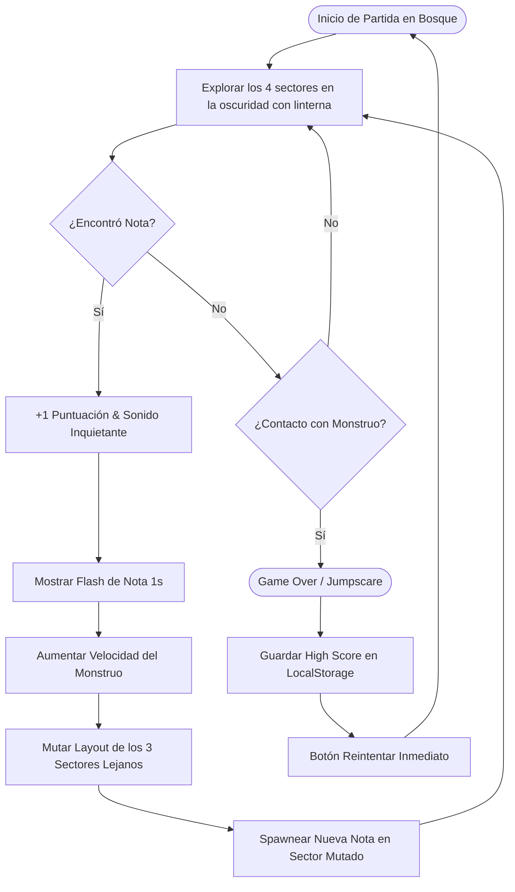
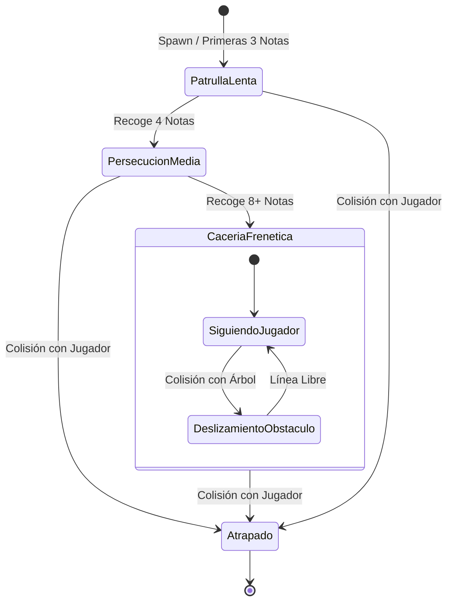

# Mecánicas y Entidades

Este documento detalla el bucle principal de juego (*Core Gameplay Loop*), las entidades principales y sus especificaciones técnicas de implementación en Godot 4.

---

## 1. Core Gameplay Loop



---

## 2. Especificación de Entidades

### 2.1. Jugador (`CharacterBody2D`)
> 📄 **Especificación completa:** Consulta **[Personaje y Habilidades](personaje_y_habilidades.md)** para el desglose detallado de atributos físicos, máquina de estados y arquitectura de nodos.

* **Movimiento:** 8 direcciones con aceleración y fricción altas (`5000 px/s²`) para un control preciso, responsivo y sin deslizamiento residual (`stop_threshold`).
* **Habilidad de Sprint:** Carrera temporal (`1000 px/s`) regulada por una **barra de estamina** recargable.
* **Iluminación (Linterna Decorativa):** Nodo `PointLight2D` siempre activo con halo de proximidad y orientación híbrida (apunta al cursor del ratón o se alinea con la dirección de movimiento si se juega solo con teclado).
* **Colisión:** `CollisionShape2D` compacto en los pies para evitar atascarse en esquinas y troncos.

### 2.2. El Monstruo (`CharacterBody2D` o `Area2D`)
* **IA de Persecución:** Movimiento vectorial directo hacia las coordenadas del jugador:
  ```gdscript
  var direccion = global_position.direction_to(jugador.global_position)
  velocity = direccion * velocidad_actual
  move_and_slide()
  ```
* **Comportamiento ante obstáculos:** Si choca contra un árbol, se desliza alrededor de él utilizando la física y colisiones nativas de Godot (`move_and_slide()`).
* **Feedback de proximidad:** Sonido ambiental gutural/estática o temblor leve de cámara cuando está dentro del radio de luz del jugador.

#### Diagrama de Estados del Monstruo


### 2.3. Sistema de Notas (`Area2D`)
* Existe **solo una nota en pantalla a la vez** para forzar al jugador a explorar y recorrer activamente los 4 sectores del mapa.
* Cada vez que se recoge una nota:
  1. Se reproduce un efecto sonoro tenso/desgarrador.
  2. Aumenta el contador de puntuación (+1).
  3. Aumenta la velocidad del enemigo en un multiplicador acumulativo.
  4. Dispara el **Flash de Nota** de 1 segundo en el centro de la pantalla.
  5. Se dispara la señal de mutación espacial: el gestor del mapa identifica el sector actual del jugador, preserva su distribución intacta y muta los otros **3 sectores lejanos**.
  6. La nueva nota aparece en uno de los puntos candidatos (`Marker2D`) ubicados dentro de los 3 sectores recién mutados, obligando al jugador a adentrarse en territorio reconfigurado.

### 2.4. El Bosque: Cuadrícula 2x2 de Sectores Mutables
* **Topología y Dimensiones:**
  - El bosque es una arena cerrada cuadrada de **$2160 \times 2160\text{ px}$** (equivalente a $2 \times 2$ pantallas/viewports completos de $1080 \times 1080\text{ px}$).
  - Se compone de 4 cuadrantes o partes conectadas sin muros ni costuras intermedias:
    - `Sector NO` (Noroeste): $[-1080, -1080]$ a $[0, 0]$
    - `Sector NE` (Noreste): $[0, -1080]$ a $[1080, 0]$
    - `Sector SO` (Suroeste): $[-1080, 0]$ a $[0, 1080]$
    - `Sector SE` (Sureste): $[0, 0]$ a $[1080, 1080]$
* **Mecánica de Mutación Dinámica por Página:**
  - Cada sector cuenta con un catálogo de **variantes de distribución prefabricadas** (sub-escenas o nodos con distintas configuraciones de árboles, rocas, troncos y puntos de spawn de notas).
  - Al recoger una nota:
    1. Se calcula el sector donde está ubicado el jugador según sus coordenadas globales.
    2. El sector del jugador **se mantiene intacto**, garantizando que ningún árbol u obstáculo aparezca repentinamente frente a su vista o sobre su colisión.
    3. Los **otros 3 sectores** reemplazan su distribución actual por otra variante aleatoria de su catálogo.
    4. **Salvaguarda para el Monstruo:** Si el monstruo se encuentra en uno de los 3 sectores mutados, su posición se valida con un radio libre de seguridad para evitar que quede atrapado dentro de una nueva colisión sólida.
* **Perímetro y Obstáculos:**
  - Bordes exteriores sellados por una valla perimetral de madera rota y árboles impenetrables con `StaticBody2D`.
  - Los obstáculos interiores (árboles densos, rocas y troncos caídos) proporcionan cobertura para romper la persecución directa del monstruo y realizar saltos evasivos (*Dive*).

#### Jerarquía de Nodos del Escenario (`escenas/escenario.tscn`)
```text
Escenario (Node2D) [scripts/escenario.gd]
├── Suelo (Sprite2D / Parallax / Tile - 2160x2160 px)
├── VallaPerimetral (StaticBody2D - colisiones en los 4 bordes exteriores)
└── Sectores (Node2D)
    ├── SectorNO (Marker2D / Node2D en [-540, -540]) -> Instancia Variante
    ├── SectorNE (Marker2D / Node2D en [ 540, -540]) -> Instancia Variante
    ├── SectorSO (Marker2D / Node2D en [-540,  540]) -> Instancia Variante
    └── SectorSE (Marker2D / Node2D en [ 540,  540]) -> Instancia Variante
```

### 2.5. Cámara Interactiva (`Camera2D`)
* **Filosofía:** En lugar de una cámara estática por habitación que causaría transiciones ciegas y muertes abruptas en las fronteras entre sectores durante sprints intensos, la cámara mantiene **seguimiento interactivo en tiempo real al jugador**.
* **Configuración en Escena (`escenas/camara.tscn`):**
  - Instanciada como hija del nodo `Personaje`.
  - `anchor_mode = ANCHOR_MODE_DRAG_CENTER`
  - **Límites Perimetrales:**
    - `limit_left = -1080`
    - `limit_top = -1080`
    - `limit_right = 1080`
    - `limit_bottom = 1080`
  - Los límites perimetrales aseguran que al explorar los extremos del bosque la cámara se detenga suavemente en la valla exterior, evitando mostrar áreas vacías fuera del mundo de juego.

