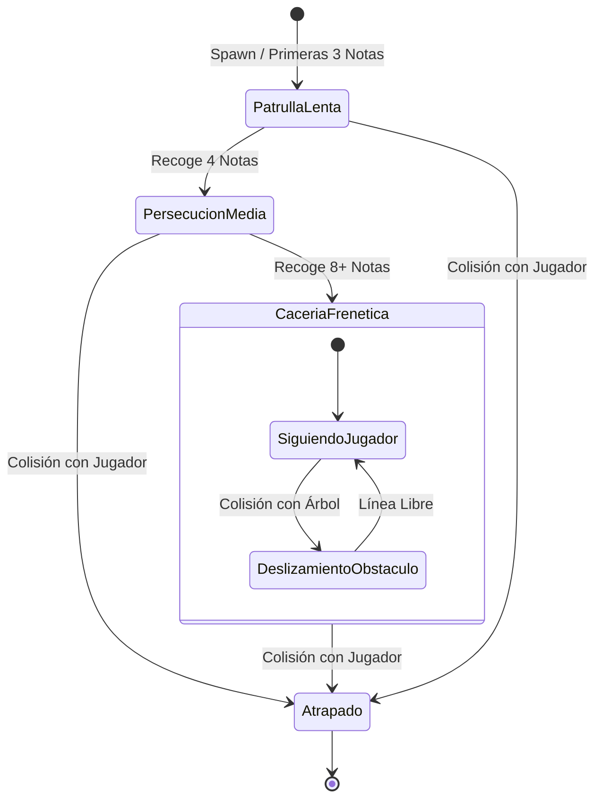

# Mecánicas y Entidades

Este documento detalla el bucle principal de juego (*Core Gameplay Loop*), las entidades principales y sus especificaciones técnicas de implementación en Godot 4.

---

## 1. Core Gameplay Loop


---

## 2. Especificación de Entidades

### 2.1. Jugador (`CharacterBody2D`)
> 📄 **Especificación completa:** Consulta **[Personaje y Habilidades](personaje_y_habilidades.md)** para el desglose detallado de atributos físicos, máquina de estados y arquitectura de nodos.

* **Movimiento:** 8 direcciones con aceleración y fricción altas (`5000 px/s²`) para un control preciso, responsivo y sin deslizamiento residual (`stop_threshold`).
* **Habilidad de Sprint:** Carrera temporal (`1000 px/s`) regulada por una **barra de estamina** recargable.
* **Iluminación (Linterna Decorativa):** Nodo `PointLight2D` siempre activo con halo de proximidad y orientación híbrida (apunta al cursor del ratón o se alinea con la dirección de movimiento si se juega solo con teclado).
* **Colisión:** `CollisionShape2D` compacto en los pies para evitar atascarse en esquinas y troncos.

### 2.2. El Monstruo (`CharacterBody2D` o `Area2D`)
* **IA de Persecución:** Movimiento vectorial directo hacia las coordenadas del jugador:
  ```gdscript
  var direccion = global_position.direction_to(jugador.global_position)
  velocity = direccion * velocidad_actual
  move_and_slide()
  ```
* **Comportamiento ante obstáculos:** Si choca contra un árbol, se desliza alrededor de él utilizando la física y colisiones nativas de Godot (`move_and_slide()`).
* **Feedback de proximidad:** Sonido ambiental gutural/estática o temblor leve de cámara cuando está dentro del radio de luz del jugador.

#### Diagrama de Estados del Monstruo


### 2.3. Sistema de Notas (`Area2D`)
* Existe **solo una nota en pantalla a la vez** para forzar al jugador a explorar y recorrer los 4 sectores del mapa activamente.
* **Jerarquía de la Escena (`escenas/nota.tscn`):**
  ```text
  Nota (Area2D) [Capa 5: Interactuables]
  ├── Sprite2D (Hoja ensangrentada / envejecida de 64x64 px)
  ├── CollisionShape2D (Círculo de radio 32 px)
  ├── LuzPropia (PointLight2D - Halo tenue blanco/amarillento de ~200 px con pulso suave)
  └── GPUParticles2D / CPUParticles2D (Partículas flotantes sutiles de polvo/brillo)
  ```
* **Visibilidad en Penumbra:**
  - La nota emite su propio resplandor pulsante (`PointLight2D`), actuando como una **baliza visual a media distancia** para que el jugador pueda orientarse hacia ella en la oscuridad sin necesidad de barrer a ciegas.
* **Proceso de Recolección Inmediata:**
  1. **Contacto:** Detección instantánea al entrar en contacto con el jugador (`body_entered`).
  2. **Feedback Sonoro:** Reproduce un acorde tenso, rasgado de papel o golpe de cuerda disonante.
  3. **Puntuación:** Incrementa el contador del HUD en $+1$.
  4. **Flash de Nota (1 segundo):** Muestra una ilustración siniestra en pantalla completa durante 1 segundo exacto sin congelar el juego (el monstruo sigue persiguiendo).
  5. **Escalado del Monstruo:** Aumenta la velocidad del enemigo según la fórmula exponencial.
  6. **Mutación Espacial:** Dispara la mutación de los **3 sectores lejanos** (donde no está el jugador).
  7. **Nueva Nota:** Se instancia una nueva nota en un `Marker2D` candidato de cualquiera de los 3 sectores recién mutados a una distancia $R_{\min} \ge 600\text{ px}$.

### 2.4. El Bosque: Cuadrícula 2x2 de Sectores Mutables
> 📄 **Especificación completa:** Consulta **[Mapa y Sectores](mapa_y_sectores.md)** para la topología matemática, arquitectura de sub-escenas de variantes, límites físicos/visuales, corredores de conectividad y matriz de capas de colisión.

* **Topología:** Arena cerrada continua de $2160 \times 2160\text{ px}$ dividida en 4 cuadrantes ($1080 \times 1080\text{ px}$ cada uno: `Sector NO`, `Sector NE`, `Sector SO`, `Sector SE`).
* **Mecánica de Mutación por Página:** Al recolectar una nota, el cuadrante del jugador permanece intacto mientras los otros **3 cuadrantes lejanos** reemplazan su sub-escena por otra variante aleatoria de árboles y obstáculos prefabricados.
* **Corredores Libres:** Franja de seguridad de $160\text{ px}$ en las intersecciones centrales ($X=0, Y=0$) para evitar bloqueos entre cuadrantes al mutar.
* **Límites Perimetrales:** `VallaPerimetral` fija (`StaticBody2D` en Capa 1: `Mundo_Alto`) en $[-1080, 1080]$ tanto en $X$ como en $Y$.
