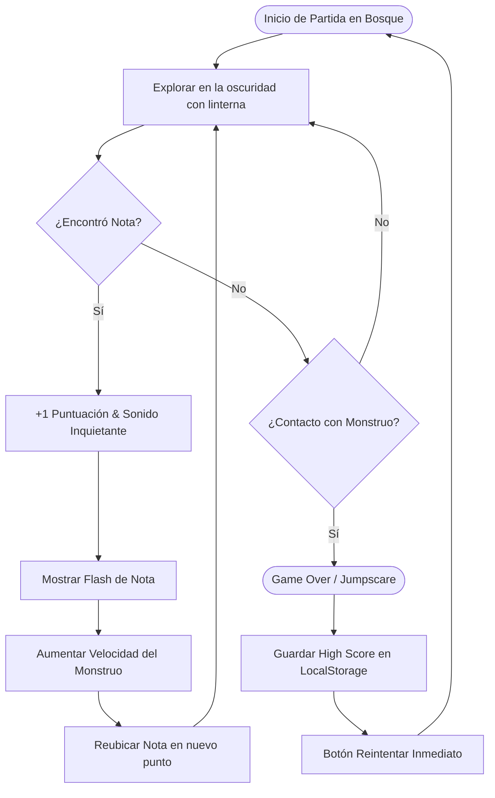
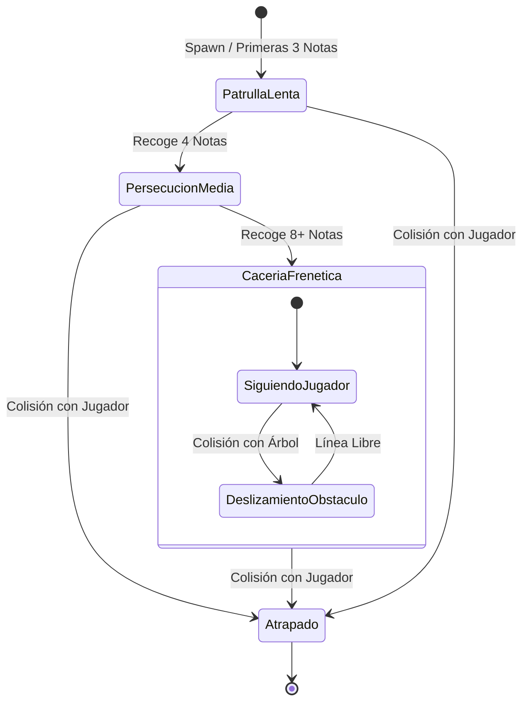

# Mecánicas y Entidades

Este documento detalla el bucle principal de juego (*Core Gameplay Loop*), las entidades principales y sus especificaciones técnicas de implementación en Godot 4.

---

## 1. Core Gameplay Loop



---

## 2. Especificación de Entidades

### 2.1. Jugador (`CharacterBody2D`)
* **Movimiento:** 8 direcciones con velocidad fija (sin aceleración resbaladiza para garantizar control preciso e instantáneo).
* **Iluminación:** Nodo `PointLight2D` con textura de degradado circular que simula el haz de una linterna con poco alcance.
* **Colisión:** `CollisionShape2D` circular pequeño en los pies para evitar atascarse en esquinas y troncos.

### 2.2. El Monstruo (`CharacterBody2D` o `Area2D`)
* **IA de Persecución:** Movimiento vectorial directo hacia las coordenadas del jugador:
  ```gdscript
  var direccion = global_position.direction_to(jugador.global_position)
  velocity = direccion * velocidad_actual
  move_and_slide()
  ```
* **Comportamiento ante obstáculos:** Si choca contra un árbol, se desliza alrededor de él utilizando la física y colisiones nativas de Godot (`move_and_slide()`).
* **Feedback de proximidad:** Sonido ambiental gutural/estática o temblor leve de cámara cuando está dentro del radio de luz del jugador.

#### Diagrama de Estados del Monstruo


### 2.3. Sistema de Notas (`Area2D`)
* Existe **solo una nota en pantalla a la vez** para forzar al jugador a explorar y recorrer el mapa activamente.
* Cada vez que se recoge una nota:
  1. Se reproduce un efecto sonoro tenso/desgarrador.
  2. Aumenta el contador de puntuación.
  3. Aumenta la velocidad del enemigo en un multiplicador fijo.
  4. La siguiente nota aparece en uno de varios puntos predefinidos (`Marker2D`) alejados de la posición actual del jugador.

### 2.4. El Bosque (Mapa Único)
* **Dimensiones:** Una arena cerrada de aproximadamente 2 pantallas de ancho por 2 de alto.
* **Límites:** Bordes sellados por una valla de madera rota o una hilera impenetrable de árboles.
* **Obstáculos:** Pequeñas agrupaciones de árboles, rocas y un tronco caído que sirven para cortar la línea de persecución del monstruo.
