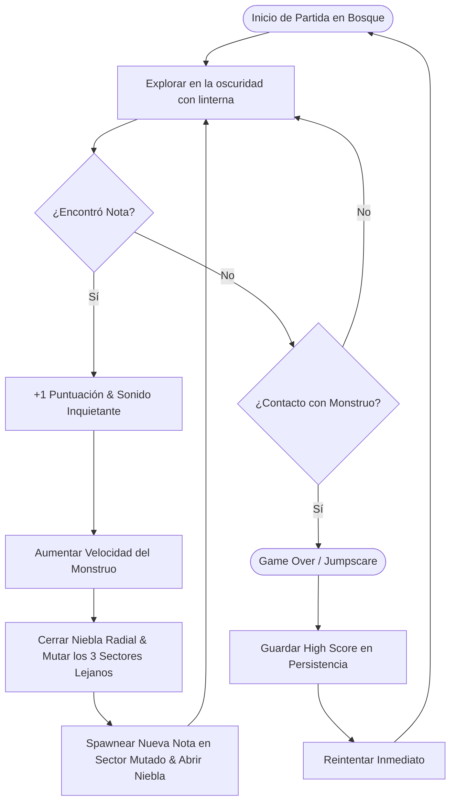

# Mecánicas y Entidades

Este documento detalla el bucle principal de juego (*Core Gameplay Loop*), las entidades principales y sus especificaciones técnicas de implementación en Godot 4.

---

## 1. Core Gameplay Loop



---

## 2. Especificación de Entidades

### 2.1. Jugador (`CharacterBody2D`)
> 📄 **Especificación completa:** Consulta [Personaje y Habilidades](personaje_y_habilidades.md) para el desglose detallado de atributos físicos, máquina de estados y arquitectura de nodos.

* **Movimiento:** 8 direcciones con aceleración y fricción altas (`5000 px/s²`) para control instantáneo y responsivo (`stop_threshold = 15 px/s`).
* **Habilidad de Sprint:** Carrera a `1000 px/s` regulada por estamina ($100\text{ pts}$ con consumo de $-25\text{ pts/s}$).
* **Salto Libre y Salto de Plancha (*Dive*):** Permite sortear obstáculos bajos (Capa 2) con una parábola en eje Z simulado ($0.45\text{ s}$ de vuelo) o plancha hacia adelante ($1200\text{ px/s}$) con inmovilidad de recuperación de $0.6\text{ s}$.
* **Iluminación:** `PointLight2D` frontal libremente orientable en $360^\circ$ más un halo de proximidad tenue en los pies.

---

### 2.2. El Monstruo (`CharacterBody2D`)
> 💻 **Script en motor:** [`scripts/enemigo.gd`](../../scripts/enemigo.gd)  
> 📄 **Fórmulas de balance:** [Dificultad y Balance](dificultad_y_balance.md)

* **Físicas e Inercia:**
  - `speed`: Inicia en $500.0\text{ px/s}$ y escala con las notas hasta un tope máximo de $920.0\text{ px/s}$.
  - `acceleration`: $3500.0\text{ px/s}^2$ constantes (giro con inercia controlada, permitiendo al jugador sacarle ventaja en curvas cerradas).
  - `motion_mode`: `MOTION_MODE_FLOATING`.
* **Geometría de Detección y Colisión:**
  - **Colisión Física:** Radio circular de $42.0\text{ px}$ con `move_and_slide()` que choca contra Capa 1 (`Mundo_Alto`) y Capa 2 (`Obstaculos_Bajos`).
  - **Área de Captura Letal (`Area2D`):** Radio de detección de $56.0\text{ px}$. Si el cuerpo del jugador penetra este círculo y no tiene `god_mode`, dispara instantáneamente el Game Over.
* **Línea de Visión (`RayCastVision`):**
  - Nodo `RayCast2D` interno en Capa 1 que apunta dinámicamente hacia las coordenadas globales del jugador.
  - Variable booleana `tiene_linea_vision`: si el rayo choca con un árbol, se marca como obstruido.
* **Desatasco Tangencial (*Steering* Liviano):**
  - Si el monstruo no tiene línea de visión y su velocidad real cae por debajo del $30\%$ de su velocidad máxima debido a un choque perpendicular con un árbol, añade un vector tangencial ($\pm 45^\circ$) hacia la arista libre para continuar la persecución sin congelarse.
* **Representación Visual y Rotación Continua:**
  - El nodo visual rota matemáticamente hacia el ángulo de movimiento:
    ```gdscript
    if velocity.length_squared() > 1.0:
        _visual.rotation = velocity.angle()
    ```
  - **Ojos Reflectantes:** Par de puntos emisivos visibles en penumbra para alertar al jugador antes de que la silueta sea iluminada por la linterna.

---

### 2.3. Sistema de Notas Coleccionables Arcade (`Area2D`)
> 📄 **Especificación técnica completa:** [Sistema de Notas y Spawner](sistema_de_notas_y_spawner.md)

* Solo **1 nota activa a la vez** en todo el mapa.
* Emite un resplandor pulsante (`PointLight2D`) que actúa como faro orientativo en la oscuridad.
* **Recolección Instantánea:** Al tocarla, emite la señal, reproduce el rasgado sonoro, suelta partículas doradas y se libera con `queue_free()`, disparando el incremento de velocidad del monstruo y la mutación bajo niebla.

---

### 2.4. El Bosque Mutable (Arena 2x2)
> 📄 **Especificación completa:** [Mapa y Sectores](mapa_y_sectores.md)

* Cuadrícula simétrica de $4320 \times 4320\text{ px}$ dividida en 4 cuadrantes.
* Al recoger una nota, se mutan las variantes de los **3 sectores lejanos** bajo el iris radial de `EfectoNieblaMutacion`.
* Corredores de seguridad de $160\text{ px}$ en $X=0, Y=0$ para garantizar transitabilidad permanente.
