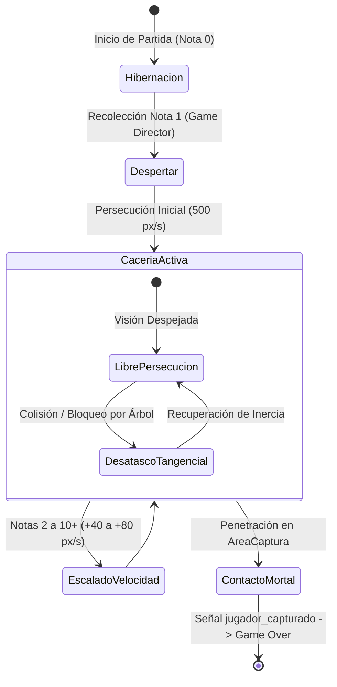

# La Criatura (Monstruo) y Sistema de IA

Este documento detalla la arquitectura, estados de comportamiento, cinemática, percepción sensorial y especificaciones técnicas de implementación en Godot 4 del antagonista de **Vosque**.

> 💻 **Script en motor:** [`scripts/enemigo.gd`](../../scripts/enemigo.gd)  
> 🎭 **Escena:** [`escenas/enemigo.tscn`](../../escenas/enemigo.tscn)  
> ⚖️ **Fórmulas y escalado:** [Dificultad y Balance](dificultad_y_balance.md)

---

## 1. Identidad y Filosofía de Diseño

* **Rol:** Amenaza implacable, solitaria y opresiva. En una arena cerrada de $4320 \times 4320\text{ px}$, la criatura actúa como el motor de tensión constante del *Core Gameplay Loop*.
* **Asimetría Mecánica:** El monstruo no puede saltar obstáculos ni posee sprint temporal; en su lugar, cuenta con persecución inagotable, rotación omnidireccional $360^\circ$ y una velocidad sostenida que escala progresivamente hasta rozar la velocidad máxima de escape del jugador.
* **Clase Base en Motor:** `CharacterBody2D` configurado con modo flotante (`motion_mode = MOTION_MODE_FLOATING`), optimizado para desplazamientos cenitales continuos con `move_and_slide()`.

---

## 2. Ciclo de Vida y Fases de Activación

El monstruo implementa un modelo de transición de dos fases para balancear la curva de aprendizaje inicial y optimizar el rendimiento en compilaciones Web (HTML5/WASM):



### 2.1. Fase Tutorial / Zona Segura (Nota 0)
* **Objetivo de Diseño:** Permitir al jugador familiarizarse con los controles básicos (<kbd>W</kbd><kbd>A</kbd><kbd>S</kbd><kbd>D</kbd>), el salto parabólico de troncos y el sprint antes de introducir la amenaza.
* **Hibernación Total en Motor:** Para evitar caídas de fotogramas (*frame drops*) o demoras por compilación de shaders al instanciar nodos en WebGL en medio de la partida:
  - El nodo `Enemigo` preexiste en el árbol de escenas desde el arranque.
  - `visible = false`.
  - `process_mode = Node.PROCESS_MODE_DISABLED`.
  - Posición de espera en coordenadas fuera de mapa: `Vector2(-99999, -99999)`.

### 2.2. El Despertar (Nota 1)
* Al recolectar la primera página, el `Game Director` (`scripts/maain.gd`):
  1. Identifica un punto de spawn seguro fuera de pantalla (cuadrante distante a $\ge 800\text{ px}$ del jugador).
  2. Reposiciona la entidad en ese punto.
  3. Restaura `visible = true` y `process_mode = Node.PROCESS_MODE_INHERIT`.
  4. Inicia la persecución a la velocidad base de $500.0\text{ px/s}$.

---

## 3. Parámetros Físicos y Cinemática

| Propiedad | Tipo | Valor | Unidad | Descripción |
| :--- | :--- | :---: | :---: | :--- |
| `speed` | `float` | $500.0 \to 920.0$ | $\text{px/s}$ | Velocidad máxima de avance (escala según notas recogidas). |
| `acceleration` | `float` | $3500.0$ | $\text{px/s}^2$ | Tasa de aceleración lineal e inercia de viraje. |
| `motion_mode` | `MotionMode` | `FLOATING` | — | Movimiento 2D sin gravedad. |
| `stop_threshold` | `float` | $10.0$ | $\text{px/s}$ | Umbral de detención completa. |

```gdscript
# Cálculo de aceleración continua hacia el jugador
var direccion: Vector2 = (posicion_jugador - global_position).normalized()
velocity = velocity.move_toward(direccion * speed, acceleration * delta)
move_and_slide()
```

* **Inercia y Viraje:** Con `acceleration = 3500 px/s²`, el monstruo posee un ligero radio de giro al cambiar de sentido bruscamente, lo que recompensa al jugador por doblar en esquinas cerradas entre árboles y rocas.

---

## 4. Geometría de Colisión y Detección

El enemigo cuenta con dos áreas concéntricas con propósitos claramente desacoplados:

```text
       ┌────────────────────────────────┐
       │     AreaCaptura (Radio 56px)   │ <── Gatillo de Muerte Inmediata
       │    ┌──────────────────────┐    │
       │    │ Colisión Física (42px│    │ <── Cuerpo Sólido (move_and_slide)
       │    │       (Centro)       │    │
       │    └──────────────────────┘    │
       └────────────────────────────────┘
```

### 4.1. Colisión Física Sólida (`CollisionShape2D`)
* **Radio:** $42.0\text{ px}$ (forma circular).
* **Capas de Colisión Activas:** 
  - Capa 1: `Mundo_Alto` (árboles densos, rocas grandes, valla perimetral).
  - Capa 2: `Obstaculos_Bajos` (troncos caídos, tocones).
* **Implicación Táctica del Salto:** Debido a que el monstruo choca obligatoriamente contra la Capa 2, **no puede atravesar los troncos caídos**, debiendo rodearlos. El jugador, al saltar o lanzarse en plancha (*Dive*), desactiva temporalmente la colisión con la Capa 2, ganando metros vitales de ventaja.

### 4.2. Área de Captura Letal (`Area2D`)
* **Radio:** $56.0\text{ px}$ (ligeramente mayor al cuerpo físico).
* **Máscara de Colisión:** Capa 3 (`Jugador`).
* **Protocolo de Contacto:**
  - Al detectar `body_entered` del protagonista, emite la señal `jugador_capturado`.
  - Verifica si `DebugConfig.god_mode` está activo; si no lo está, delega al Game Director la congelación inmediata y la transición a la pantalla de Game Over.

---

## 5. Percepción Sensorial y Desatasco (*Steering*)

### 5.1. Línea de Visión (`RayCastVision`)
* Nodo `RayCast2D` interno con máscara fijada en Capa 1 (`Mundo_Alto`).
* Se reorienta cada fotograma de físicas hacia el centro del protagonista:
  ```gdscript
  raycast_vision.target_position = to_local(posicion_jugador)
  var tiene_linea_vision: bool = not raycast_vision.is_colliding()
  ```
* Se utiliza para alertar al sistema de audio (respiración más intensa cuando hay contacto visual directo).

### 5.2. Desatasco Tangencial (*Steering* Liviano)
Si el monstruo persigue en línea recta hacia el jugador pero su trayectoria impacta perpendicularmente contra un árbol ancho:
1. Detecta si `velocity.length() < speed * 0.3` de forma continuada mientras intenta avanzar.
2. Si la línea de visión está obstruida y `is_on_wall()` es verdadero, proyecta dos vectores tangenciales a $\pm 45^\circ$ respecto a la normal del muro.
3. Elige la rama abierta con menor distancia al objetivo y suma ese componente a la velocidad para deslizarse por la arista del obstáculo sin congelarse.

---

## 6. Representación Visual y Audio Reactivo

### 6.1. Orientación Continua en $360^\circ$
Para minimizar assets de dibujo (ver [Guía de Estilo y Assets](../arte/guia_estilo_y_assets.md)), el sprite se dibuja en una única vista horizontal ($+X$, $0^\circ$) y Godot lo orienta matemáticamente:
```gdscript
if velocity.length_squared() > 1.0:
    _visual.rotation = velocity.angle()
```

### 6.2. Ojos Reflectantes en Penumbra
* Dos puntos emisivos configurados con material sin sombreado (`unshaded`) o textura aditiva tenue.
* Permiten al jugador vislumbrar el destello de la mirada de la bestia en la penumbra ambiental (`CanvasModulate`) antes de que su cuerpo completo entre en el cono de la linterna.

### 6.3. Radar de Proximidad y Audio
* El monstruo no requiere emitters complejos: el script [`audio_y_feedback.gd`](../interfaz_y_audio/audio_y_feedback.md) consulta periódicamente la distancia euclidiana entre el jugador y el monstruo:
  - $\ge 1200\text{ px}$: Silencio / Paisaje sonoro del viento.
  - $1200 \to 600\text{ px}$: Latidos cardíacos y pisadas lejanas en hojarasca.
  - $< 600\text{ px}$: Respiración gutural cercana, aumento del tempo del audio y vibración sutil de cámara.

---

## 7. Telemetría y Controles de Depuración

A través del **Menú de Debug F3** ([`docs/herramientas/menu_debug_ingame.md`](../herramientas/menu_debug_ingame.md)):
* **Casilla `[x] Congelar IA / Inactivo`:** Anula la velocidad y desactiva el `AreaCaptura` para probar movimiento y saltos libremente.
* **Selector de Fase (Notas 0 a 10+):** Permite calibrar en caliente cualquier escalón de velocidad sin recolectar notas manualmente.
* **Visualización Táctica en Mundo (`DebugOverlay`):**
  - Círculo rojo de $56\text{ px}$ (`AreaCaptura`).
  - Círculo ámbar de $42\text{ px}$ (Colisión física).
  - Rayo de visión en tiempo real (Verde: directo, Rojo: obstruido).
  - Vector directriz de velocidad y estela de desplazamiento (*breadcrumbs* de 2 segundos).
* **Botón "Reubicar Monstruo":** Teletransporta a la criatura a un cuadrante seguro.
