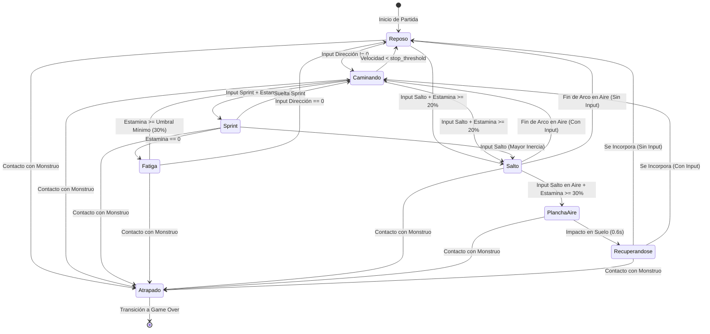

# Personaje y Habilidades

Este documento define la identidad, parámetros físicos, mecánicas de movimiento, habilidades y arquitectura técnica en Godot 4 del protagonista de **Vosque**.

---

## 1. Identidad y Perfil de Juego

* **Rol:** Explorador desorientado atrapado en un bosque oscuro y cerrado.
* **Filosofía de Diseño:** Vulnerabilidad total frente a la amenaza. El jugador carece de armas o ataques; su supervivencia depende exclusivamente del posicionamiento espacial, el aprovechamiento de obstáculos (árboles, rocas, troncos), la gestión de su estamina al correr y la lectura de su entorno iluminado.
* **Clase Base en Motor:** `CharacterBody2D` con modo de movimiento flotante (`MOTION_MODE_FLOATING`), optimizado para desplazamientos top-down de 8 direcciones sin gravedad vertical.

---

## 2. Atributos y Parámetros Físicos

El movimiento del personaje está gobernado por un modelo de velocidad con aceleración y fricción continuas ([`scripts/personaje.gd`](../../scripts/personaje.gd)), lo que proporciona un control responsivo pero con peso físico tangible.

### 2.1. Propiedades Exportadas (`@export`)

| Grupo / Propiedad | Tipo | Valor por Defecto | Unidad | Descripción |
| :--- | :--- | :--- | :--- | :--- |
| **Físicas de Movimiento** | | | | |
| `speed` | `float` | `800.0` | $\text{px/s}$ | Velocidad máxima de desplazamiento estándar al caminar. |
| `sprint_speed` | `float` | `1000.0` | $\text{px/s}$ | Velocidad máxima al sostener el botón de sprint. |
| `acceleration` | `float` | `5000.0` | $\text{px/s}^2$ | Tasa de incremento de velocidad al presionar una dirección. |
| `friction` | `float` | `5000.0` | $\text{px/s}^2$ | Tasa de desaceleración al soltar los controles de dirección. |
| `stop_threshold` | `float` | `15.0` | $\text{px/s}$ | Umbral mínimo por debajo del cual la velocidad se fuerza a `Vector2.ZERO`. |
| **Estamina y Fatiga** | | | | |
| `max_stamina` | `float` | `100.0` | $\text{pts}$ | Capacidad máxima del depósito de estamina. |
| `sprint_drain_rate` | `float` | `25.0` | $\text{pts/s}$ | Consumo continuo de estamina durante el sprint ($4.0\text{ s}$ continuos). |
| `stamina_regen_rate` | `float` | `20.0` | $\text{pts/s}$ | Tasa de regeneración continua de estamina ($5.0\text{ s}$ de $0$ a $100\%$). |
| `stamina_regen_delay` | `float` | `0.8` | $\text{s}$ | Tiempo de espera tras gastar estamina antes de iniciar la recarga. |
| `fatigue_recovery_threshold` | `float` | `30.0` | $\text{pts}$ | Umbral mínimo necesario para salir del estado de fatiga. |
| **Salto y Plancha (Dive)** | | | | |
| `jump_stamina_cost` | `float` | `20.0` | $\text{pts}$ | Coste instantáneo de estamina al despegar en salto libre. |
| `jump_duration` | `float` | `0.45` | $\text{s}$ | Duración temporal total del arco de salto libre en el aire. |
| `jump_height` | `float` | `56.0` | $\text{px}$ | Altura visual máxima simulada en el vértice del salto (eje $-Y$). |
| `shadow_min_scale` | `Vector2` | `Vector2(0.6, 0.6)` | — | Escala mínima de la sombra en el suelo al alcanzar la altura máxima. |
| `dive_stamina_cost` | `float` | `30.0` | $\text{pts}$ | Coste instantáneo de estamina al lanzarse en plancha desde el aire. |
| `dive_speed` | `float` | `1200.0` | $\text{px/s}$ | Velocidad inicial de impulso horizontal al ejecutar la plancha. |
| `dive_recovery_duration` | `float` | `0.6` | $\text{s}$ | Tiempo de inmovilidad y vulnerabilidad en suelo tras la plancha. |
| `dive_slide_friction` | `float` | `2200.0` | $\text{px/s}^2$ | Fricción de desaceleración del deslizamiento por inercia en suelo. |

### 2.2. Presets de Herramienta (`addons/personaje_tools`)

El proyecto cuenta con un plugin de editor dedicado (`character_bar.gd`) que permite calibrar en tiempo real los perfiles de movimiento del personaje mediante tres presets de referencia:

| Preset | `speed` ($\text{px/s}$) | `acceleration` ($\text{px/s}^2$) | `friction` ($\text{px/s}^2$) | Uso / Contexto |
| :--- | :--- | :--- | :--- | :--- |
| **Sigilo** | `150.0` | `800.0` | `1000.0` | Desplazamiento lento o estado de fatiga/cautela. |
| **Normal** | `800.0` | `5000.0` | `5000.0` | Velocidad estándar de exploración durante la partida. |
| **Sprint** | `1000.0` | `5000.0` | `5000.0` | Velocidad máxima al activar la habilidad de carrera. |

### 2.3. Colisión Física y Despenetración en Obstáculos Bajos
* **Nodo:** `CollisionShape2D` circular compacto centrado en la base/pies del personaje.
* **Máscaras de Colisión:**
  * En suelo: Activas Capa 1 (`Mundo_Alto`) y Capa 2 (`Obstaculos_Bajos`).
  * En aire (Salto / Plancha): Capa 2 desactivada (`set_collision_mask_value(2, false)`), Capa 1 siempre activa.
* **Regla de Despenetración de Seguridad:** Al expirar el tiempo de vuelo, la colisión con la Capa 2 se reactiva. Si el personaje cae directamente sobre el colisionador de un obstáculo bajo (ej. tronco caído), el motor aplica el deslizamiento suave con `move_and_slide()` desplazando al personaje hacia la arista exterior más próxima sin atraparlo.

---

## 3. Catálogo de Habilidades y Mecánicas

### 3.1. Locomoción en 8 Direcciones (Habilidad Base)
* **Funcionamiento:** Lectura vectorial normalizada mediante `Input.get_vector("personaje-izquierda", "personaje-derecha", "personaje-arriba", "personaje-abajo")`.
* **Normalización Diagonal:** El vector de entrada tiene longitud máxima $1.0$, garantizando que moverse en diagonal no otorgue ventaja de velocidad sobre el movimiento ortogonal.
* **Respuesta:** Gracias a la alta aceleración y fricción (`5000 px/s²`), los cambios de dirección para esquivar al monstruo son casi instantáneos.

### 3.2. Sprint y Barra de Estamina (Habilidad Activa)
* **Propósito:** Permitir al jugador romper la distancia o escapar de emboscadas críticas, especialmente en las fases avanzadas (*Persecución Media* y *Cacería Frenética* con 4+ notas) donde el monstruo iguala o supera la velocidad base de caminata.
* **Mecánica de Consumo:**
  * Al mantener presionada la acción de sprint (`Shift`) en movimiento, la velocidad objetivo pasa a `1000 px/s`.
  * Se consume estamina a una tasa de $-25\text{ pts/s}$. Si llega a $0$, entra en estado `FATIGA`.
  * Al agotarse o soltar el sprint, se aplica un retardo de regeneración de $0.8\text{ s}$ (`stamina_regen_delay`) antes de recuperar estamina a $+20\text{ pts/s}$.
* **Umbral de Fatiga:** Durante la fatiga, el sprint y el salto están bloqueados. El jugador debe esperar hasta recuperar al menos $30\text{ pts}$ (`fatigue_recovery_threshold`) para volver a realizar maniobras ágiles.

### 3.3. Salto Libre y Salto de Plancha (*Dive* en el Aire)
* **Propósito:** Mecánica evasiva y de riesgo/recompensa de alta tensión que permite sortear obstáculos bajos y zafarse de emboscadas in extremis.
* **Fase 1: Salto Libre (Despegue en Suelo):**
  * Se activa pulsando `Espacio` mientras el personaje está en el suelo y posee estamina suficiente ($\ge 20\text{ pts}$).
  * Consume $20\text{ pts}$ de estamina instantáneos.
  * **Eje Z Simulado:** En el plano 2D, se calcula una curva parabólica normalizada para la elevación del nodo contenedor visual:
    $$u = \text{clamp}\left(\frac{t_{\text{aire}}}{t_{\text{duracion}}}, 0.0, 1.0\right), \quad \text{factor\_altura} = 4u(1 - u)$$
    $$\text{Visual.position.y} = -\text{jump\_height} \times \text{factor\_altura}$$
  * La `Sombra` proyectada en el suelo se mantiene en el plano base y reduce su escala armónicamente:
    $$\text{Sombra.scale} = \text{Vector2.ONE.lerp}(\text{shadow\_min\_scale}, \text{factor\_altura})$$
  * **Superación de Obstáculos Bajos:** Durante el vuelo ($0.45\text{ s}$), el personaje desactiva la colisión con la Capa 2 (`Obstaculos_Bajos`), permitiendo cruzar troncos caídos y piedras mientras que el monstruo debe rodearlos.
* **Fase 2: Salto de Plancha (*Dive* en el Aire):**
  * Si el jugador vuelve a presionar `Espacio` en el aire (y tiene al menos $30\text{ pts}$ de estamina adicional), se lanza en plancha hacia adelante.
  * Otorga un fuerte estirón direccional instantáneo alcanzando $\approx 1200\text{ px/s}$ en la dirección de movimiento o última dirección registrada.
  * Consume $30\text{ pts}$ de estamina adicional.
* **Fase 3: Impacto en Suelo y Recuperación (*Recovery Window*):**
  * Al expirar el tiempo de plancha, el personaje entra en el estado `RECUPERANDOSE` durante $0.6\text{ s}$ (`dive_recovery_duration`).
  * Desacelera con fricción de arrastre (`dive_slide_friction = 2200 px/s²`) y queda completamente incapacitado para moverse mientras se incorpora.
  * **Vulnerabilidad Total:** Si el monstruo se encuentra demasiado cerca, alcanzará al jugador indefenso, culminando en Game Over.

### 3.4. Linterna Atmosférica y Desacople de Orientación

> 💡 **Especificación completa:** Ver [Sistema de Iluminación](sistema_de_iluminacion.md) para detalles de presupuesto WebGL, generación procedural del haz cónico y perturbación electromagnética.

* **Comportamiento:** La linterna es un elemento **decorativo y atmosférico siempre activo**. No requiere recarga de baterías ni posee interruptor de apagado manual.
* **Estructura de Iluminación Optimizada para Web:**
  1. **Halo Corporal Aditivo (`HaloCorporal`):** Para economizar pases de renderizado en WebGL 2.0 (`gl_compatibility`), se implementa como un `Sprite2D` radial translúcido con material `CanvasItemMaterial(blend_mode = BLEND_MODE_ADD)`, proporcionando iluminación suave en los pies sin generar un pase de luz real en GPU.
  2. **Haz Direccional (`LinternaFrontal`):** Un nodo `PointLight2D` frontal (sin sombras dinámicas `shadow_enabled = false`) con textura cónica procedural ($60^\circ$ de apertura, $700\text{ px}$ de alcance) que proyecta visión a media distancia hacia donde apunta. Ambos se organizan bajo `PivoteLinterna`.
* **Desacople y Conmutación Inteligente de Orientación:**
  - El sprite del personaje orienta sus animaciones según el vector de entrada de movimiento (`velocity`).
  - **Detección Dinámica de Entrada (Ratón vs. Teclado):** Para evitar que en Web la linterna quede anclada a la última posición estática del cursor tras hacer clic en la pantalla de inicio:
    - Se registra el tiempo del último evento `InputEventMouseMotion` con desplazamiento significativo ($> 4\text{ px}$).
    - **Modo Ratón Activo:** Si hubo movimiento de ratón reciente ($< 1.5\text{ s}$), el haz apunta a `get_global_mouse_position()`.
    - **Modo Teclado Puro:** Si no hay movimiento de ratón reciente o el jugador se desplaza solo con teclado, la linterna interpola suavemente su rotación (`slerp` o `rotate_toward`) hacia el ángulo de la velocidad de marcha (`velocity.angle()`) o la última dirección registrada.

---

## 4. Máquina de Estados del Personaje (FSM)



---

## 5. Arquitectura Técnica en Godot 4

### 5.1. Jerarquía de Escena (`escenas/personaje.tscn`)

```text
Personaje (CharacterBody2D) [scripts/personaje.gd, y_sort_enabled=true]
├── Sombra (Node2D)                     # Sprite/óvalo en suelo (nodo hermano de Visual)
├── Visual (Node2D)                     # Contenedor para elevación en eje Z durante salto
│   └── Sprite2D (AnimatedSprite2D)     # Animaciones y vistas direccionales (pivote en pies)
├── CollisionShape2D                    # Colisión física circular compacta en los pies
├── PivoteLinterna (Node2D)             # Contenedor orientable 360° desacoplado
│   ├── LinternaFrontal (PointLight2D)  # Haz cónico procedural orientable hacia el ratón/marcha
│   └── HaloCorporal (Sprite2D)         # Halo radial translúcido aditivo (BLEND_MODE_ADD)
├── Camera2D                            # Cámara principal de seguimiento
└── AudioPasos (AudioStreamPlayer2D)    # Reproductor de pisadas en hojarasca
```

* **Gestión de Pivote y Profundidad:** El nodo raíz `Personaje` y el mapa tienen `y_sort_enabled = true`. El pivote del sprite se ubica exactamente en la base de los pies para ordenar correctamente el renderizado delante o detrás de los árboles.
* **Independencia de Sombra:** La `Sombra` es hermana de `Visual`. Al elevarse `Visual.position.y`, la sombra permanece anclada al suelo físico y únicamente modula su escala.
