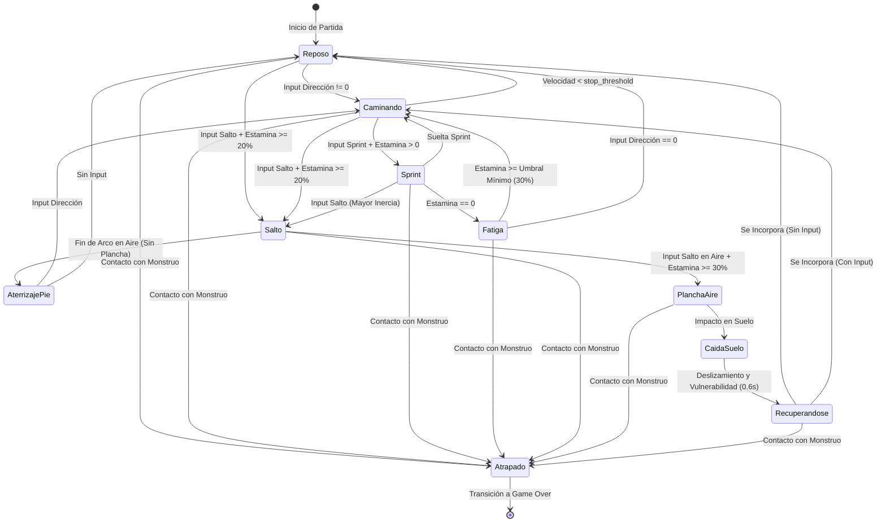

# Personaje y Habilidades

Este documento define la identidad, parámetros físicos, mecánicas de movimiento, habilidades y arquitectura técnica en Godot 4 del protagonista de **Vosque**.

---

## 1. Identidad y Perfil de Juego

* **Rol:** Explorador desorientado atrapado en un bosque oscuro y cerrado.
* **Filosofía de Diseño:** Vulnerabilidad total frente a la amenaza. El jugador carece de armas o ataques; su supervivencia depende exclusivamente del posicionamiento espacial, el aprovechamiento de obstáculos (árboles, rocas, troncos), la gestión de su estamina al correr y la lectura de su entorno iluminado.
* **Clase Base en Motor:** `CharacterBody2D` con modo de movimiento flotante (`MOTION_MODE_FLOATING`), optimizado para desplazamientos top-down de 8 direcciones sin gravedad vertical.

---

## 2. Atributos y Parámetros Físicos

El movimiento del personaje está gobernado por un modelo de velocidad con aceleración y fricción continuas (`scripts/personaje.gd`), lo que proporciona un control responsivo pero con peso físico tangible.

### 2.1. Propiedades Exportadas (`@export`)

| Propiedad | Valor Base (Script) | Valor en Escena (`maain.tscn`) | Unidad | Descripción |
| :--- | :--- | :--- | :--- | :--- |
| `speed` | `300.0` | `800.0` | $\text{px/s}$ | Velocidad máxima de desplazamiento estándar al caminar. |
| `acceleration` | `3000.0` | `5000.0` | $\text{px/s}^2$ | Tasa de incremento de velocidad al presionar una dirección. |
| `friction` | `3000.0` | `5000.0` | $\text{px/s}^2$ | Tasa de desaceleración al soltar los controles de dirección. |
| `stop_threshold` | `15.0` | `15.0` | $\text{px/s}$ | Umbral mínimo por debajo del cual la velocidad se fuerza a `Vector2.ZERO` para evitar micro-deslizamientos. |

### 2.2. Presets de Herramienta (`addons/personaje_tools`)

El proyecto cuenta con un plugin de editor dedicado (`character_bar.gd`) que permite calibrar en tiempo real los perfiles de movimiento del personaje mediante tres presets de referencia:

| Preset | `speed` ($\text{px/s}$) | `acceleration` ($\text{px/s}^2$) | `friction` ($\text{px/s}^2$) | Uso / Contexto |
| :--- | :--- | :--- | :--- | :--- |
| **Sigilo** | `150.0` | `800.0` | `1000.0` | Desplazamiento lento o estado de fatiga/cautela. |
| **Normal** | `800.0` | `5000.0` | `5000.0` | Velocidad estándar de exploración durante la partida. |
| **Sprint** | `1000.0` | `5000.0` | `5000.0` | Velocidad máxima al activar la habilidad de carrera. |

### 2.3. Colisión Física
* **Nodo:** `CollisionShape2D`.
* **Forma:** Circular o rectangular compacta centrada en la base/pies del personaje.
* **Propósito:** Evitar que el jugador se atasque en las esquinas de los troncos de árboles o bordes de rocas durante persecuciones a alta velocidad, permitiendo que `move_and_slide()` deslice suavemente al personaje alrededor de los obstáculos.

---

## 3. Catálogo de Habilidades y Mecánicas

### 3.1. Locomoción en 8 Direcciones (Habilidad Base)
* **Funcionamiento:** Lectura vectorial normalizada mediante `Input.get_vector("personaje-izquierda", "personaje-derecha", "personaje-arriba", "personaje-abajo")`.
* **Normalización Diagonal:** El vector de entrada tiene longitud máxima $1.0$, garantizando que moverse en diagonal no otorgue ventaja de velocidad sobre el movimiento ortogonal.
* **Respuesta:** Gracias a la alta aceleración y fricción (`5000 px/s²`), los cambios de dirección para esquivar al monstruo son casi instantáneos.

### 3.2. Sprint y Barra de Estamina (Habilidad Activa)
* **Propósito:** Permitir al jugador romper la distancia o escapar de emboscadas críticas, especialmente en las fases avanzadas (*Persecución Media* y *Cacería Frenética* con 4+ notas) donde el monstruo iguala o supera la velocidad base de caminata.
* **Mecánica de Consumo y Parámetros Cuantitativos:**
  - **Capacidad Máxima:** $100.0\text{ puntos}$ de estamina.
  - Al mantener presionada la acción de Sprint mientras el personaje se mueve, la velocidad máxima pasa del valor **Normal** (`800 px/s`) al valor **Sprint** (`1000 px/s`).
  - **Tasa de Consumo:** $-25.0\text{ pts/s}$ continuos (permite un sprint continuo máximo de $4.0\text{ segundos}$ desde barra llena).
  - **Reutilización de Sprites:** El sprint no requiere animación propia dibujada; acelera el ciclo de caminata en motor (`speed_scale = 1.6`) con una inclinación procedural de $5^\circ$.
* **Mecánica de Recuperación y Fatiga:**
  - **Retardo de Regeneración (*Regen Delay*):** Al soltar el botón de Sprint (o detenerse), la barra espera $0.8\text{ s}$ antes de iniciar la recarga.
  - **Tasa de Regeneración:** $+20.0\text{ pts/s}$ continuos (recarga completa de $0\%$ a $100\%$ en $5.0\text{ segundos}$).
  - **Coste de Salto Libre:** $-20.0\text{ pts}$ instantáneos al despegar.
  - **Coste de Plancha (*Dive*):** $-30.0\text{ pts}$ instantáneos adicionales al lanzarse en el aire.
  - **Agotamiento (Fatiga):** Si la estamina llega a $0.0$, el sprint se desactiva forzosamente y el jugador queda en estado de fatiga. No podrá volver a correr ni saltar hasta que la barra recupere al menos el **umbral de seguridad del $30.0\%$** ($30\text{ pts}$), evitando el *spam* de micro-sprints.

### 3.3. Salto Libre y Salto de Plancha (*Dive* en el Aire)
* **Propósito:** Mecánica evasiva y de riesgo/recompensa de alta tensión que permite sortear obstáculos bajos y zafarse de emboscadas in extremis.
* **Fase 1: Salto Libre (Despegue en Suelo):**
  - Se activa pulsando la tecla de salto (`Espacio`) mientras el personaje está en el suelo y posee estamina suficiente ($\ge 20\%$).
  - Consume un $20\%$ de estamina base.
  - **Eje Z Simulado y Visuales Minimalistas:** En el plano 2D, se utiliza $1$ solo cuadro estático con rodillas flexionadas (`jugador_salto_aire`). La elevación física se simula mediante una parábola vertical en `position.y` del nodo visual, encogiendo proceduralmente el sprite elíptico de la sombra en el suelo (`jugador_sombra`).
  - **Superación de Obstáculos Bajos:** Durante el vuelo ($\approx 0.45\text{ s}$), el personaje desactiva temporalmente la colisión con obstáculos bajos (como troncos caídos y piedras pequeñas), permitiendo cruzarlos mientras que el monstruo debe rodearlos. Los árboles altos y los límites perimetrales del bosque mantienen su colisión física total en todo momento.
  - Si aterriza sin realizar ninguna maniobra adicional, toca tierra de pie y continúa su marcha sin penalización.
* **Fase 2: Salto de Plancha (*Belly Dive* en el Aire):**
  - Si el jugador vuelve a presionar `Espacio` mientras el personaje está en el aire (y tiene al menos $30\%$ de estamina adicional), se lanza de bruces hacia adelante.
  - **Impulso Extra y Pose Estática:** Otorga un fuerte estirón direccional instantáneo hacia adelante alcanzando $\approx 1200\text{ px/s}$, mostrando $1$ solo cuadro horizontal aerodinámico (`jugador_plancha_aire`).
  - Consume un $30\%$ de estamina adicional.
* **Fase 3: Impacto en Suelo y Ventana de Recuperación (*Recovery Window*):**
  - Al impactar el suelo tras la plancha, el personaje muestra $1$ cuadro tendido boca abajo en la hojarasca (`jugador_suelo_recuperacion`) y se desliza levemente por inercia.
  - **Vulnerabilidad Total:** Queda incapacitado para moverse durante $\approx 0.6\text{ s}$ mientras se reincorpora presa del pánico antes de regresar a *Reposo* o *Caminando*. Si el monstruo se encuentra demasiado cerca, alcanzará al jugador indefenso, culminando en Game Over.
  - No es posible saltar ni lanzarse en plancha si el personaje está en estado de *Fatiga* (estamina agotada).

### 3.4. Linterna Atmosférica y Desacople de Orientación
* **Comportamiento:** La linterna es un elemento **decorativo y atmosférico siempre activo**. No requiere recarga de baterías ni posee interruptor de apagado manual, manteniendo el foco del jugador en el movimiento y la evasión arcade.
* **Estructura de Iluminación (`PointLight2D`):**
  1. **Halo de Proximidad:** Luz radial tenue alrededor del cuerpo del personaje para asegurar que siempre vea sus pies y los obstáculos inmediatos.
  2. **Haz Direccional:** Cono de luz frontal que proyecta visión a media distancia hacia donde apunta.
* **Desacople entre Sprite y Linterna (Ahorro Artístico):**
  - **Sprite del Personaje:** Siempre adopta una de las 3 vistas (Frente, Perfil o Espalda con `flip_h`) según el vector de movimiento de las teclas de dirección (`velocity`). Esto evita la necesidad de dibujar animaciones complejas de caminata hacia atrás (*backpedal*).
  - **Haz de Luz Frontal:** Rota independientemente en $360^\circ$ apuntando suavemente hacia el cursor del ratón (`get_global_mouse_position()`). Si el jugador no mueve el ratón o juega solo con teclado, el haz se alinea automáticamente con el ángulo del vector de movimiento (`velocity.angle()`).

### 3.5. Recolección de Notas (Pasiva / Proximidad)
* **Activación:** Automática al entrar en contacto con el área de una nota (`Area2D`).
* **Efecto Inmediato:** Incrementa el contador de puntuación, dispara el flash visual de 1 segundo sin pausar la acción y notifica al sistema de dificultad para escalar la velocidad del monstruo.

---

## 4. Máquina de Estados del Personaje (FSM)



---

## 5. Arquitectura Técnica en Godot 4

### 5.1. Jerarquía de Escena (`escenas/personaje.tscn`)

```text
Personaje (CharacterBody2D) [scripts/personaje.gd, y_sort_enabled=true]
├── Sombra (Sprite2D)                 # Óvalo en los pies (jugador_sombra, 64x32 px)
├── Visual (Node2D)                   # Contenedor para elevación en eje Z durante salto
│   └── Anim (AnimatedSprite2D)       # 15 frames divididos en 3 vistas + poses estáticas (pivote en pies)
├── CollisionShape2D                  # Colisión física circular compacta en los pies
├── LinternaFrontal (PointLight2D)    # Haz cónico libremente orientable en 360° hacia el ratón
├── LuzCuerpo (PointLight2D)          # Halo radial 360° tenue centrado en el protagonista
├── Camera2D                          # Cámara principal de seguimiento
└── AudioPasos (AudioStreamPlayer2D)  # Reproductor de pisadas en hojarasca
```

* **Gestión de Pivote y Profundidad:** El nodo raíz `Personaje` y el mapa tienen `y_sort_enabled = true`. El pivote (`offset`) del `AnimatedSprite2D` se ubica exactamente en la base de los pies para ordenar correctamente el renderizado delante o detrás de los árboles.
* **Simulación de Elevación:** Durante el salto o plancha, solo se desplaza el contenedor `Visual` en el eje local $-Y$, permitiendo que la `Sombra` (nodo hermano directo bajo la raíz, nunca hijo de `Visual`) permanezca fija en el suelo mientras reduce su escala suavemente (`scale = Vector2(0.6, 0.6)`).

### 5.2. Mapa de Entradas (`InputMap` en `project.godot`)

| Acción en `InputMap` | Teclas / Entradas | Estado Actual | Función |
| :--- | :--- | :--- | :--- |
| `personaje-arriba` | `W` / `Flecha Arriba` | Implementado | Movimiento vertical hacia arriba ($-Y$) |
| `personaje-abajo` | `S` / `Flecha Abajo` | Implementado | Movimiento vertical hacia abajo ($+Y$) |
| `personaje-izquierda` | `A` / `Flecha Izquierda` | Implementado | Movimiento horizontal a la izquierda ($-X$) |
| `personaje-derecha` | `D` / `Flecha Derecha` | Implementado | Movimiento horizontal a la derecha ($+X$) |
| `personaje-salto` | `Espacio` | Implementado | Salto Libre (en suelo) / Salto de Plancha (*Dive*, en el aire) |
| `sprint` / `personaje-sprint` | `Shift` (o `Espacio` sostenido) | Configurado (`Shift` recomendado) | Carrera continua consumiendo la barra de estamina (en `project.godot` registrado como `sprint`) |
| *Movimiento de Ratón* | `InputEventMouseMotion` | Opcional / Híbrido | Orientación libre del haz de la linterna |

### 5.3. Integración con Sistemas de Depuración y Editor
* **Panel de Telemetría (`scripts/debug_info.gd`):** Al presionar `F3` en ejecución, el HUD de depuración inspecciona en tiempo real al nodo `Personaje`, mostrando velocidad instantánea, velocidad máxima, aceleración, fricción, vector de dirección y cruceta visual de inputs activos.
* **Barra Contextual (`addons/personaje_tools`):** Al seleccionar cualquier `CharacterBody2D` que implemente `speed`, `acceleration` y `friction` en el editor 2D de Godot, se despliega una barra superior con `SpinBox` sincronizados con soporte de `UndoRedo` y botones de presets rápidos (`Sigilo`, `Normal`, `Sprint`).
