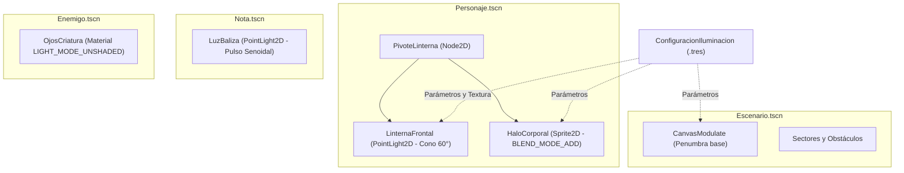
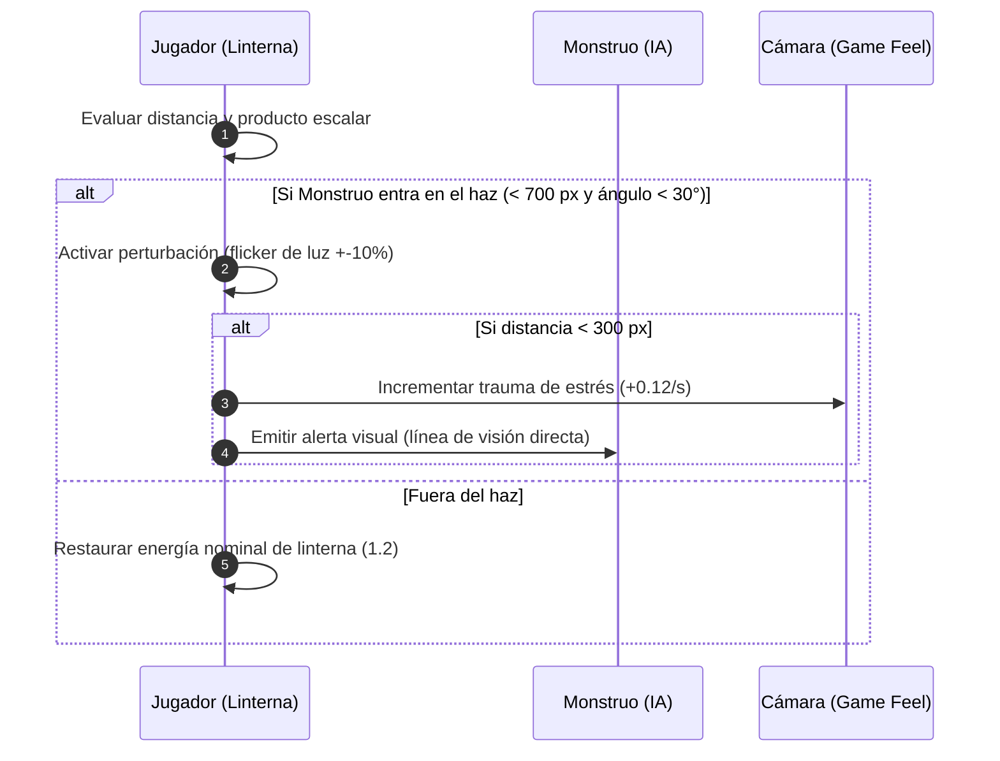

# Sistema de Iluminación y Visibilidad

Este documento detalla la arquitectura técnica, el presupuesto de renderizado para WebGL 2.0 (`gl_compatibility`), la especificación de fuentes de luz, la detección matemática del monstruo y la modulación ambiental de **Vosque**.

> 💡 **Documentos relacionados:**
> - [Guía de Estilo y Assets](../arte/guia_estilo_y_assets.md)
> - [Personaje y Habilidades](personaje_y_habilidades.md)
> - [Cámara y Game Feel](camara_y_game_feel.md)
> - [Sistema de Notas y Spawner](sistema_de_notas_y_spawner.md)
> - [La Criatura y su IA](monstruo_e_ia.md)
> - [Menú de Depuración In-Game](../herramientas/menu_debug_ingame.md)

---

## 1. Filosofía Visual y Atmósfera: Noche Americana

El juego no implementa una oscuridad absoluta ciega que frustre al jugador. Su estética se fundamenta en la **Penumbra Contrastada (Noche Americana)**:
1. **Fondo Visible:** Una base ambiental azul petróleo (`#141824`) permite al jugador identificar siluetas de árboles, rocas y vallas perimetrales a media distancia incluso sin apuntar con la linterna, garantizando la navegación fluida a altas velocidades ($800 - 1000\text{ px/s}$).
2. **Haz Focal Directo:** La linterna frontal actúa como el bisturí visual del jugador: recorta la penumbra, resalta detalles de corteza, descubre notas y proyecta el peligro inminente.
3. **Balizas en la Oscuridad:** Los coleccionables y los ojos de la criatura emiten señales lumínicas visibles a través de la penumbra, guiando o alertando al jugador.

---

## 2. Presupuesto WebGL 2.0 y Arquitectura de Renderizado

En el renderizador `gl_compatibility` de Godot 4, cada nodo `PointLight2D` activo genera un pase adicional de renderizado sobre cada elemento en pantalla que intersecte su radio o área de influencia. Múltiples luces 2D dinámicas provocan caídas drásticas de fotogramas en navegadores web y GPUs integradas.

### 2.1. Regla de Oro del Presupuesto Lumínico
Para mantener $60\text{ FPS}$ estables en navegadores de escritorio:
* **Presupuesto Máximo:** **3 nodos `PointLight2D` activos simultáneamente en el árbol de escena del mundo.**
  1. `LinternaFrontal` (Protagonista): Haz direccional cónico siempre activo.
  2. `HaloCorporal` (Protagonista): Luz radial suave centrada en el personaje para iluminar sus pies y entorno inmediato.
  3. `LuzBaliza` (Nota activa): Halo radial pulsante que sirve como objetivo. Al recolectarse, su luz se apaga de inmediato antes de que el spawner instancie la siguiente.
* **Prohibición de Sombras Dinámicas:** Todos los nodos `PointLight2D` deben configurarse con **`shadow_enabled = false`**. El cálculo de oclusión de sombras dinámicas 2D en WebGL resulta prohibitivo.

| Elemento | Tipo de Nodo | Técnica | Coste GPU |
| :--- | :--- | :--- | :---: |
| **Linterna Frontal** | `PointLight2D` | Textura cónica procedural ($700\text{ px}$, $60^\circ$) | 1 pase de luz |
| **Halo Corporal** | `PointLight2D` | Gradiente radial suave nativo ($140\text{ px}$) | 1 pase de luz |
| **Baliza de Nota** | `PointLight2D` | Gradiente radial ámbar pulsante ($\approx 256\text{ px}$) | 1 pase de luz |
| **Ojos del Monstruo** | `Sprite2D` | Material con `LIGHT_MODE_UNSHADED` | 0 pases de luz |
| **Penumbra Base** | `CanvasModulate` | Multiplicación cromática global del Canvas | 1 operación de pase |

---

## 3. Jerarquía y Componentes del Sistema

---

## 4. Especificación Técnica de las Fuentes de Luz

### 4.1. Linterna Frontal (`LinternaFrontal`)
* **Nodo:** `PointLight2D` hijo de un `PivoteLinterna (Node2D)` en el jugador.
* **Propiedades de Godot 4:**
  * `enabled`: `true`.
  * `color`: `Color(1.0, 0.96, 0.88, 1.0)` (blanco cálido halógeno).
  * `energy`: `1.2` (nominal base).
  * `blend_mode`: `BLEND_MODE_ADD`.
  * `range_z_min`: `-100`, `range_z_max`: `100`.
  * `range_layer_min`: `0`, `range_layer_max`: `0` (no afecta al CanvasLayer de la interfaz ni de la niebla).
  * `shadow_enabled`: `false`.
* **Geometría y Generación Procedural del Haz:**
  * **Alcance eficaz:** $700\text{ px}$.
  * **Ángulo de apertura:** $60^\circ$ ($\pm 30^\circ$ desde el eje frontal del pivote).
  * **Textura:** Generada proceduralmente (`ImageTexture`) con resolución de $512 \times 512\text{ px}$. Utiliza una atenuación radial cuadrática suave y una caída angular difuminada en los límites laterales para evitar bordes duros de tijera.
* **Control de Orientación Desacoplado:**
  * **Modo Ratón:** El pivote rota instantáneamente apuntando hacia `get_global_mouse_position()`.
  * **Modo Teclado Puro:** Si no se detecta movimiento de cursor reciente, el pivote interpola su rotación (`rotate_toward`) hacia el ángulo del vector de movimiento (`velocity.angle()`) a razón de $10\text{ rad/s}$.

### 4.2. Halo Corporal (`HaloCorporal`)
* **Nodo:** `Sprite2D` centrado en el personaje.
* **Material:** `CanvasItemMaterial` con `blend_mode = BLEND_MODE_ADD`.
* **Textura:** Gradiente radial suave de $256 \times 256\text{ px}$, difuminado de blanco a transparente.
* **Modulación:** `Color(0.8, 0.85, 1.0, 0.25)` (resplandor tenue azulado en los pies que permite ver el suelo inmediato sin encandilar).

### 4.3. Baliza de Nota (`LuzBaliza`)
* **Nodo:** `PointLight2D` hijo de `Nota.tscn`.
* **Propiedades:**
  * `texture`: `res://escenas/luz_baliza_textura.tres` (Gradiente radial $256 \times 256\text{ px}$).
  * `color`: `Color(1.0, 0.95, 0.8, 1.0)` (pergamino cálido/ámbar).
  * `energy`: Modulada senoidalmente en `_process(delta)`:
    $$\text{energy} = 0.8 + 0.15 \cdot \sin(3.5 \cdot t)$$
    Oscila armónicamente entre $0.65$ y $0.95$ para llamar la atención en la penumbra.
  * Al activarse `recolectar()`: `visible = false` inmediato.

### 4.4. Ojos Reflectantes del Monstruo
* **Técnica:** El sprite o sub-nodo de los ojos utiliza un `CanvasItemMaterial` con `light_mode = LIGHT_MODE_UNSHADED`.
* **Efecto:** Los ojos mantienen su luminosidad y color (amarillo o rojo sangre) intactos en plena penumbra sin necesidad de luces adicionales, generando la sensación de acecho a la distancia.

### 4.5. Iluminación Ambiental (`CanvasModulate`)
* **Nodo:** `CanvasModulate` ubicado en la escena `Escenario.tscn`.
* **Color Base Nominal:** `Color(0.08, 0.10, 0.15, 1.0)` (penumbra azul petróleo).
* **Escalada de Tensión por Notas:** Conforme el jugador recolecta notas ($0 \to 8$), el ambiente se oscurece gradualmente mediante interpolación lineal:
  $$\text{Color}(n) = \text{lerp}(\text{Color}(0.08, 0.10, 0.15), \text{Color}(0.04, 0.05, 0.07), n / 8.0)$$

---

## 5. Detección Analítica y Perturbación Electromagnética (Flicker)

Para maximizar el rendimiento y evitar cálculos de física innecesarios, la presencia del monstruo en el haz de la linterna se determina **analíticamente en código**, sin usar nodos de colisión `Area2D` adicionales.

### 5.1. Algoritmo Matemático de Visión Cónica
En cada ciclo de proceso, la linterna evalúa la posición relativa de la criatura:
1. Se calcula la distancia euclidiana:
   $$d = \|\vec{P}_{\text{monstruo}} - \vec{P}_{\text{linterna}}\|$$
2. Si $d \le 700\text{ px}$, se calcula el vector normalizado hacia el monstruo:
   $$\vec{u}_{\text{hacia\_monstruo}} = \frac{\vec{P}_{\text{monstruo}} - \vec{P}_{\text{linterna}}}{d}$$
3. Se compara mediante el producto escalar (*dot product*) contra el vector frontal de la linterna $\vec{u}_{\text{frente}} = (\cos\alpha, \sin\alpha)$:
   $$\cos\theta = \vec{u}_{\text{frente}} \cdot \vec{u}_{\text{hacia\_monstruo}}$$
4. **Criterio de Inclusión:** El monstruo está dentro del cono si:
   $$\cos\theta \ge \cos(30^\circ) \approx 0.866 \quad \land \quad d \le 700\text{ px}$$

### 5.2. Dinámica del Titileo Electromagnético
Cuando el monstruo está dentro del haz:
* La energía de la linterna sufre una perturbación estocástica de alta frecuencia:
  $$\text{energy} = \text{energia\_base} \cdot (1.0 + \text{ruido} \cdot 0.10)$$
  donde $\text{ruido} \in [-1.0, 1.0]$ se genera mediante una función pseudoaleatoria o un muestreo de `FastNoiseLite`.
* Comunica visual y visceralmente la cercanía de la anomalía sin requerir medidores en pantalla.

---

## 6. Centralización con el Recurso `ConfiguracionIluminacion`

Siguiendo el patrón modular utilizado en `ConfiguracionNiebla`, el sistema se centraliza en un recurso `ConfiguracionIluminacion` (`scripts/configuracion_iluminacion.gd` y `recursos/config_iluminacion_defecto.tres`):

* **Grupo Ambiente:**
  * `color_ambiente_inicial: Color = Color(0.08, 0.10, 0.15, 1.0)`
  * `color_ambiente_final: Color = Color(0.04, 0.05, 0.07, 1.0)`
  * `modular_con_notas: bool = true`
* **Grupo Linterna:**
  * `color_linterna: Color = Color(1.0, 0.96, 0.88, 1.0)`
  * `energia_base: float = 1.2`
  * `alcance_px: float = 700.0`
  * `apertura_grados: float = 60.0`
  * `suavizado_borde: float = 0.25`
* **Grupo Flicker y Feedback:**
  * `intensidad_flicker: float = 0.10`
  * `frecuencia_flicker: float = 24.0`
  * `distancia_estres_px: float = 300.0`
  * `tasa_estres_camara: float = 0.12`

### 6.1. Integración con el Menú de Depuración (DebugMenu)
El menú de depuración en juego (`F3`) expondrá controles para calibrar en vivo:
1. Deslizador de energía de linterna y ángulo de cono.
2. Selector de color o brillo del `CanvasModulate`.
3. Casilla para forzar el estado de flicker/perturbación para validación de audio y sacudida de cámara.
