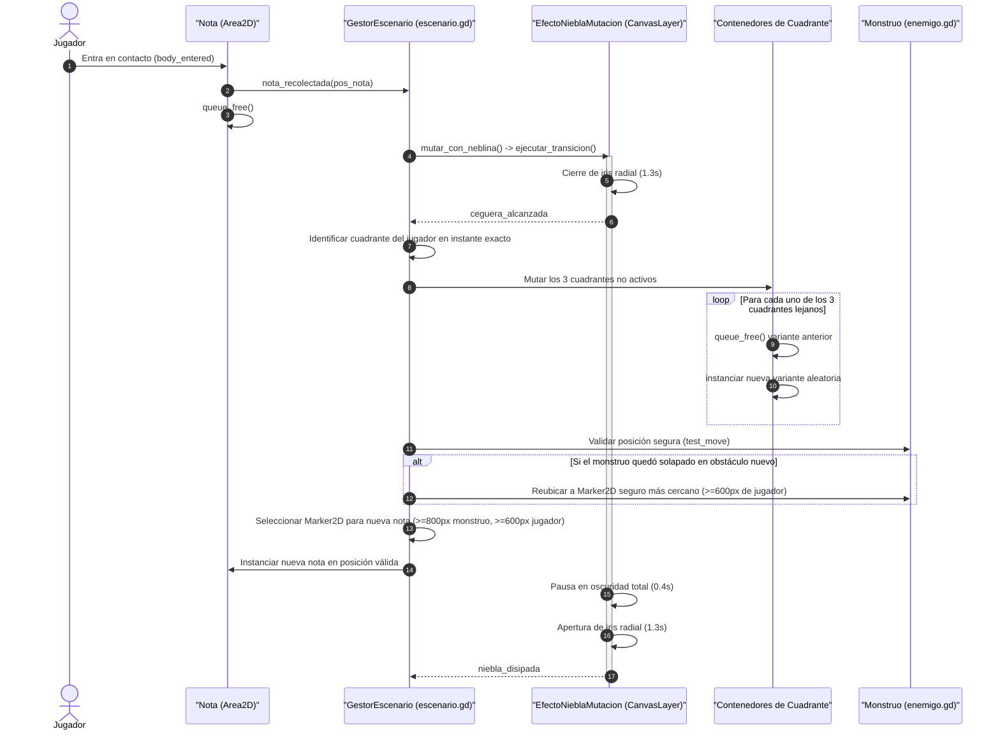

# Sistema de Mutación Espacial y Niebla Dinámica

Este documento detalla el algoritmo procedural, la sincronización de estados, los tiempos de transición visual y las optimizaciones de rendimiento del sistema de mutación de **Vosque**.

> 💻 **Scripts en motor:** [`scripts/escenario.gd`](../../scripts/escenario.gd), [`scripts/efecto_niebla_mutacion.gd`](../../scripts/efecto_niebla_mutacion.gd)  
> 🗺️ **Topología de base:** [Mapa y Sectores](mapa_y_sectores.md)  
> 👾 **Comportamiento de la IA:** [Monstruo e IA](monstruo_e_ia.md)

---

## 1. Concepto y Filosofía de Diseño

El "Bosque Mutable" es la firma de jugabilidad de *Vosque*: un entorno que desorienta activamente al jugador sin recurrir a pantallas de carga ni reinicios de escena. Cada vez que el jugador recoge una página:
1. Una cortina de niebla radial se cierra temporalmente sobre la pantalla, reduciendo el campo visual a negro absoluto.
2. Durante este instante de oscuridad total, **los 3 cuadrantes donde el jugador NO se encuentra mutan atómicamente**, instanciando nuevas combinaciones de variantes de bosque.
3. La niebla se disipa revelando una arena transformada, obligando al jugador a reorientarse mientras el monstruo acelera su cacería.

---

## 2. Secuencia Temporal y Ciclo de Vida de la Mutación



### 2.1. Cronograma Cuantitativo de la Transición
| Fase | Duración | Comportamiento Visual | Estado de Simulación y Entidades |
| :--- | :---: | :--- | :--- |
| **1. Cierre de Niebla** | $1.3\text{ s}$ | El radio de visión del shader de niebla se contrae suavemente hacia el centro de la pantalla. | El juego continúa activo en tiempo real; el jugador y el monstruo siguen desplazándose. |
| **2. Ceguera Total** | $0.4\text{ s}$ | Pantalla en oscuridad absoluta (`radio_vision = 0.0`). | Se produce el reemplazo atómico de variantes, el desatasco de entidades y la instanciación de la nueva nota. |
| **3. Apertura de Niebla** | $1.3\text{ s}$ | El iris de niebla se expande revelando el nuevo mapa. | El jugador descubre la nueva configuración de obstáculos a su alrededor. |
| **TOTAL CICLO** | **$3.0\text{ s}$** | — | **Cero interrupción de físicas ni pausas del motor.** |

---

## 3. Algoritmo de Selección y Reemplazo de Variantes

### 3.1. Detección en Tiempo Real del Cuadrante del Jugador
El cuadrante activo se calcula **en el fotograma exacto en que se emite la señal `ceguera_alcanzada`**, evaluando las coordenadas globales del protagonista respecto al origen `(0, 0)`:
```gdscript
func obtener_cuadrante_posicion(pos: Vector2) -> String:
    if pos.x < 0.0 and pos.y < 0.0:
        return "NO"
    elif pos.x >= 0.0 and pos.y < 0.0:
        return "NE"
    elif pos.x < 0.0 and pos.y >= 0.0:
        return "SO"
    else:
        return "SE"
```
> [!IMPORTANT]
> **Anti-Glitches en la Frontera:** Evaluar el cuadrante al alcanzar la ceguera (y no al tocar la nota $1.3\text{ s}$ antes) garantiza que si el jugador cruzó un eje divisorio ($X=0$ o $Y=0$) durante el cierre de la niebla, el sector donde **efectivamente se encuentra** será el preservado, evitando que un sector mute bajo sus propios pies.

### 3.2. Selección Aleatoria Ponderada sin Repetición Inmediata
Para los 3 cuadrantes lejanos:
1. Se consulta el catálogo pre-cargado de variantes de ese sector en `res://escenas/sectores/variantes/`.
2. Se filtra la variante que estaba activa previamente para evitar que un cuadrante vuelva a cargar idéntico.
3. Se sortea una nueva variante del conjunto filtrado.
4. La variante anterior se retira mediante `queue_free()`.
5. Se instancia la nueva variante (`nueva.instantiate()`) y se añade como hija del contenedor correspondiente (`SectorNO`, `SectorNE`, etc.).
6. Se asigna un nombre semántico para inspección limpia en el Árbol Remoto (`Activa_variante_nombre`).

---

## 4. Protocolo Anti-Atascamiento de la Criatura

Dado que los 3 cuadrantes lejanos mutan proceduralmente, existe la posibilidad matemática de que el nuevo diseño de sector instancie un obstáculo sólido (árbol o roca de Capa 1) en las coordenadas exactas donde el monstruo se encontraba persiguiendo al jugador:

1. **Detección de Solapamiento:** Tras instanciar las nuevas variantes, el gestor de escenario invoca `monstruo.test_move()` o verifica colisión estática en su posición global.
2. **Reubicación Segura:**
   - Si se detecta solapamiento, se consultan todos los marcadores transitables (`Marker2D`) en el sector donde está el monstruo.
   - Se descartan aquellos ubicados a menos de $600\text{ px}$ del jugador para evitar teletransportes letales injustos.
   - Se teletransporta al monstruo al marcador seguro más cercano.
   - Dicho marcador se marca como **reservado** para que el spawner de notas no lo utilice en el mismo ciclo.

---

## 5. Exclusión Mutua con el Spawner de Notas

Para que la nueva nota nunca aparezca en las garras de la bestia ni en un punto inalcanzable:
* La nueva nota **solo puede aparecer en uno de los 3 sectores recién mutados**.
* Se filtran todos los nodos del grupo `"puntos_nota"` aplicando una doble barrera espacial:
  - $\text{Distancia al Jugador} \ge 600\text{ px}$ (para obligar al jugador a explorar).
  - $\text{Distancia al Monstruo} \ge 800\text{ px}$ (para evitar recolecciones suicidas inmediatas).
  - Exclusión del marcador reservado por el desatasco de la IA.

---

## 6. Optimizaciones Críticas para WebAssembly Mono-Hilo

En la exportación Web (HTML5/WASM) de Godot 4, el motor opera en un único hilo (`threads = false`). La mutación debe mantener cero sobrecarga (*zero jank*):

1. **Grupos Indexados Nativos ($O(1)$) en Lugar de Búsquedas Recursivas:**
   - Queda estrictamente prohibido usar `find_children()` sobre el árbol de variantes.
   - Se utiliza la API en C++ `get_tree().get_nodes_in_group("puntos_nota")`, reduciendo el tiempo de búsqueda a microsegundos.
2. **Consolidación de Colisionadores Estáticos:**
   - Cada variante agrupa sus obstáculos en un único `StaticBody2D` para Capa 1 y otro para Capa 2, minimizando los cuerpos registrados en el `PhysicsServer2D`.
3. **Estrategia Futura de *Sector Pooling*:**
   - Si se diseñan variantes de alta densidad con cientos de objetos, el gestor de escenario puede pre-instanciar el catálogo al arrancar la partida y alternar únicamente `visible`, `process_mode` y máscaras de colisión en lugar de invocar `instantiate()` y `queue_free()` en tiempo de ejecución.
