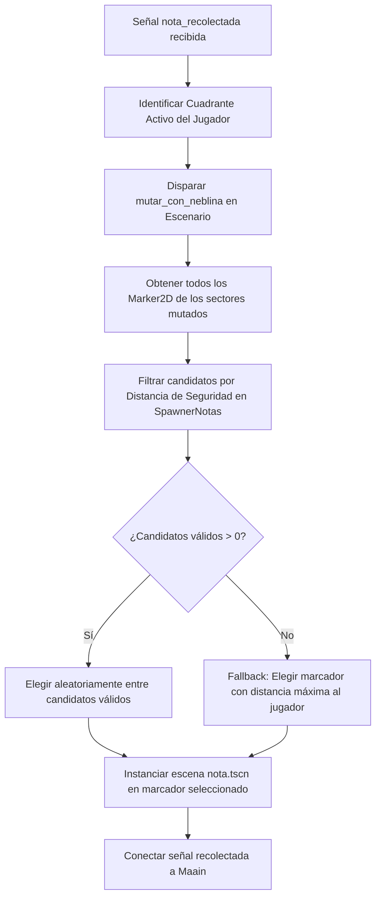

# Sistema de Notas y Spawner

Este documento define la arquitectura técnica de la entidad coleccionable `Nota`, sus efectos visuales de baliza luminosa y el algoritmo de generación espacial (*spawner*) en **Vosque**.

---

## 1. Filosofía de Diseño Arcade

En los juegos clásicos de recolección de notas, el jugador suele detenerse a leer textos o inspeccionar hojas estáticas en pantalla completa. En *Vosque*, en cambio, el diseño responde al ritmo **arcade puro y continuo**:
* **Recolección Instantánea (Estilo Moneda/Gema):** La nota se recoge por simple contacto físico sin detener la carrera ni bloquear los controles.
* **Foco de Orientación en la Penumbra:** La nota no está oculta en una oscuridad ciega; emite su propia luz pulsante tenue para que el jugador pueda avistarla desde la distancia y trazar mentalmente su ruta de escape.

---

## 2. Jerarquía de Escena (`escenas/nota.tscn`)

```text
Nota (Area2D) [scripts/entidades/items/nota.gd, Capa 5: Interactuables]
├── VisualPapel (Sprite2D)              # Textura de papel antiguo arrugado (64x64 px)
├── CollisionShape2D                    # Círculo de colisión física (radio: 32 px)
├── LuzBaliza (PointLight2D)            # Resplandor radial ámbar (~256 px, 2ª luz permitida WebGL)
└── ParticulasRecogida (CPUParticles2D) # Emisión puntual de micro-chispas al recolectarse
```

### 2.1. Iluminación y Rendimiento en WebGL 2.0

> 💡 **Detalles del presupuesto:** Ver [Sistema de Iluminación](sistema_de_iluminacion.md).

* **Integración en el Presupuesto Lumínico:** `LuzBaliza` constituye la segunda y última luz `PointLight2D` permitida en simultáneo en el mundo (`shadow_enabled = false`).
* **Implementación con `PointLight2D`:** Utiliza `res://escenas/luz_baliza_textura.tres` con modulación senoidal en su propiedad `energy` ($\text{rango } 0.65 - 0.95$, frecuencia angular $3.5\text{ rad/s}$).
* **Color:** Blanco cálido / pergamino ámbar (`Color(1.0, 0.95, 0.8, 1.0)`).
* **Apagado Atómico:** Al recolectar la nota, `_luz_baliza.visible = false` de forma sincrónica para liberar de inmediato el pase de luz en GPU antes de que el spawner cree la nota siguiente.

### 2.2. Animación Procedural de Flotación
Para evitar requerir spritesheets adicionales, el nodo `VisualPapel` realiza una levitación suave en motor:
```gdscript
var _tiempo: float = 0.0

func _process(delta: float) -> void:
    _tiempo += delta
    $VisualPapel.position.y = sin(_tiempo * 2.5) * 4.0
```

---

## 3. Protocolo de Recolección Atómica

Al hacer contacto con el cuerpo del jugador (`body_entered`):
1. **Desactivación Inmediata de Colisión:** Para evitar emisiones dobles en el mismo frame:
   ```gdscript
   $CollisionShape2D.set_deferred("disabled", true)
   ```
2. **Registro de Estado y Consulta Pública:** La nota marca internamente `_recolectada = true` y expone el método público:
   ```gdscript
   func esta_recolectada() -> bool:
       return _recolectada
   ```
   Esto permite que subsistemas como `SpawnerNotas` verifiquen la validez de la nota sin violar la privacidad de atributos internos.
3. **Emisión de Señales:** Se notifica al Game Director (`scripts/core/maain/maain.gd`):
   ```gdscript
   signal recolectada(posicion_global: Vector2)
   ```
4. **Efectos Locales:**
   * Se reproduce el SFX de rasgado de papel seco mediante un nodo de audio independiente.
   * Se activa el nodo `ParticulasRecogida` (emisión de 8 partículas doradas que se disuelven en $0.4\text{ s}$).
   * El sprite y la luz se ocultan inmediatamente.
5. **Liberación del Nodo:** Se invoca `queue_free()` tras expirar las partículas.

---

## 4. Algoritmo del Spawner Espacial de Notas (`SpawnerNotas`)

El spawner está desacoplado del Game Director y reside como clase independiente `SpawnerNotas` en [`scripts/core/maain/spawner_notas.gd`](../../scripts/core/maain/spawner_notas.gd). Funciona en coordinación con `Escenario`.



### 4.1. Filtros Matemáticos de Validación
Un marcador candidato $M$ es válido si y solo si cumple simultáneamente:
1. **Pertenece a un sector mutado:** $\text{Sector}(M) \ne \text{CuadranteActivo}(\text{Jugador})$.
2. **Distancia mínima al Jugador:**
   $$\|\mathbf{p}_M - \mathbf{p}_{\text{jugador}}\| \ge \text{DISTANCIA\_SEGURA\_JUGADOR\_DEFECTO } (600\text{ px})$$
3. **Distancia mínima al Monstruo:**
   $$\|\mathbf{p}_M - \mathbf{p}_{\text{monstruo}}\| \ge \text{DISTANCIA\_SEGURA\_MONSTRUO\_DEFECTO } (800\text{ px})$$
4. **Exclusión de Reubicación (Anti-atascamiento):**
   $$\|\mathbf{p}_M - \mathbf{p}_{\text{desatasco\_enemigo}}\|^2 \ge \text{TOLERANCIA\_DESATASCO\_SQ } (1.0\text{ px}^2)$$

Este filtrado asegura que el jugador nunca tenga la nota servida en bandeja en su sector actual ni sufra una emboscada inmediata al momento de aparecer la nueva nota.

### 4.2. API de `SpawnerNotas`
* `hay_nota_activa() -> bool`: Comprueba el estado de la instancia activa (`is_instance_valid()`, `not is_queued_for_deletion()` y `not esta_recolectada()`).
* `generar_nota(contenedor, escena_nota, escenario, jugador, enemigo, ...) -> Nota`: Valida el invariante de nota única, ejecuta la selección espacial e instancia la nueva nota.
* `filtrar_candidatos_espaciales(...) -> Array[Marker2D]`: Algoritmo matemático estático de exclusión.
* `elegir_marcador(...) -> Marker2D`: Algoritmo estático con fallback de distancia máxima en sectores mutados.
* `calcular_cuadrante_estatico(pos: Vector2) -> String`: Función utilitaria pura de orientación cardinal.
