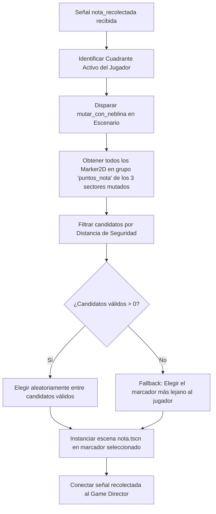

# Sistema de Notas y Spawner

Este documento define la arquitectura técnica de la entidad coleccionable `Nota`, sus efectos visuales de baliza luminosa y el algoritmo de generación espacial (*spawner*) en **Vosque**.

---

## 1. Filosofía de Diseño Arcade

En los juegos clásicos de recolección de notas, el jugador suele detenerse a leer textos o inspeccionar hojas estáticas en pantalla completa. En *Vosque*, en cambio, el diseño responde al ritmo **arcade puro y continuo**:
* **Recolección Instantánea (Estilo Moneda/Gema):** La nota se recoge por simple contacto físico sin detener la carrera ni bloquear los controles.
* **Foco de Orientación en la Penumbra:** La nota no está oculta en una oscuridad ciega; emite su propia luz pulsante tenue para que el jugador pueda avistarla desde la distancia y trazar mentalmente su ruta de escape.

---

## 2. Jerarquía de Escena (`escenas/nota.tscn`)

```text
Nota (Area2D) [scripts/nota.gd, Capa 5: Interactuables]
├── VisualPapel (Sprite2D)          # Textura de papel antiguo arrugado (64x64 px)
├── CollisionShape2D                # Círculo de colisión física (radio: 32 px)
├── LuzBaliza (PointLight2D)        # Resplandor radial ámbar tenue (~200 px)
└── ParticulasRecogida (CPUParticles2D) # Emisión puntual de micro-chispas al recolectarse
```

### 2.1. Parámetros del Nodo `PointLight2D`
* **Color:** Blanco cálido / pergamino (`Color(1.0, 0.95, 0.8, 1.0)`).
* **Energía Base:** $0.8$ con una oscilación senoidal sutil ($\pm 0.15$) a $1.5\text{ Hz}$ para generar un pulso orgánico de baliza.
* **Textura:** Gradiente radial suave sin aristas duras.

### 2.2. Animación Procedural de Flotación
Para evitar requerir spritesheets adicionales, el nodo `VisualPapel` realiza una levitación suave en motor:
```gdscript
var _tiempo: float = 0.0

func _process(delta: float) -> void:
    _tiempo += delta
    $VisualPapel.position.y = sin(_tiempo * 2.5) * 4.0
```

---

## 3. Protocolo de Recolección Atómica

Al hacer contacto con el cuerpo del jugador (`body_entered`):
1. **Desactivación Inmediata de Colisión:** Para evitar emisiones dobles en el mismo frame:
   ```gdscript
   $CollisionShape2D.set_deferred("disabled", true)
   ```
2. **Emisión de Señales:** Se notifica al Game Director (`maain.gd`):
   ```gdscript
   signal recolectada(posicion_global: Vector2)
   ```
3. **Efectos Locales:**
   * Se reproduce el SFX de rasgado de papel seco mediante un nodo de audio independiente.
   * Se activa el nodo `ParticulasRecogida` (emisión de 8 partículas doradas que se disuelven en $0.4\text{ s}$).
   * El sprite y la luz se ocultan inmediatamente.
4. **Liberación del Nodo:** Se invoca `queue_free()` tras expirar las partículas.

---

## 4. Algoritmo del Spawner Espacial de Notas

El spawner está gestionado por el Game Director en coordinación con `Escenario`.



### 4.1. Filtros Matemáticos de Validación
Un marcador candidato $M$ es válido si y solo si cumple simultáneamente:
1. **Pertenece a un sector mutado:** $\text{Sector}(M) \ne \text{CuadranteActivo}(\text{Jugador})$.
2. **Distancia mínima al Jugador:**
   $$\|\mathbf{p}_M - \mathbf{p}_{\text{jugador}}\| \ge 600\text{ px}$$
3. **Distancia mínima al Monstruo:**
   $$\|\mathbf{p}_M - \mathbf{p}_{\text{monstruo}}\| \ge 800\text{ px}$$
4. **Exclusión de Reubicación:** $\mathbf{p}_M \ne \mathbf{p}_{\text{desatasco\_enemigo}}$.

Este filtrado asegura que el jugador nunca tenga la nota servida en bandeja en su sector actual ni sufra una emboscada inmediata al momento de aparecer la nueva nota.
