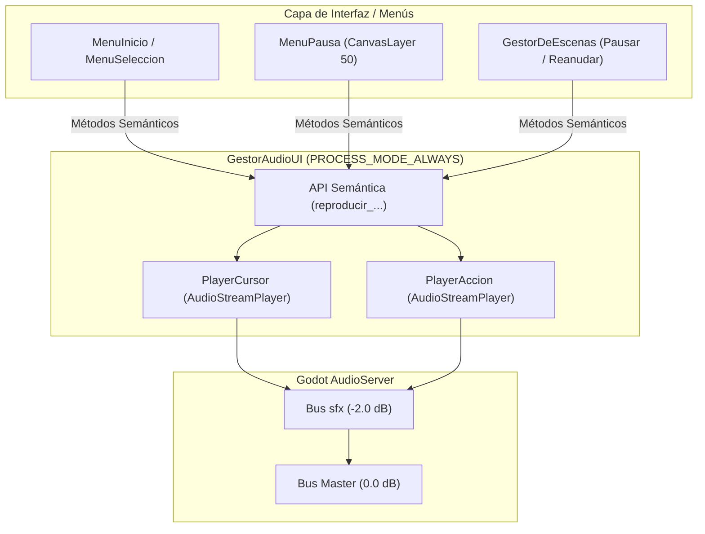

# Sistema de Audio de los Menús

Este documento describe la arquitectura, catálogo de efectos, comportamiento en pausa y guía de uso del sistema de audio para interfaces y menús en **Vosque**, administrado por el singleton Autoload `GestorAudioUI`.

> 🎮 **Pantallas y Menús:** [Pantallas y Menús](pantallas_y_menus.md)  
> 🔊 **Audio General y Buses:** [Audio y Feedback Sensorial](audio_y_feedback.md)  
> 🏛️ **Gestión del Árbol y Pausa:** [Gestor de Escenas](gestor_de_escenas.md)

---

## 1. Visión General y Filosofía

Los menús de *Vosque* no son interfaces estáticas convencionales, sino experiencias inmersivas que marcan el tono de terror, soledad y tensión:
* En el **Menú Principal**, la linterna ilumina árboles en la oscuridad con animaciones cinemáticas y parallax.
* En el **Menú de Pausa**, el juego suspende el mundo diegético pero mantiene feedback auditivo reactivo y limpio.

Para garantizar que los sonidos de navegación y confirmación sean inmediatos, táctiles y no se interrumpan al pausar el árbol de escena (`get_tree().paused = true`) o al transicionar entre pantallas, toda la gestión de audio de interfaz está desacoplada en el servicio global `GestorAudioUI`.

---

## 2. Arquitectura Técnica (`GestorAudioUI`)

El servicio reside en `scripts/core/gestor_audio_ui.gd` y está registrado como Autoload prioritario en `project.godot`.



### 2.1. Inmunidad a la Pausa (`PROCESS_MODE_ALWAYS`)
Tanto el nodo raíz de `GestorAudioUI` como sus reproductores hijos `PlayerCursor` y `PlayerAccion` operan con `process_mode = Node.PROCESS_MODE_ALWAYS`. Esto garantiza que los efectos de sonido de la interfaz se reproduzcan normalmente mientras el juego está pausado.

### 2.2. Canales Dedicados y Prevención de Saturación
En lugar de un único reproductor que corte los sonidos o un pool polifónico infinito que sature el bus en navegaciones rápidas, el sistema utiliza dos canales especializados:
1. **Canal Cursor (`PlayerCursor`):** Asignado al desplazamiento entre opciones y botones. Si el jugador navega a gran velocidad, el sonido actual se reinicia limpiamente desde el principio, evitando solapamientos excesivos o ecos molestos.
2. **Canal Acción (`PlayerAccion`):** Asignado a confirmaciones, descensos, retrocesos, apertura y cierre de menús. Se reproduce de manera independiente sin ser interrumpido por el movimiento del cursor, permitiendo que las resonancias de confirmación se escuchen completas incluso si el usuario continúa interactuando.

---

## 3. Catálogo de Efectos y Mapeo de Archivos

Todos los archivos de audio se ubican en `res://sonido/sfx/menus/` en formato `.wav` optimizados para latencia cero:

| Menú / Contexto | Evento Semántico | Archivo WAV | Disparador en Código | Propósito |
| :--- | :--- | :--- | :--- | :--- |
| **Menú Inicio** | Seleccionar opción | `seleccionar_menu_main.wav` | `MenuSeleccion.navegar()` | Feedback al desplazar la linterna entre *Opciones*, *Jugar* y *Créditos*. |
| **Menú Inicio** | Confirmar opción / Bajar | `aceptar_menu_pincial.wav` | `MenuInicio.iniciar_descenso()` y `MenuSeleccion.confirmar_opcion()` | Confirmación de inicio de descenso desde la presentación y al presionar Enter en una opción. |
| **Menú Inicio** | Retroceder | `retroceder_menu_main.wav` | `MenuInicio.regresar_a_presentacion()` | Pulsar <kbd>Escape</kbd> (`ui_cancel`) para volver a la presentación superior. |
| **Menú Pausa** | Abrir pausa | `abrir_pausa.wav` | `GestorDeEscenas.pausar()` | Presionar la tecla de pausa (<kbd>P</kbd> / <kbd>Escape</kbd>) en gameplay. |
| **Menú Pausa** | Mover cursor | `JA_SE_SYS_CURS_MOVE.wav` | `MenuPausa._navegar_vertical()` | Cambio de foco vertical entre *Continuar*, *Reiniciar* y *Volver al Menú*. |
| **Menú Pausa** | Presionar botón | `presionar_pausa.wav` | `MenuPausa._on_reiniciar_pulsado()` y `_on_menu_pulsado()` | Selección de opciones críticas (Reiniciar partida o salir al menú principal). |
| **Menú Pausa** | Cerrar / Reanudar | `cerrar_pausa_01.wav` | `GestorDeEscenas.reanudar()` | Pulsar el botón *Continuar* o despausar con la tecla de pausa. |

---

## 4. Referencia de la API GDScript

Para invocar sonidos desde cualquier menú, ventana emergente o pantalla del juego, utiliza directamente el singleton:

```gdscript
# ==========================================
# MENÚ PRINCIPAL Y PANTALLAS GENERALES
# ==========================================
GestorAudioUI.reproducir_menu_seleccionar()
GestorAudioUI.reproducir_menu_aceptar()
GestorAudioUI.reproducir_menu_retroceder()

# ==========================================
# MENÚ DE PAUSA
# ==========================================
GestorAudioUI.reproducir_pausa_abrir()
GestorAudioUI.reproducir_pausa_navegar()
GestorAudioUI.reproducir_pausa_aceptar()
GestorAudioUI.reproducir_pausa_cerrar()
```

### Buenas Prácticas de Integración
* Para proteger contra ejecuciones dentro del editor en scripts marcados con `@tool`, valida `Engine.is_editor_hint()` antes de invocar el gestor:
  ```gdscript
  if not Engine.is_editor_hint() and has_node("/root/GestorAudioUI"):
      get_node("/root/GestorAudioUI").reproducir_menu_seleccionar()
  ```
* Si en el futuro se implementan los paneles de **Opciones** o **Créditos**, estos deben invocar `GestorAudioUI.reproducir_menu_seleccionar()`, `GestorAudioUI.reproducir_menu_aceptar()` y `GestorAudioUI.reproducir_menu_retroceder()` para mantener consistencia acústica.

---

## 5. Pruebas Automatizadas

El funcionamiento del gestor está respaldado por la suite de pruebas unitarias:
* **Archivo:** `res://tests/test_gestor_audio_ui.gd`
* **Suite:** `gestor_audio_ui`
* **Validaciones realizadas:**
  1. Instanciación correcta de la clase en memoria.
  2. Asignación del modo `Node.PROCESS_MODE_ALWAYS`.
  3. Existencia y asignación del bus `sfx` a los reproductores internos (`PlayerCursor` y `PlayerAccion`).
  4. Carga y disparo libre de errores de cada uno de los métodos públicos.

Para ejecutar la suite mediante el MCP o el runner de pruebas:
```gdscript
# Ejecutar suite específica
test_run(suite="gestor_audio_ui", verbose=true)
```
