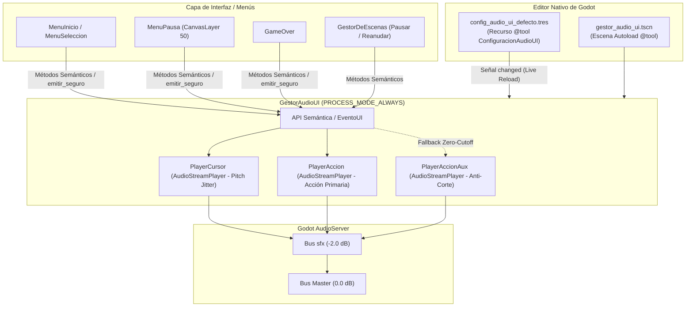

# Sistema de Audio de los Menús

Este documento describe la arquitectura, catálogo de efectos, comportamiento en pausa y guía de uso del sistema de audio para interfaces y menús en **Vosque**, administrado por el singleton Autoload `GestorAudioUI` y configurable desde el Inspector de Godot mediante `ConfiguracionAudioUI`.

> 🎮 **Pantallas y Menús:** [Pantallas y Menús](pantallas_y_menus.md)  
> 🔊 **Audio General y Buses:** [Audio y Feedback Sensorial](audio_y_feedback.md)  
> 🏛️ **Gestión del Árbol y Pausa:** [Gestor de Escenas](gestor_de_escenas.md)

---

## 1. Visión General y Filosofía

Los menús de *Vosque* no son interfaces estáticas convencionales, sino experiencias inmersivas que marcan el tono de terror, soledad y tensión:
* En el **Menú Principal**, la linterna ilumina árboles en la oscuridad con animaciones cinemáticas y parallax.
* En el **Menú de Pausa**, el juego suspende el mundo diegético pero mantiene feedback auditivo reactivo y limpio.
* En la pantalla de **Game Over**, las opciones de reintentar o salir mantienen consistencia acústica inmersiva.

Para garantizar que los sonidos de navegación y confirmación sean inmediatos, táctiles, no se interrumpan al pausar el árbol de escena (`get_tree().paused = true`) o al transicionar entre pantallas, toda la gestión de audio de interfaz está desacoplada en el servicio global `GestorAudioUI` respaldado por una escena nativa y un recurso reactivo `@tool`.

---

## 2. Arquitectura Técnica (`GestorAudioUI`)

El servicio se aloja en `res://escenas/gestor_audio_ui.tscn` (con script `scripts/core/gestor_audio_ui.gd` bajo `ControladorAudioUI`) y se encuentra registrado como Autoload prioritario en `project.godot`.



### 2.1. Inmunidad a la Pausa (`PROCESS_MODE_ALWAYS`)
Tanto el nodo raíz de `GestorAudioUI` como sus reproductores hijos `PlayerCursor`, `PlayerAccion` y `PlayerAccionAux` operan con `process_mode = Node.PROCESS_MODE_ALWAYS`. Esto garantiza que los efectos de sonido de la interfaz se reproduzcan normalmente mientras el juego está pausado.

### 2.2. Canales Especializados y Prevención de Cortes (*Zero-Cutoff*)
1. **Canal Cursor (`PlayerCursor`):** Asignado al desplazamiento entre opciones y botones. Si el jugador navega a gran velocidad, el sonido actual se reinicia limpiamente desde el principio, evitando solapamientos excesivos o ecos molestos. Cuenta además con *Pitch Jitter* configurable (por defecto `0.96` a `1.04`) para evitar fatiga auditiva.
2. **Canal Acción Primario (`PlayerAccion`):** Asignado a confirmaciones, descensos, retrocesos, apertura y cierre de menús. Se reproduce de manera independiente sin ser interrumpido por el cursor.
3. **Canal Acción Auxiliar (`PlayerAccionAux`):** Si una acción crítica (ej. pulsar *Reiniciar* en pausa) se ejecuta y de inmediato se invoca el sonido de cierre o despausa, el sistema delega automáticamente al reproductor auxiliar sin interrumpir ni cortar en seco la resonancia del primer efecto.

### 2.3. Configuración Reactiva desde el Inspector (`ConfiguracionAudioUI`)
Ubicado en `res://recursos/audio/config_audio_ui_defecto.tres`:
* Permite reemplazar cualquier archivo `.wav` directamente arrastrándolo en el Inspector.
* Sliders en `dB` para calibrar ganancia general (`volumen_general_db`), cursor (`volumen_cursor_db`) y acciones (`volumen_accion_db`).
* Conmutador y rango de variación de tono (*pitch jitter*).
* Diccionario `eventos_extra` para extender eventos sin modificar el código fuente.

---

## 3. Catálogo de Efectos y Mapeo de Archivos

Todos los archivos de audio se ubican en `res://sonido/sfx/menus/` en formato `.wav` optimizados para latencia cero:

| Menú / Contexto | Evento Semántico (`EventoUI`) | Archivo WAV | Disparador en Código | Propósito |
| :--- | :--- | :--- | :--- | :--- |
| **Menú Inicio** | `MENU_SELECCIONAR` | `seleccionar_menu_main.wav` | `MenuSeleccion.navegar()` | Feedback al desplazar la linterna entre *Opciones*, *Jugar* y *Créditos*. |
| **Menú Inicio** | `MENU_ACEPTAR` | `aceptar_menu_pincial.wav` | `MenuInicio.iniciar_descenso()` y `MenuSeleccion.confirmar_opcion()` | Confirmación de inicio de descenso desde la presentación y al presionar Enter en una opción. |
| **Menú Inicio** | `MENU_RETROCEDER` | `retroceder_menu_main.wav` | `MenuInicio.regresar_a_presentacion()` | Pulsar <kbd>Escape</kbd> (`ui_cancel`) para volver a la presentación superior. |
| **Menú Pausa** | `PAUSA_ABRIR` | `abrir_pausa.wav` | `GestorDeEscenas.pausar()` | Presionar la tecla de pausa (<kbd>P</kbd> / <kbd>Escape</kbd>) en gameplay. |
| **Menú Pausa** | `PAUSA_NAVEGAR` | `JA_SE_SYS_CURS_MOVE.wav` | `MenuPausa._navegar_vertical()` | Cambio de foco vertical entre *Continuar*, *Reiniciar* y *Volver al Menú*. |
| **Menú Pausa** | `PAUSA_ACEPTAR` | `presionar_pausa.wav` | `MenuPausa._on_reiniciar_pulsado()` y `_on_menu_pulsado()` | Selección de opciones críticas (Reiniciar partida o salir al menú principal). |
| **Menú Pausa** | `PAUSA_CERRAR` | `cerrar_pausa_01.wav` | `GestorDeEscenas.reanudar()` | Pulsar el botón *Continuar* o despausar con la tecla de pausa. |
| **Game Over** | `PAUSA_NAVEGAR` / `PAUSA_ACEPTAR` | `JA_SE_SYS_CURS_MOVE.wav` / `presionar_pausa.wav` | `GameOver._on_boton_enfocado()`, `_on_reintentar_pulsado()`, `_on_menu_pulsado()` | Navegación y confirmación entre *Reintentar* y *Volver al Menú*. |

---

## 4. Referencia de la API GDScript

### Disparo Mediante Utilidad Estática Segura (Recomendado para Vistas)
```gdscript
# Invoca de forma segura sin riesgo en el editor (@tool) ni tests sin árbol:
ControladorAudioUI.emitir_seguro(self, ControladorAudioUI.EventoUI.PAUSA_NAVEGAR)
ControladorAudioUI.emitir_seguro(self, ControladorAudioUI.EventoUI.PAUSA_ACEPTAR)
```

### Auto-Vinculación Declarativa de Botones
```gdscript
# Conecta automáticamente focus_entered y pressed:
GestorAudioUI.vincular_boton($BotonContinuar, true) # true = tema pausa, false = tema general
```

### Invocación Directa al Singleton
```gdscript
# Eventos semánticos
GestorAudioUI.reproducir_evento(ControladorAudioUI.EventoUI.MENU_SELECCIONAR)

# Retrocompatibilidad de métodos
GestorAudioUI.reproducir_menu_seleccionar()
GestorAudioUI.reproducir_menu_aceptar()
GestorAudioUI.reproducir_menu_retroceder()
GestorAudioUI.reproducir_pausa_abrir()
GestorAudioUI.reproducir_pausa_navegar()
GestorAudioUI.reproducir_pausa_aceptar()
GestorAudioUI.reproducir_pausa_cerrar()
```

---

## 5. Pruebas Automatizadas

El funcionamiento del gestor está respaldado por la suite de pruebas unitarias:
* **Archivo:** `res://tests/test_gestor_audio_ui.gd`
* **Suite:** `gestor_audio_ui`
* **Validaciones realizadas:**
  1. Instanciación y verificación de reproductores (`PlayerCursor`, `PlayerAccion`, `PlayerAccionAux`).
  2. Asignación del modo `Node.PROCESS_MODE_ALWAYS` y bus `sfx`.
  3. Reactividad y carga del recurso `ConfiguracionAudioUI` (`config_audio_ui_defecto.tres`).
  4. Integridad de la escena `gestor_audio_ui.tscn` y registro Autoload en `project.godot`.
  5. *Pitch jitter* dentro de los rangos tolerados y comportamiento anti-corte (*Zero-Cutoff*).
  6. Auto-vinculación funcional en `vincular_boton()`.

Para ejecutar la suite mediante el MCP:
```gdscript
test_run(suite="gestor_audio_ui", verbose=true)
```
