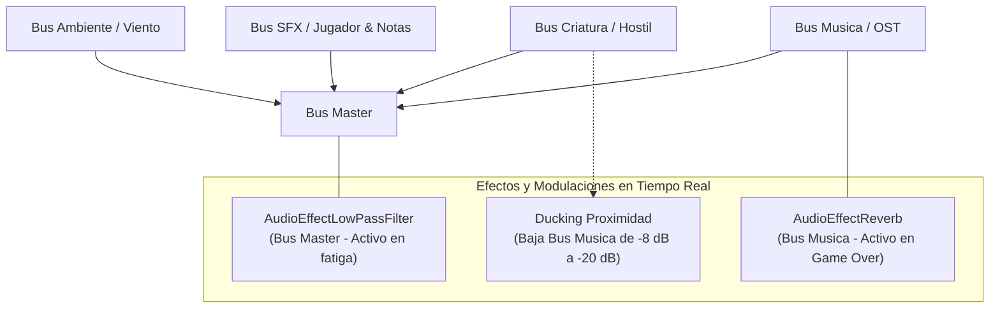

# Audio y Feedback Sensorial

Este documento describe el paisaje sonoro, los efectos de audio (SFX), el sistema de música interactiva, la arquitectura de buses en Godot 4 y los recursos de respuesta sensorial para generar terror y tensión en **Vosque**.

---

## 1. Filosofía del Audio: Radar en la Oscuridad

En *Vosque*, el audio es un pilar central de supervivencia. Dado que el rango de visión frontal es limitado y los 3 sectores lejanos mutan tras cada nota, **el paisaje sonoro actúa como un radar diegético**: el jugador debe aprender a escuchar la distancia, cadencia y posición del monstruo para no correr directamente hacia sus garras.

Por esta razón, la **música nunca debe enmascarar ni opacar los SFX críticos de proximidad**. La música se comporta como un barómetro de tensión psicológica y se subordina dinámicamente (*audio ducking*) a la presencia de la criatura.

---

## 2. Layout de Buses y Organización de Archivos (`res://audio/` y `res://sonido/`)

Los recursos sonoros se organizan en las siguientes rutas del proyecto:
* `res://sonido/musica/`: Pistas musicales en formato `.ogg` con metadatos de sincronización e importación.
* `res://sonido/sfx/` o `res://audio/`: Efectos de sonido agrupados por entidad:
  * `ambiente/`: Loops continuos de viento, susurros y ramas secas (`.ogg`).
  * `criatura/`: SFX del monstruo, zumbido de estática, pisadas pesadas y jumpscare (`.wav` y `.ogg`).
  * `jugador/`: Pasos en hojarasca, despegue de salto, impacto/arrastre de plancha y jadeos (`.wav`).
  * `interfaz/`: Rasgado seco de notas y clics/hovers de menú (`.wav`).
* `res://audio/default_bus_layout.tres`: Configuración de los buses de audio en Godot.

| Bus de Audio | Volumen Base | Efectos Asignados | Propósito |
| :--- | :---: | :--- | :--- |
| **Master** | $0.0\text{ dB}$ | `AudioEffectLowPassFilter` (bypass) | Mezcla general final; el filtro paso-bajo se activa en estado de fatiga o agonía. |
| **Ambiente** | $-6.0\text{ dB}$ | Pre-procesado (Bypass en motor) | Viento sibilante continuo y crujidos con reverberación horneada en el `.ogg`. |
| **Efectos** | $-2.0\text{ dB}$ | Ninguno | Pasos en hojarasca, jadeos de recuperación, salto y rasgado de notas. |
| **Criatura** | $+1.0\text{ dB}$ | Pre-procesado (Bypass en motor) | Sonidos guturales y estática con máxima prioridad auditiva. |
| **Musica** | $-8.0\text{ dB}$ | `AudioEffectReverb` (bypass) | Pistas musicales interactivas; aplica atenuación por proximidad y efecto pesadilla en derrota. |

---

## 3. Sistema de Música Interactiva (`res://sonido/musica/`)

> 📖 **Especificación completa:** Para consultar la máquina de estados detallada, diagramas de transición, arquitectura del Autoload `GestorMusica` y fórmulas matemáticas de atenuación, consulta [Sistema de Música Interactiva](sistema_de_musica.md).

El diseño musical acompaña la evolución emocional del jugador desde la intriga inicial hasta la paranoia absoluta del bosque abierto:
* **Menú Principal + Tutorial (`Night Crawling`):** Mantiene continuidad fluida entre el menú con linterna y el aprendizaje seguro en el Sector Central sin cortes de reproducción.
* **Supervivencia Activa (`Haunted Boardwalk`):** Transición mediante crossfade de $2.0\text{ s}$ al recolectar la Nota 1.
* **Audio Ducking:** Atenuación dinámica de $-8\text{ dB}$ a $-20\text{ dB}$ cuando la criatura se sitúa a menos de $800\text{ px}$.
* **Game Over (Nightmare Decay):** Detención súbita en jumpscare seguida de ralentización (`pitch_scale = 0.65`) y activación de `AudioEffectReverb` cavernoso en la pantalla de derrota.

---

## 4. Optimización para WebAudio y Navegadores (`threads = false`)

En compilaciones HTML5 sin soporte de hilos, el motor de mezcla de audio se ejecuta en el mismo hilo de CPU que las físicas y el renderizado:

1. **Efectos Pre-procesados (*Baked DSP*):**
   - Efectos pesados en tiempo real como `AudioEffectReverb` o distorsiones continuas pueden generar crepitaciones (*audio crackling*) si el framerate fluctúa. Por ello, **la reverberación del bosque y la distorsión del monstruo deben venir pre-procesadas directamente en las pistas de audio** (.ogg/.wav), reservando únicamente el `AudioEffectLowPassFilter` dinámico en el bus `Master` para la mecánica de fatiga.
2. **Límites de Polifonía (`max_polyphony`):**
   - En todos los nodos `AudioStreamPlayer2D` (como los pasos del protagonista o el rasgado de la nota), fijar `max_polyphony = 2` o `3` para evitar que llamadas rápidas acumulen instancias virtuales en WebAudio.
3. **Formatos de Archivo:**
   - Ambientes y pistas continuas: formato `.ogg` con compresión de calidad media (Q4 a Q6) para minimizar el tamaño en megabytes sin pérdida perceptible.
   - Efectos cortos y críticos de latencia (saltos, clics, impactos): archivos `.wav` de 16-bit mono.

---

## 4. Catálogo de Efectos de Sonido (SFX)

### 3.1. Jugador
* **Pasos en Hojarasca:** Sonido seco y crujiente reproducido mediante `AudioStreamPlayer2D` con modulación de pitch aleatoria ($\pm 0.08$) para evitar monotonía. Su cadencia acelera automáticamente al entrar en `SPRINT`.
* **Despegue de Salto:** Esfuerzo breve y susurro de ropa al impulsarse.
* **Impacto y Recuperación de Plancha:** Golpe sordo y arrastre pesado en el suelo hojoso, seguido de una respiración agitada durante los $0.6\text{ s}$ de inmovilidad.

### 3.2. Criatura y Proximidad Amenazante
* **Radar de Proximidad 2D:** El monstruo cuenta con un `AudioStreamPlayer2D` continuo emitiendo una combinación de respiración cavernosa y zumbido electromagnético/estática de radio.
* **Modelo de Atenuación Sonora:**
  - `max_distance`: $1400.0\text{ px}$.
  - `attenuation`: Curva logarítmica ($1.8$) para que el sonido empiece casi inaudible a larga distancia pero aumente con una presencia sofocante en los últimos $400\text{ px}$.
* **Jumpscare Letal:** Golpe orquestal súbito, seco y disonante en el milisegundo de contacto que culmina en Game Over.

### 3.3. Entorno y Coleccionables
* **Recolección de Nota:** Rasgado nítido de papel antiguo acompañado de un breve acorde tenso de advertencia que confirma la recogida sin interrumpir la música.
* **Viento Ominoso:** Bucle de baja frecuencia continuo que genera sensación de desamparo y frío nocturno.

---

## 4. Feedback Sensorial y Tensión Visual

* **Monstruo en el Haz de Luz:** Cuando el enemigo penetra el cono de la linterna frontal:
  - Se activa una ligera vibración de cámara (ver [Cámara y Game Feel](../gameplay/camara_y_game_feel.md)).
  - La intensidad de la luz titila levemente ($\approx 10\%$) simulando una perturbación electromagnética.
* **Efecto de Pánico en Fatiga:** Si la estamina cae a $0$, la pantalla amortigua los agudos del audio activando el filtro paso-bajo (`AudioEffectLowPassFilter` en $800\text{ Hz}$) y se reproduce un latido cardíaco acelerado hasta recuperar el $30\%$ de estamina.
