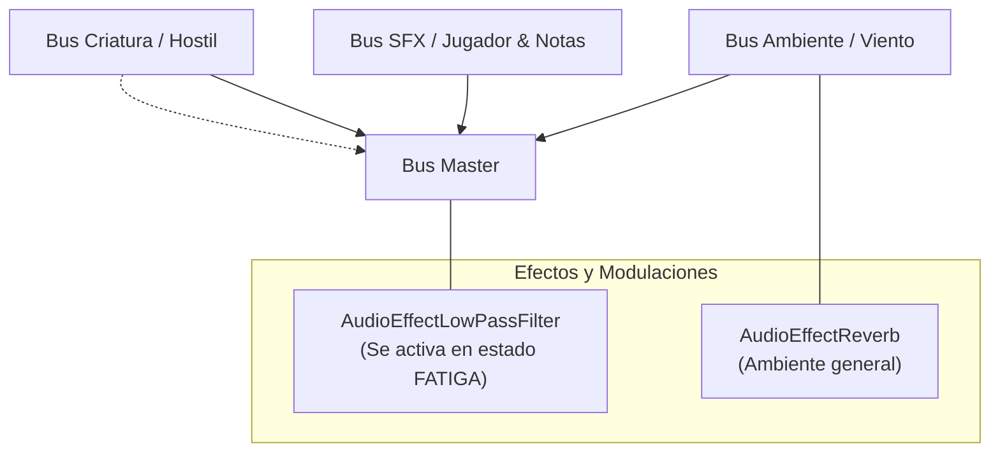

# Audio y Feedback Sensorial

Este documento describe el paisaje sonoro, los efectos de audio (SFX), la arquitectura de buses en Godot 4 y los recursos de respuesta sensorial para generar terror y tensión en **Vosque**.

---

## 1. Filosofía del Audio: Radar en la Oscuridad

En *Vosque*, el audio es un pilar central de supervivencia. Dado que el rango de visión frontal es limitado y los 3 sectores lejanos mutan tras cada nota, **el paisaje sonoro actúa como un radar diegético**: el jugador debe aprender a escuchar la distancia, cadencia y posición del monstruo para no correr directamente hacia sus garras.

---

## 2. Layout de Buses y Organización de Archivos (`res://audio/`)

Todos los archivos de audio del proyecto se estructuran en carpetas temáticas bajo `res://audio/`:
* `res://audio/ambiente/`: Loops continuos de viento, susurros y ramas secas (`.ogg`).
* `res://audio/criatura/`: SFX del monstruo, zumbido de estática, pisadas pesadas y grito de jumpscare (`.wav` y `.ogg`).
* `res://audio/jugador/`: Pasos en hojarasca, despegue de salto, impacto/arrastre de plancha y jadeos (`.wav`).
* `res://audio/interfaz/`: Rasgado seco de notas y clics/hovers de menú (`.wav`).
* `res://audio/default_bus_layout.tres`: Configuración de los 4 buses de audio.

| Bus de Audio | Volumen Base | Efectos Asignados | Propósito |
| :--- | :---: | :--- | :--- |
| **Master** | $0.0\text{ dB}$ | `AudioEffectLowPassFilter` (bypass) | Mezcla final general; el filtro paso-bajo se activa en estado de fatiga o salud crítica. |
| **Ambiente** | $-6.0\text{ dB}$ | `AudioEffectReverb` tenue | Viento sibilante continuo y crujidos lejanos de ramas secas. |
| **Efectos** | $-2.0\text{ dB}$ | Ninguno | Pasos en hojarasca, jadeos de recuperación, salto y rasgado de papel. |
| **Criatura** | $+1.0\text{ dB}$ | Distorsión / Pitch Shift | Sonidos guturales, zumbido de estática y garras rozando la madera. |

---

## 3. Catálogo de Efectos de Sonido (SFX)

### 3.1. Jugador
* **Pasos en Hojarasca:** Sonido seco y crujiente reproducido mediante `AudioStreamPlayer2D` con modulación de pitch aleatoria ($\pm 0.08$) para evitar monotonía. Su cadencia acelera automáticamente al entrar en `SPRINT`.
* **Despegue de Salto:** Esfuerzo breve y susurro de ropa al impulsarse.
* **Impacto y Recuperación de Plancha:** Golpe sordo y arrastre pesado en el suelo hojoso, seguido de una respiración agitada durante los $0.6\text{ s}$ de inmovilidad.

### 3.2. Criatura y Proximidad Amenazante
* **Radar de Proximidad 2D:** El monstruo cuenta con un `AudioStreamPlayer2D` continuo emitiendo una combinación de respiración cavernosa y zumbido electromagnético/estática de radio.
* **Modelo de Atenuación Sonora:**
  - `max_distance`: $1400.0\text{ px}$.
  - `attenuation`: Curva logarítmica ($1.8$) para que el sonido empiece casi inaudible a larga distancia pero aumente con una presencia sofocante en los últimos $400\text{ px}$.
* **Jumpscare Letal:** Golpe orquestal súbito, seco y disonante en el milisegundo de contacto que culmina en Game Over.

### 3.3. Entorno y Coleccionables
* **Recolección de Nota:** Rasgado nítido de papel antiguo acompañado de un breve acorde tenso de advertencia que confirma la recogida sin interrumpir la música.
* **Viento Ominoso:** Bucle de baja frecuencia continuo que genera sensación de desamparo y frío nocturno.

---

## 4. Feedback Sensorial y Tensión Visual

* **Monstruo en el Haz de Luz:** Cuando el enemigo penetra el cono de la linterna frontal:
  - Se activa una ligera vibración de cámara (ver [Cámara y Game Feel](../gameplay/camara_y_game_feel.md)).
  - La intensidad de la luz titila levemente ($\approx 10\%$) simulando una perturbación electromagnética.
* **Efecto de Pánico en Fatiga:** Si la estamina cae a $0$, la pantalla amortigua los agudos del audio activando el filtro paso-bajo (`AudioEffectLowPassFilter` en $800\text{ Hz}$) y se reproduce un latido cardíaco acelerado hasta recuperar el $30\%$ de estamina.
