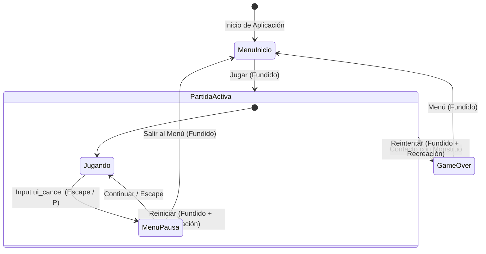

# Controles e Interfaz de Usuario (HUD)

Este documento especifica los esquemas de entrada para teclado en PC y las pantallas y elementos de la interfaz de usuario.

---

## 1. Esquema de Controles (PC / Teclado y Ratón Opcional)

| Acción | Teclas / Entradas Asignadas | Propósito |
| :--- | :--- | :--- |
| **Moverse Arriba** | `W` / `Flecha Arriba` | Desplazamiento vertical hacia arriba ($-Y$) |
| **Moverse Abajo** | `S` / `Flecha Abajo` | Desplazamiento vertical hacia abajo ($+Y$) |
| **Moverse Izquierda** | `A` / `Flecha Izquierda` | Desplazamiento horizontal a la izquierda ($-X$) |
| **Moverse Derecha** | `D` / `Flecha Derecha` | Desplazamiento horizontal a la derecha ($+X$) |
| **Sprint (Correr)** | `Shift` | Aceleración temporal continua consumiendo la barra de estamina |
| **Salto / Plancha (*Dive*)** | `Espacio` | Salto en suelo; segunda pulsación en el aire ejecuta plancha hacia adelante con caída e inmovilidad de recuperación |
| **Pausar / Reanudar** | `Escape` / `P` | Alterna el menú de pausa durante la partida activa congelando la simulación |
| **Orientar Linterna** | *Movimiento del Ratón* / *Automático* | Apunta al cursor si se usa el ratón, o sigue la dirección de marcha si se juega solo con teclado |
| **Reintentar Partida** | `Espacio` / `Enter` / Clic en botón | Reinicio inmediato tras Game Over o desde el menú de pausa |
| **Panel de Depuración** | `F3` | Alterna la visibilidad de la telemetría de físicas y dirección |

---

## 2. Elementos del HUD (En Partida)

* **Filosofía:** Minimalismo extremo para potenciar la inmersión y el miedo a la oscuridad.
* **Contador de Páginas:**
  - Posición: Esquina superior izquierda.
  - Formato: Texto simple y limpio (ejemplo: `Notas: 0`).
* **Barra de Estamina (Resistencia):**
  - Indicador visual discreto que muestra la reserva de energía disponible para la habilidad de **Sprint** (ver [Personaje y Habilidades](../gameplay/personaje_y_habilidades.md)).
  - Disminuye al correr y se recarga gradualmente al caminar o detenerse; cambia de color o parpadea si entra en estado de agotamiento (*Fatiga*).
* **Flash de Nota (Feedback de Recolección):**
  - Al recoger una página, se muestra una ilustración o texto perturbador en el centro de la pantalla durante **1 segundo exacto**.
  - **No pausa el juego:** La criatura sigue desplazándose durante este segundo, elevando el pánico del jugador. (Nota: si el jugador pausa manualmente con `Escape` mientras el flash está activo, el temporizador del flash se congela junto con el resto del juego).

---

## 3. Menú de Pausa (En Partida)

El menú de pausa permite interrumpir temporalmente la sesión de juego sin perder el estado actual ni romper la inmersión visual.

### 3.1. Estética y Comportamiento Visual
* **Superposición translúcida:** Un fondo oscuro semitransparente (`ColorRect` en `Color(0, 0, 0, 0.65)`) cubre la pantalla.
* **Fondo congelado:** El bosque, el personaje y la criatura permanecen visibles bajo el velo en la posición exacta donde se pausó, y la `Camera2D` del personaje sigue centrando la vista en el viewport.
* **Congelación de simulación:** Se desactivan las físicas (`_physics_process`), el movimiento de personajes, enemigos y temporizadores de notas.

### 3.2. Opciones y Flujo de Interacción
1. **Continuar:**
   - Cierra la superposición de pausa de inmediato (sin fundido a negro) y restaura la simulación.
   - Recibe el foco automático (`grab_focus()`) al abrir el menú de pausa para reanudación instantánea con `Espacio`, `Enter` o pulsando nuevamente `Escape`.
2. **Reiniciar Partida:**
   - Oculta el menú de pausa, ejecuta un fundido a negro vía `GestorDeEscenas.iniciar_partida()` y recrea la pantalla de juego (`maain.tscn`) desde cero.
3. **Menú Principal:**
   - Oculta el menú de pausa, ejecuta un fundido a negro vía `GestorDeEscenas.volver_al_menu()` y transiciona a `menu_inicio.tscn`.

---

## 4. Pantalla de Game Over

Aparece de forma inmediata tras el contacto con el monstruo:
1. **Arte de Impacto:** Ilustración de jumpscare/derrota en estilo cómic oscuro o estática roja.
2. **Resultados de la Partida:**
   - Páginas recogidas en la sesión actual.
   - Récord histórico (*High Score* persistido en `LocalStorage` vía JavaScript / Web).
3. **Acción Rápida:** Botón llamativo de "Reintentar" y soporte para presionar `Espacio` para reiniciar la partida en menos de 1 segundo.

---

## 5. Arquitectura e Integración Técnica (`GestorDeEscenas` y `MenuPausa`)

### 5.1. Flujo de Estados de Pantallas y Pausa


### 5.2. Jerarquía de Nodos en Godot 4
El menú de pausa **no** se instancia como una pantalla exclusiva dentro de `$Contenedor` (lo cual ocultaría la partida y apagaría la `Camera2D`), sino como una capa superpuesta dedicada en `GestorEscenas`:

```text
GestorEscenas (Node) [scripts/gestor_escenas.gd]
├── Contenedor (Node)
│   ├── MenuInicio (Control) [scripts/menu_inicio.gd]
│   ├── Maain (Node2D)       [Partida activa / Camera2D / Personaje / Enemigo]
│   └── GameOver (Control)   [scripts/game_over.gd]
├── MenuPausa (CanvasLayer, layer=50) [scripts/menu_pausa.gd]
│   └── Control (anchors_preset=15)
│       ├── Fondo (ColorRect - negro translúcido)
│       └── Layout (CenterContainer)
│           └── Columna (VBoxContainer)
│               ├── Titulo ("PAUSA")
│               ├── BotonContinuar
│               ├── BotonReiniciar
│               └── BotonMenu
└── Transicion (CanvasLayer, layer=100)
    ├── Velo (ColorRect - negro opaco)
    └── Anim (AnimationPlayer - fundidos)
```

### 5.3. Estrategia de Pausa y `process_mode`
Para evitar congelar el `GestorDeEscenas` o la animación de transición (`Transicion/Anim`), la pausa se gestiona a nivel de nodo de juego:
* **Al Pausar:**
  ```gdscript
  func pausar() -> void:
      if _ruta_actual != RUTA_JUEGO or _pausado:
          return
      _pausado = true
      var juego: Node = _obtener(RUTA_JUEGO)
      juego.process_mode = Node.PROCESS_MODE_DISABLED
      _menu_pausa.visible = true
      _menu_pausa.enfocar()
  ```
* **Al Reanudar:**
  ```gdscript
  func reanudar() -> void:
      if not _pausado:
          return
      _pausado = false
      _menu_pausa.visible = false
      var juego: Node = _obtener(RUTA_JUEGO)
      juego.process_mode = Node.PROCESS_MODE_INHERIT
  ```
* **Al Reiniciar o Salir al Menú:**
  `ir_a()` asegura cerrar la pausa antes de iniciar el fundido:
  ```gdscript
  if _pausado:
      _pausado = false
      _menu_pausa.visible = false
  ```
* **Control de Entradas en `_unhandled_input`:**
  ```gdscript
  if evento.is_action_pressed("ui_cancel"):
      if _ruta_actual == RUTA_JUEGO:
          alternar_pausa()
          get_viewport().set_input_as_handled()
      elif _ruta_actual != RUTA_MENU:
          volver_al_menu()
          get_viewport().set_input_as_handled()
  ```

