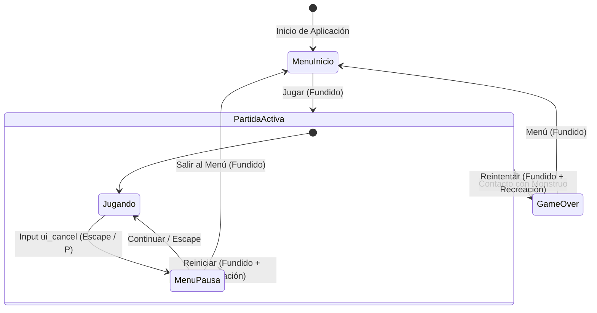

# Controles e Interfaz de Usuario (HUD)

Este documento especifica los esquemas de entrada para teclado en PC y las pantallas y elementos de la interfaz de usuario.

---

## 1. Esquema de Controles (PC / Teclado y Ratón Opcional)

| Acción | Teclas / Entradas Asignadas | Propósito |
| :--- | :--- | :--- |
| **Moverse Arriba** | `W` / `Flecha Arriba` | Desplazamiento vertical hacia arriba ($-Y$) |
| **Moverse Abajo** | `S` / `Flecha Abajo` | Desplazamiento vertical hacia abajo ($+Y$) |
| **Moverse Izquierda** | `A` / `Flecha Izquierda` | Desplazamiento horizontal a la izquierda ($-X$) |
| **Moverse Derecha** | `D` / `Flecha Derecha` | Desplazamiento horizontal a la derecha ($+X$) |
| **Sprint (Correr)** | `Shift` | Aceleración temporal continua consumiendo la barra de estamina |
| **Salto / Plancha (*Dive*)** | `Espacio` | Salto en suelo; segunda pulsación en el aire ejecuta plancha hacia adelante con caída e inmovilidad de recuperación |
| **Pausar / Reanudar** | `Escape` / `P` | Alterna el menú de pausa durante la partida activa congelando la simulación |
| **Orientar Linterna** | *Movimiento del Ratón* / *Automático* | Apunta al cursor si se usa el ratón, o sigue la dirección de marcha si se juega solo con teclado |
| **Reintentar Partida** | `Espacio` / `Enter` / Clic en botón | Reinicio inmediato tras Game Over o desde el menú de pausa |
| **Panel de Depuración** | `F3` | Alterna la visibilidad de la telemetría de físicas y dirección |

---

## 2. Elementos del HUD (En Partida)

* **Filosofía:** Minimalismo extremo y ritmo arcade puro para potenciar la inmersión y el miedo a la oscuridad sin obstrucciones visuales.
* **Contador de Coleccionables (Notas):**
  - Posición: Esquina superior izquierda (`Vector2(32, 32)`).
  - Componentes: Icono vectorial simple de página (`hud_icono_nota`, $32 \times 32$ px) seguido del valor numérico con tipografía limpia y de alto contraste (ejemplo: `x 0`).
  - Animación de Recogida: Al tomar una nota, el contador realiza un salto de escala elástico mediante un `Tween` (`scale` $1.3 \to 1.0$ en $0.25\text{ s}$) y un breve destello blanco.
* **Barra de Estamina (Resistencia):**
  - Indicador visual discreto construido 100% mediante nodos nativos de Godot (`ProgressBar` con `StyleBoxFlat`, **cero dibujo manual**).
  - Fondo: Rectángulo delgado ($200 \times 12$ px) gris carbón oscuro (`#101216`) con borde de $1\text{ px}$.
  - Relleno normal: Tono amarillo tenue o ámbar (`#D4A836`) que vacía de derecha a izquierda según el gasto de Sprint, Salto o Plancha.
  - Estado de Fatiga: Cuando la estamina cae por debajo de los 30 pts o llega a 0, la barra pulsa en rojo carmesí (`#B82828`) y titila hasta superar el umbral de recuperación.
* **Feedback de Recolección Arcade (Sin Pausas ni Flashes Bloqueantes):**
  - Al hacer contacto con el `Area2D` de la nota, la recolección es **inmediata y desatendida** (estilo moneda o reliquia arcade).
  - El jugador no sufre parones, ni se abre ninguna ilustración que le tape la pantalla.
  - Efectos simultáneos en el instante de contacto:
    1. **Audio:** Sonido seco y crujiente de papel antiguo desgarrado.
    2. **Partículas:** Brote radial de 8 a 10 partículas diminutas de polvo blanco/dorado (`CPUParticles2D`) en el punto del mapa donde estaba la nota.
    3. **HUD:** Incremento del contador numérico con el pulso elástico del icono.
    4. **Comportamiento del Monstruo:** La criatura recibe la señal de aceleración de fase (ver [Dificultad y Balance](../gameplay/dificultad_y_balance.md)) sin interrumpir la persecución activa.

---

## 3. Tutorial Flotante sobre la Cabeza del Personaje (Onboarding In-Game)

Para garantizar un onboarding inmediato que no rompa la inmersión cenital ni requiera pausas artificiales, al iniciar cada partida aparece un indicador flotante diegético centrado en la cabeza del personaje (`Vector2(0, -90)`):

### 3.1. Estructura Visual
* **Contenedor:** Pastilla flotante con fondo negro translúcido (`Color(0.08, 0.10, 0.15, 0.85)`), esquinas redondeadas y borde sutil.
* **Badges de Teclas:** Representaciones visuales de teclas estilizadas con contraste alto.

### 3.2. Secuencia de 3 Pasos
1. **Paso 1: Locomoción en 4 Direcciones:**
   - Mensaje: `"Mueve con [W] [A] [S] [D]"` (o flechas).
   - Comportamiento: A medida que el jugador presiona cada dirección, el badge de esa tecla se ilumina en ámbar/verde (`#4ade80`).
   - Criterio de avance: Haber presionado las 4 direcciones (o alcanzar desplazamiento sostenido).
2. **Paso 2: Superación de Obstáculos Bajos (Salto):**
   - Mensaje: `"Presiona [Espacio] para saltar"`.
   - Criterio de avance: Detectar `personaje-salto` y la transición al estado `SALTO`.
3. **Paso 3: Aceleración con Estamina (Sprint):**
   - Mensaje: `"Mantén presionado [Shift] para correr"`.
   - Criterio de avance: Sostener la acción `sprint` y transicionar a `SPRINT`.
   - Cierre: Al activarse el sprint, la pastilla reproduce un pulso de confirmación y se desvanece suavemente con un `Tween` de alfa en $0.4\text{ s}$ antes de liberarse.

### 3.3. Protocolo de Desvanecimiento Forzado
* Si el jugador se dirige directamente a la primera nota y la recolecta antes de completar los 3 pasos, el tutorial se desvanece instantáneamente para no entorpecer la cacería de la criatura.

### 3.4. Ausencia Total del Monstruo durante el Tutorial (Zona Segura Inicial)
* **El monstruo literalmente no aparece en el mapa:** Durante toda la fase de tutorial (Nota 0), el monstruo no está presente físicamente ni visible en el escenario.
* **Objetivo de diseño:** Ofrecer un entorno seguro y libre de estrés para que el jugador aprenda la locomoción básica, el salto de obstáculos y la aceleración con sprint, explorando la penumbra a su propio ritmo hasta localizar la primera nota.
* **Arquitectura de Motor (Hibernación Total):** Para garantizar cero tirones de framerate (*jank*) en la exportación Web (WASM/WebGL) por instanciación o compilación de shaders al recolectar la nota, el nodo de la criatura preexiste en el árbol pero en **hibernación completa**: `visible = false`, `process_mode = Node.PROCESS_MODE_DISABLED` y coordenadas de espera fuera del escenario (`Vector2(-99999, -99999)`).
* **El Despertar (Nota 1):** En el instante en que se recoge la primera página, el Game Director reposiciona a la criatura en un sector distante y seguro fuera de pantalla, restaura `visible = true`, `process_mode = Node.PROCESS_MODE_INHERIT` y activa la persecución a $500\text{ px/s}$.

---

## 3. Menú Principal (Key Art y Portada Dinámica)

El Menú Principal (`escenas/menu_inicio.tscn`) es la pieza visual prioritaria del proyecto, funcionando simultáneamente como portada oficial (*Key Art* para plataformas como itch.io y Newgrounds) y pantalla de bienvenida interactiva.

### 3.1. Arquitectura Visual en Capas de Profundidad (Paralaje 2D)
En lugar de una imagen estática plana, el menú se compone de 3 planos en Godot:
1. **Fondo (`TextureRect`):** Paisaje sombrío de copas de pinos lejanos envueltos en bruma fría azul petróleo (`#141824`).
2. **Sujeto Central (`TextureRect` con canal alfa):** Silueta detallada a tinta negra de árboles en primer plano con la criatura oculta acechando, cuyos ojos brillan con material `unshaded`.
3. **Capa Interactiva (UI / CanvasLayer):**
   - **Logotipo "VOSQUE":** Tipografía vectorial raspada y angular, con una animación sutil de parpadeo estocástico y micro-temblor de pánico.
   - **Niebla en Movimiento:** Emisor `CPUParticles2D` con partículas suaves semitransparentes cruzando horizontalmente la parte inferior de la pantalla.
   - **Efecto de Ratón (Paralaje Dinámico):** Un script sencillo desplaza la capa de fondo y el sujeto ligeramente en dirección contraria a la posición del cursor del ratón ($\pm 15\text{ px}$ y $\pm 30\text{ px}$ respectivamente), generando un efecto 2.5D impresionante sin coste de renderizado.

### 3.2. Botones y Tipografía
* Se descartan los botones grises por defecto del motor.
* Botones estilizados mediante `Theme` y `StyleBoxFlat`:
  - Estado Normal: Fondo transparente, texto blanco desgastado con contorno negro sutil.
  - Estado *Hover* / *Focus*: Resalte en rojo óxido (`#8A2020`) con una pequeña línea indicadora vertical y sonido grave de tensión al pasar el cursor.

---

## 4. Menú de Pausa (En Partida)

El menú de pausa permite interrumpir temporalmente la sesión de juego sin perder el estado actual ni romper la inmersión visual.

### 4.1. Estética y Comportamiento Visual
* **Superposición translúcida:** Un fondo oscuro semitransparente (`ColorRect` en `Color(0, 0, 0, 0.65)`) cubre la pantalla.
* **Fondo congelado:** El bosque, el personaje y la criatura permanecen visibles bajo el velo en la posición exacta donde se pausó, y la `Camera2D` del personaje sigue centrando la vista en el viewport.
* **Congelación de simulación:** Se desactivan las físicas (`_physics_process`), el movimiento de personajes, enemigos y temporizadores de notas.

### 4.2. Opciones y Flujo de Interacción
1. **Continuar:**
   - Cierra la superposición de pausa de inmediato (sin fundido a negro) y restaura la simulación.
   - Recibe el foco automático (`grab_focus()`) al abrir el menú de pausa para reanudación instantánea con `Espacio`, `Enter` o pulsando nuevamente `Escape`.
2. **Reiniciar Partida:**
   - Oculta el menú de pausa, ejecuta un fundido a negro vía `GestorDeEscenas.iniciar_partida()` y recrea la pantalla de juego (`maain.tscn`) desde cero.
3. **Menú Principal:**
   - Oculta el menú de pausa, ejecuta un fundido a negro vía `GestorDeEscenas.volver_al_menu()` y transiciona a `menu_inicio.tscn`.

---

## 5. Pantalla de Game Over (Impacto y Jumpscare)

Aparece de forma inmediata tras el contacto mortal con el monstruo:
1. **Arte de Impacto:** Ilustración de jumpscare de alto contraste (`game_over_jumpscare`, $512 \times 512$ px) enmarcada en el tercio superior/central.
2. **Efectos en Motor:**
   - Sacudida súbita de pantalla (*Camera Shake*) durante $0.3\text{ s}$.
   - Flash rojo intenso instantáneo que se disuelve en oscuridad total.
   - Estática y ruido sutil analógico.
3. **Resultados de la Partida:**
   - Páginas recogidas en la sesión actual.
   - Récord histórico (*High Score* persistido en `LocalStorage` vía JavaScript / Web).
4. **Acción Rápida:** Botón llamativo de "Reintentar" y soporte para presionar `Espacio` para reiniciar la partida en menos de 1 segundo.

---

## 5. Arquitectura e Integración Técnica (`GestorDeEscenas` y `MenuPausa`)

### 5.1. Flujo de Estados de Pantallas y Pausa


### 5.2. Jerarquía de Nodos en Godot 4
El menú de pausa **no** se instancia como una pantalla exclusiva dentro de `$Contenedor` (lo cual ocultaría la partida y apagaría la `Camera2D`), sino como una capa superpuesta dedicada en `GestorEscenas`:

```text
GestorEscenas (Node) [scripts/gestor_escenas.gd]
├── Contenedor (Node)
│   ├── MenuInicio (Control) [scripts/menu_inicio.gd]
│   ├── Maain (Node2D)       [Partida activa / Camera2D / Personaje / Enemigo]
│   └── GameOver (Control)   [scripts/game_over.gd]
├── MenuPausa (CanvasLayer, layer=50) [scripts/menu_pausa.gd]
│   └── Control (anchors_preset=15)
│       ├── Fondo (ColorRect - negro translúcido)
│       └── Layout (CenterContainer)
│           └── Columna (VBoxContainer)
│               ├── Titulo ("PAUSA")
│               ├── BotonContinuar
│               ├── BotonReiniciar
│               └── BotonMenu
└── Transicion (CanvasLayer, layer=100)
    ├── Velo (ColorRect - negro opaco)
    └── Anim (AnimationPlayer - fundidos)
```

### 5.3. Estrategia de Pausa y `process_mode`
Para evitar congelar el `GestorDeEscenas` o la animación de transición (`Transicion/Anim`), la pausa se gestiona a nivel de nodo de juego:
* **Al Pausar:**
  ```gdscript
  func pausar() -> void:
      if _ruta_actual != RUTA_JUEGO or _pausado:
          return
      _pausado = true
      var juego: Node = _obtener(RUTA_JUEGO)
      juego.process_mode = Node.PROCESS_MODE_DISABLED
      _menu_pausa.visible = true
      _menu_pausa.enfocar()
  ```
* **Al Reanudar:**
  ```gdscript
  func reanudar() -> void:
      if not _pausado:
          return
      _pausado = false
      _menu_pausa.visible = false
      var juego: Node = _obtener(RUTA_JUEGO)
      juego.process_mode = Node.PROCESS_MODE_INHERIT
  ```
* **Al Reiniciar o Salir al Menú:**
  `ir_a()` asegura cerrar la pausa antes de iniciar el fundido:
  ```gdscript
  if _pausado:
      _pausado = false
      _menu_pausa.visible = false
  ```
* **Control de Entradas en `_unhandled_input`:**
  ```gdscript
  if evento.is_action_pressed("ui_cancel"):
      if _ruta_actual == RUTA_JUEGO:
          alternar_pausa()
          get_viewport().set_input_as_handled()
      elif _ruta_actual != RUTA_MENU:
          volver_al_menu()
          get_viewport().set_input_as_handled()
  ```

