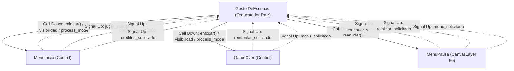
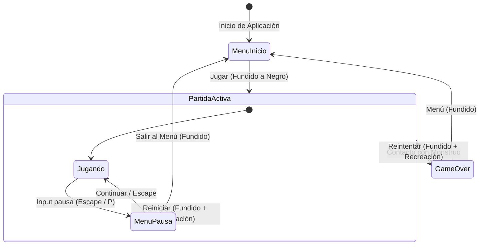

# Gestor de Escenas y Ciclo de Vida de Pantallas

Este documento especifica la arquitectura de navegación, el patrón de diseño desacoplado, la gestión de estados de pausa y la guía para incorporar nuevas pantallas en **Vosque**.

> 💻 **Script maestro:** [`scripts/gestor_escenas.gd`](../../scripts/gestor_escenas.gd)  
> 🎭 **Escenas y menús:** [Pantallas y Menús](pantallas_y_menus.md)  
> 🕹️ **Game Director:** [Arquitectura de Partida y Director](../gameplay/arquitectura_de_partida_y_director.md)

---

## 1. El Patrón "Call Down, Signal Up"

Para garantizar alta cohesión, modularidad y testabilidad en Godot 4:
* **Call Down (Orquestador $\to$ Pantallas):** `GestorDeEscenas` gestiona la visibilidad (`visible`), el modo de proceso (`process_mode`), apaga cámaras (`_fijar_camaras`) e invoca el método `enfocar()` de forma diferida en la pantalla activa.
* **Signal Up (Pantallas $\to$ Orquestador):** Las pantallas no dependen de rutas fijas (`/root/GestorEscenas`) y son completamente autónomas (pueden instanciarse y probarse solas con <kbd>F6</kbd> o en tests automatizados). Notifican sus eventos mediante señales:
  - `MenuInicio`: emite `jugar_solicitado`, `opciones_solicitado` y `creditos_solicitado`.
  - `GameOver`: emite `reintentar_solicitado` y `menu_solicitado`.
  - `MenuPausa`: emite `continuar_solicitado`, `reiniciar_solicitado` y `menu_solicitado`.
  - `GestorDeEscenas`: conecta dinámicamente estas señales en `_conectar_senales_pantalla()` al registrar o instanciar cada pantalla.



---

## 2. Flujo de Estados de Pantallas y Pausa



---

## 3. Jerarquía de Nodos en Godot 4 y Reglas de `process_mode`

El menú de pausa **no** se instancia como una pantalla exclusiva dentro de `$Contenedor` (lo cual ocultaría la partida y apagaría la `Camera2D`), sino como una capa superpuesta dedicada en `GestorEscenas` (`CanvasLayer` en `layer = 50`).

Para que la pausa congele absolutamente todo el gameplay (físicas, lógica, `SceneTreeTimer`, tweens y audio diegético) sin congelar la interfaz ni las transiciones, se define una jerarquía estricta de `process_mode`:

```text
GestorEscenas (Node) [scripts/gestor_escenas.gd] [process_mode = PROCESS_MODE_ALWAYS]
├── Contenedor (Node)
│   ├── MenuInicio (Control) [scripts/menu_inicio.gd] [inactivo: PROCESS_MODE_DISABLED]
│   ├── Maain (Node2D)       [Partida activa: PROCESS_MODE_PAUSABLE]
│   │   ├── Escenario / EfectoNieblaMutacion (CanvasLayer 15)
│   │   ├── Personaje / Linterna / IndicadorEstamina
│   │   ├── Enemigo (CharacterBody2D)
│   │   ├── Notas (Area2D)
│   │   └── HUD (CanvasLayer 10)
│   └── GameOver (Control)   [scripts/game_over.gd] [inactivo: PROCESS_MODE_DISABLED]
├── MenuPausa (CanvasLayer, layer=50) [scripts/menu_pausa.gd] [process_mode = PROCESS_MODE_ALWAYS]
│   └── Control (anchors_preset=15)
│       ├── Fondo (ColorRect - negro translúcido Color(0, 0, 0, 0.65))
│       └── Layout (CenterContainer)
│           └── Columna (VBoxContainer)
│               ├── Titulo ("PAUSA")
│               ├── BotonContinuar
│               ├── BotonReiniciar
│               └── BotonMenu
└── Transicion (CanvasLayer, layer=100) [scripts/transicion.gd] [process_mode = PROCESS_MODE_ALWAYS]
    ├── Velo (ColorRect - negro opaco / shader iris)
    └── Anim (AnimationPlayer - fundidos)
```

---

## 4. Estrategia de Pausa Híbrida y Blindaje Anti-Bugs

Para lograr una pausa **100% atómica, inmune a desincronizaciones y libre de condiciones de carrera**, la arquitectura adopta un **modelo híbrido**:
1. **`get_tree().paused = true`** detiene instantáneamente físicas (`_physics_process`), lógica (`_process`), partículas `CPUParticles2D`, audio 2D en el mundo y **todos los `SceneTreeTimer`** (`get_tree().create_timer()`, que por defecto tienen `process_always = false`).
2. **`process_mode = PROCESS_MODE_ALWAYS`** en `GestorDeEscenas`, `MenuPausa`, `TransicionEscenas` y `DebugMenu` garantiza que la interfaz de pausa responda de inmediato y las animaciones de fundido continúen ejecutándose sin interferencias.
3. **`process_mode = PROCESS_MODE_PAUSABLE`** en `Maain` asegura que todo el subárbol de juego quede suspendido mientras el árbol esté en pausa.

### 4.1. Las 6 Salvaguardas Anti-Bugs Obligatorias

1. **Guardia de Estado Estricto (`puede_pausar()`):**
   No se puede pausar si:
   - `_ruta_actual != RUTA_JUEGO`
   - `_cambiando == true` (hay un fundido de transición en curso)
   - El jugador ya ha sido capturado (`enemigo._capturado == true` o se está llamando a Game Over).
2. **Congelación de `SceneTreeTimer` y Corrutinas Asíncronas:**
   Al utilizar `get_tree().paused = true`, se evita que los temporizadores de:
   - La fase de ceguera en la niebla (`await tree.create_timer(dur_pausa).timeout` en `efecto_niebla_mutacion.gd`)
   - La recuperación de velocidad del monstruo (`reducir_velocidad_oscuridad` en `enemigo.gd`)
   - La autodestrucción de partículas tras recoger notas (`nota.gd`)
   sigan corriendo en segundo plano durante la pausa.
3. **Despausa Diferida y Blindaje Robusto Anti-Salto Fantasma (<kbd>Espacio</kbd>):**
   Si el jugador reanuda con <kbd>Espacio</kbd> sobre *"Continuar"*, se aplica una solución en 3 capas de protección:
   - `MenuPausa` y `GestorDeEscenas` liberan proactivamente las acciones en `Input` con `Input.action_release("personaje-salto")` e `Input.action_release("ui_accept")`.
   - `GestorDeEscenas` llama a `consumir_buffer_salto()` en el personaje activo y restaura el árbol de forma diferida (`get_tree().set_deferred("paused", false)` al final del frame).
   - `Personaje` intercepta `NOTIFICATION_UNPAUSED` y anula `quiere_salto` en su primer fotograma de físicas activo. Esto impide totalmente que `personaje.gd` interprete esa pulsación como `personaje-salto` y ejecute un salto no deseado que gaste $-20\text{ pts}$ de estamina.
4. **Limpieza Atómica en Transiciones (`ir_a()`):**
   Al transicionar hacia *Reiniciar*, *Menú Principal* o por muerte hacia *Game Over*, la función `ir_a()` ejecuta de inmediato `_limpiar_pausa_forzada()`:
   - Cierra y oculta `_menu_pausa` (`visible = false`, botones deshabilitados para evitar dobles clics).
   - Asegura `_pausado = false`.
   - Garantiza que al instanciar y activar la nueva pantalla, `get_tree().paused` vuelva a `false`.
5. **Jerarquía de Precedencia con el Menú de Depuración (`DebugMenu` / <kbd>F3</kbd>):**
   - Si el `DebugMenu` está en `ModoVisual.COMPLETO`, su `_unhandled_input` intercepta <kbd>Escape</kbd>, lo cierra a `ModoVisual.OCULTO` y consume el evento (`set_input_as_handled()`), evitando que se abra el `MenuPausa` por accidente.
   - La casilla `[x] Pausar Simulación` de F3 y el `MenuPausa` comparten la misma fuente de verdad (`get_tree().paused`).
6. **Auto-Pausa al Perder el Foco en Navegadores Web:**
   `GestorDeEscenas` escucha `_notification(what)` para `NOTIFICATION_APPLICATION_FOCUS_OUT` y `NOTIFICATION_WM_WINDOW_FOCUS_OUT`. Si el jugador cambia de pestaña o pincha fuera del iframe en itch.io o Newgrounds durante una partida viva (`puede_pausar() == true`), el juego se pausa automáticamente evitando muertes en segundo plano.

### 4.2. Implementación de Referencia en `GestorDeEscenas`

```gdscript
var _pausado: bool = false
@onready var _menu_pausa: MenuPausa = $MenuPausa

func puede_pausar() -> bool:
	if _ruta_actual != RUTA_JUEGO or _cambiando:
		return false
	var juego := _pantallas.get(RUTA_JUEGO)
	if juego == null or not is_instance_valid(juego):
		return false
	var enemigo = juego.get_node_or_null("Enemigo")
	if enemigo != null and enemigo.get("_capturado") == true:
		return false
	return true

func alternar_pausa() -> void:
	if _pausado:
		reanudar()
	elif puede_pausar():
		pausar()

func pausar() -> void:
	if not puede_pausar() or _pausado:
		return
	_pausado = true
	get_tree().paused = true
	_menu_pausa.mostrar()

func reanudar() -> void:
	if not _pausado:
		return
	_pausado = false
	_menu_pausa.ocultar()
	get_tree().set_deferred("paused", false)

func _limpiar_pausa_forzada() -> void:
	if _pausado or get_tree().paused:
		_pausado = false
		if _menu_pausa != null:
			_menu_pausa.ocultar_inmediato()
		get_tree().paused = false

func _notification(what: int) -> void:
	if what == NOTIFICATION_APPLICATION_FOCUS_OUT or what == NOTIFICATION_WM_WINDOW_FOCUS_OUT:
		if puede_pausar() and not _pausado:
			pausar()

func _unhandled_input(evento: InputEvent) -> void:
	if _cambiando:
		return
	if evento.is_action_pressed("pausa") or evento.is_action_pressed("ui_cancel"):
		if _ruta_actual == RUTA_JUEGO:
			alternar_pausa()
			get_viewport().set_input_as_handled()
		elif _ruta_actual != RUTA_MENU:
			volver_al_menu()
			get_viewport().set_input_as_handled()
```

---

## 5. Guía Técnica para Incorporar Nuevas Pantallas

Cuando se desarrollen las escenas dedicadas para `escenas/opciones.tscn` o `escenas/creditos.tscn`:
1. **Definir la Escena:** Asignar como raíz un nodo `Control` con script autónomo.
2. **Método de Foco:** Implementar `func enfocar() -> void:` para inicializar el foco de teclado/mando en el primer botón activo.
3. **Declarar Señales de Retorno:** Ej. `signal volver_al_menu_solicitado`.
4. **Registrar en `GestorDeEscenas`:**
   - Añadir la constante de ruta (ej. `const RUTA_OPCIONES: String = "res://escenas/opciones.tscn"`).
   - En `_conectar_senales_pantalla()`, conectar `volver_al_menu_solicitado` con `volver_al_menu()`.
   - Conectar la señal `opciones_solicitado` de `MenuInicio` a `ir_a(RUTA_OPCIONES)`.
