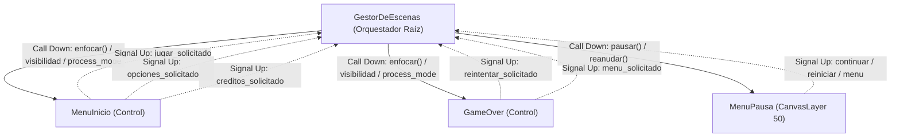
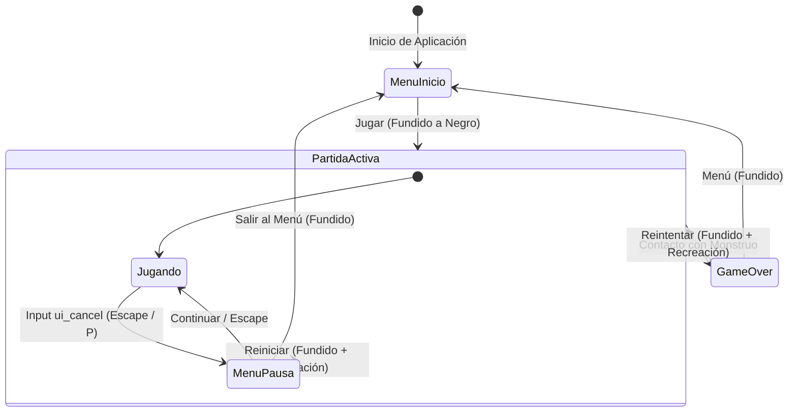

# Gestor de Escenas y Ciclo de Vida de Pantallas

Este documento especifica la arquitectura de navegación, el patrón de diseño desacoplado, la gestión de estados de pausa y la guía para incorporar nuevas pantallas en **Vosque**.

> 💻 **Script maestro:** [`scripts/gestor_escenas.gd`](../../scripts/gestor_escenas.gd)  
> 🎭 **Escenas y menús:** [Pantallas y Menús](pantallas_y_menus.md)  
> 🕹️ **Game Director:** [Arquitectura de Partida y Director](../gameplay/arquitectura_de_partida_y_director.md)

---

## 1. El Patrón "Call Down, Signal Up"

Para garantizar alta cohesión, modularidad y testabilidad en Godot 4:
* **Call Down (Orquestador $\to$ Pantallas):** `GestorDeEscenas` gestiona la visibilidad (`visible`), el modo de proceso (`process_mode`), apaga cámaras (`_fijar_camaras`) e invoca el método `enfocar()` de forma diferida en la pantalla activa.
* **Signal Up (Pantallas $\to$ Orquestador):** Las pantallas no dependen de rutas fijas (`/root/GestorEscenas`) y son completamente autónomas (pueden instanciarse y probarse solas con <kbd>F6</kbd> o en tests automatizados). Notifican sus eventos mediante señales:
  - `MenuInicio`: emite `jugar_solicitado`, `opciones_solicitado` y `creditos_solicitado`.
  - `GameOver`: emite `reintentar_solicitado` y `menu_solicitado`.
  - `GestorDeEscenas`: conecta dinámicamente estas señales en `_conectar_senales_pantalla()` al registrar o instanciar cada pantalla.



---

## 2. Flujo de Estados de Pantallas y Pausa



---

## 3. Jerarquía de Nodos en Godot 4

El menú de pausa **no** se instancia como una pantalla exclusiva dentro de `$Contenedor` (lo cual ocultaría la partida y apagaría la `Camera2D`), sino como una capa superpuesta dedicada en `GestorEscenas`:

```text
GestorEscenas (Node) [scripts/gestor_escenas.gd]
├── Contenedor (Node)
│   ├── MenuInicio (Control) [scripts/menu_inicio.gd]
│   ├── Maain (Node2D)       [Partida activa / Camera2D / Personaje / Enemigo]
│   └── GameOver (Control)   [scripts/game_over.gd]
├── MenuPausa (CanvasLayer, layer=50) [scripts/menu_pausa.gd]
│   └── Control (anchors_preset=15)
│       ├── Fondo (ColorRect - negro translúcido)
│       └── Layout (CenterContainer)
│           └── Columna (VBoxContainer)
│               ├── Titulo ("PAUSA")
│               ├── BotonContinuar
│               ├── BotonReiniciar
│               └── BotonMenu
└── Transicion (CanvasLayer, layer=100)
    ├── Velo (ColorRect - negro opaco)
    └── Anim (AnimationPlayer - fundidos)
```

---

## 4. Estrategia de Pausa y Control de `process_mode`

Para evitar congelar el propio `GestorDeEscenas` o la animación de transición (`Transicion/Anim`), la pausa se gestiona a nivel de nodo de juego sin usar `get_tree().paused = true`:

* **Al Pausar:**
  ```gdscript
  func pausar() -> void:
      if _ruta_actual != RUTA_JUEGO or _pausado:
          return
      _pausado = true
      var juego: Node = _obtener(RUTA_JUEGO)
      juego.process_mode = Node.PROCESS_MODE_DISABLED
      _menu_pausa.visible = true
      _menu_pausa.enfocar()
  ```
* **Al Reanudar:**
  ```gdscript
  func reanudar() -> void:
      if not _pausado:
          return
      _pausado = false
      _menu_pausa.visible = false
      var juego: Node = _obtener(RUTA_JUEGO)
      juego.process_mode = Node.PROCESS_MODE_INHERIT
  ```
* **Al Reiniciar o Salir al Menú:**
  `ir_a()` asegura cerrar la pausa antes de iniciar el fundido:
  ```gdscript
  if _pausado:
      _pausado = false
      _menu_pausa.visible = false
  ```
* **Control de Entradas en `_unhandled_input`:**
  ```gdscript
  if evento.is_action_pressed("ui_cancel"):
      if _ruta_actual == RUTA_JUEGO:
          alternar_pausa()
          get_viewport().set_input_as_handled()
      elif _ruta_actual != RUTA_MENU:
          volver_al_menu()
          get_viewport().set_input_as_handled()
  ```

---

## 5. Guía Técnica para Incorporar Nuevas Pantallas

Cuando se desarrollen las escenas dedicadas para `escenas/opciones.tscn` o `escenas/creditos.tscn`:
1. **Definir la Escena:** Asignar como raíz un nodo `Control` con script autónomo.
2. **Método de Foco:** Implementar `func enfocar() -> void:` para inicializar el foco de teclado/mando en el primer botón activo.
3. **Declarar Señales de Retorno:** Ej. `signal volver_al_menu_solicitado`.
4. **Registrar en `GestorDeEscenas`:**
   - Añadir la constante de ruta (ej. `const RUTA_OPCIONES: String = "res://escenas/opciones.tscn"`).
   - En `_conectar_senales_pantalla()`, conectar `volver_al_menu_solicitado` con `volver_al_menu()`.
   - Conectar la señal `opciones_solicitado` de `MenuInicio` a `ir_a(RUTA_OPCIONES)`.
