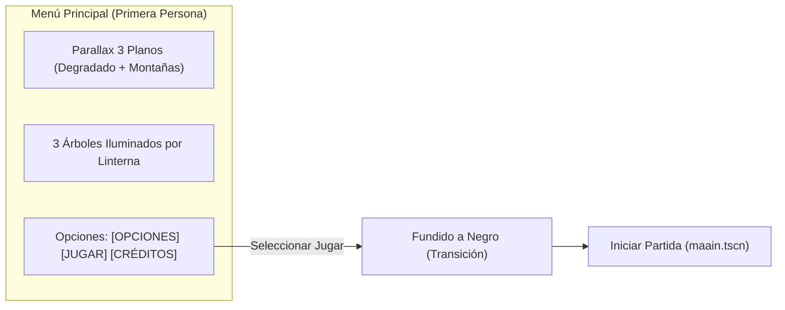

# Pantallas y Menús del Juego

Este documento detalla la estética visual, comportamiento cinematográfico, fórmulas de animación y flujos de usuario para el Menú Principal, el Menú de Pausa y la Pantalla de Game Over de **Vosque**.

> 🎮 **Controles y HUD:** [Controles y HUD](controles_y_hud.md)  
> 🏛️ **Arquitectura de orquestación:** [Gestor de Escenas](gestor_de_escenas.md)

---

## 1. Menú Principal (Linterna Diegética en Primera Persona)

El Menú Principal (`escenas/menu_inicio.tscn` / `scripts/menu_inicio.gd`) es la pieza visual prioritaria y carta de presentación de *Vosque*. En lugar de un menú convencional plano, presenta una **experiencia diegética e inmersiva en primera persona** ambientada en la noche del bosque.

### 1.1. Concepto Visual e Iluminación de Árboles
El jugador observa la oscuridad a través de una linterna sostenida en mano. La vista enfoca a tres árboles que representan las opciones del menú:
1. **Árbol Izquierdo:** `Opciones` (inclinación $+1.2^\circ$, offset $+95\text{ px}$).
2. **Árbol Central:** `Jugar` (inclinación $0.0^\circ$, offset $0\text{ px}$).
3. **Árbol Derecho:** `Créditos` (inclinación $-1.2^\circ$, offset $-95\text{ px}$).

Al navegar entre opciones, la linterna se desplaza y realiza un *crossfade* suave de transparencia (`modulate:a`) entre los sprites correspondientes (`ArbolOpciones`, `ArbolJugar`, `ArbolCreditos`), iluminando únicamente el tronco y follaje de la opción seleccionada mientras los demás permanecen en penumbra.

### 1.2. Parallax Multicapa Relativo al Editor 2D
El fondo se organiza en tres planos de profundidad bajo el nodo `$Fondos`:
1. **Fondo Degradado (`FondoDegradado`):** Cielo nocturno casi estático en el infinito (factor de parallax $0.08$ en traslación y $0.06$ en rotación).
2. **Montaña 2 (`Montaña2`):** Capa lejana con desplazamiento suave (factor $0.22$ en traslación y $0.18$ en rotación).
3. **Montaña 1 (`Montaña1`):** Capa intermedia que se desliza visiblemente tras los troncos (factor $0.45$ en traslación y $0.35$ en rotación).

> [!NOTE]
> **Preservación del Diseño en Editor (`_capturar_posiciones_iniciales`):**
> Para evitar fragilidad ante ajustes artísticos en Godot, el script captura en `_ready()` las coordenadas iniciales configuradas en la escena (`_pos_inicial_fondos`, `_pos_inicial_degradado`, `_pos_inicial_montana_2`, etc.). En `_process()`, el parallax se suma de manera relativa a esas posiciones base, garantizando que mover nodos con el ratón en el editor 2D se preserve intacto en ejecución sin tocar código.

### 1.3. Oscilación Orgánica (*Sway*) y Desacoplamiento de Tween
Para simular el pulso y la respiración natural de un explorador sosteniendo una linterna en la oscuridad:
* `_process(delta)` calcula oscilaciones sinusoidales armónicas compuestas en $X$, $Y$ y rotación (*sway*).
* La transición entre opciones se anima mediante un `Tween` interpolando las variables intermedias `_offset_base` y `_rotacion_base` (`TRANS_CUBIC`, `EASE_OUT`).
* Ambas transformaciones se suman sin conflicto: `offset_total = _offset_base + sway`, evitando que el `Tween` y el bucle por fotograma sobrescriban la propiedad `position` mutuamente.

### 1.4. Navegación por Teclado/Mando y Feedback Tipográfico
* **Navegación horizontal:** Teclas <kbd>A</kbd>/<kbd>D</kbd>, <kbd>←</kbd>/<kbd>→</kbd> o sticks analógicos recorren cíclicamente el arreglo `ORDEN_OPCIONES = [OPCIONES, JUGAR, CREDITOS]`.
* **Confirmación:** <kbd>Espacio</kbd> o <kbd>Enter</kbd> confirman la opción. Al seleccionar `JUGAR`, el menú activa `_bloqueado = true` para evitar dobles pulsaciones durante el fundido y emite la señal `jugar_solicitado`.
* **Scale Punch tipográfico:** El texto de la opción activa incrementa su escala a $1.08\times$ mediante `Tween` con curva `TRANS_BACK` y opacidad $1.0$, mientras que las opciones inactivas reducen su opacidad a $0.16$ y escala base $1.0$.

---

## 2. Menú de Pausa In-Game (`menu_pausa.gd`)

El menú de pausa permite interrumpir temporalmente la sesión de juego sin perder el estado actual ni romper la inmersión visual.

### 2.1. Estética y Comportamiento Visual
* **Superposición translúcida:** Un fondo oscuro semitransparente (`ColorRect` en `Color(0, 0, 0, 0.65)`) cubre la pantalla.
* **Fondo congelado:** El bosque, el personaje y la criatura permanecen visibles bajo el velo en la posición exacta donde se pausó, y la `Camera2D` del personaje sigue centrando la vista en el viewport.
* **Congelación de simulación:** Se desactivan las físicas (`_physics_process`), el movimiento de personajes, enemigos y temporizadores de notas.

### 2.2. Opciones y Flujo de Interacción
1. **Continuar:**
   - Cierra la superposición de pausa de inmediato (sin fundido a negro) y restaura la simulación.
   - Recibe el foco automático (`grab_focus()`) al abrir el menú de pausa para reanudación instantánea con <kbd>Espacio</kbd>, <kbd>Enter</kbd> o pulsando nuevamente <kbd>Escape</kbd>.
2. **Reiniciar Partida:**
   - Oculta el menú de pausa, ejecuta un fundido a negro vía `GestorDeEscenas.iniciar_partida()` y recrea la pantalla de juego (`maain.tscn`) desde cero.
3. **Menú Principal:**
   - Oculta el menú de pausa, ejecuta un fundido a negro vía `GestorDeEscenas.volver_al_menu()` y transiciona a `menu_inicio.tscn`.

---

## 3. Pantalla de Game Over (`game_over.gd`)

Aparece de forma inmediata tras el contacto mortal con el monstruo:
1. **Arte de Impacto:** Ilustración de jumpscare de alto contraste (`game_over_jumpscare`, $512 \times 512$ px) enmarcada en el tercio superior/central.
2. **Efectos en Motor:**
   - Sacudida súbita de pantalla (*Camera Shake*) durante $0.3\text{ s}$ (ver [Cámara y Game Feel](../gameplay/camara_y_game_feel.md)).
   - Flash rojo intenso instantáneo que se disuelve en oscuridad total.
   - Estática y ruido sutil analógico.
3. **Resultados de la Partida:**
   - Páginas recogidas en la sesión actual.
   - Récord histórico (*High Score* persistido en IndexedDB y `LocalStorage` Web).
4. **Acción Rápida:** Botón llamativo de "Reintentar" y soporte nativo para presionar <kbd>Espacio</kbd> o <kbd>Enter</kbd> para reiniciar la partida en menos de 1 segundo.
