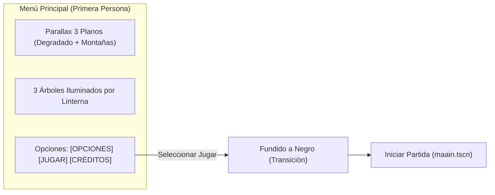

# Pantallas y Menús del Juego

Este documento detalla la estética visual, comportamiento cinematográfico, fórmulas de animación y flujos de usuario para el Menú Principal, el Menú de Pausa y la Pantalla de Game Over de **Vosque**.

> 🎮 **Controles y HUD:** [Controles y HUD](controles_y_hud.md)  
> 🏛️ **Arquitectura de orquestación:** [Gestor de Escenas](gestor_de_escenas.md)

---

## 1. Menú Principal (Linterna Diegética en Primera Persona)

El Menú Principal (`escenas/menu_inicio.tscn` / `scripts/menu_inicio.gd`) es la pieza visual prioritaria y carta de presentación de *Vosque*. En lugar de un menú convencional plano, presenta una **experiencia diegética e inmersiva en primera persona** ambientada en la noche del bosque.

### 1.1. Concepto Visual e Iluminación de Árboles
El jugador observa la oscuridad a través de una linterna sostenida en mano. La vista enfoca a tres árboles que representan las opciones del menú:
1. **Árbol Izquierdo:** `Opciones` (inclinación $+1.2^\circ$, offset $+95\text{ px}$).
2. **Árbol Central:** `Jugar` (inclinación $0.0^\circ$, offset $0\text{ px}$).
3. **Árbol Derecho:** `Créditos` (inclinación $-1.2^\circ$, offset $-95\text{ px}$).

Al navegar entre opciones, la linterna se desplaza y realiza una transición por **Shader de Mezcla Directa (`shaders/crossfade_arboles.gdshader`)** sobre un único nodo `Sprite2D` (`$Arboles/ArbolVisual`). El shader interpola fragmento a fragmento (`mix(textura_anterior, textura_actual, progreso)`):
* **Cero caída de alfa (Alpha Dip):** Como la mezcla se calcula a nivel de fragmento sobre las texturas, las regiones cubiertas por los árboles conservan el 100% de opacidad ($1.0$), impidiendo totalmente que las montañas y degradados del fondo se transparenten.
* **Cero texturas huérfanas o conflictos de Z-Index:** Al no existir múltiples sprites encendiéndose o apagándose por separado, es imposible que una textura de otra opción quede superpuesta por error al navegar rápidamente.
* **Texturas precargadas:** `menu_inicio.gd` gestiona un diccionario constante `TEXTURAS_OPCIONES` que asigna de forma directa las variaciones (`variacion izquierda inicio.png`, `manu seleccion inicio.png`, `variacion derecha inicio.png`) según el árbol enfocado.

### 1.2. Parallax Multicapa Relativo al Editor 2D
El fondo se organiza en tres planos de profundidad bajo el nodo `$Fondos`:
1. **Fondo Degradado (`FondoDegradado`):** Cielo nocturno casi estático en el infinito (factor de parallax $0.08$ en traslación y $0.06$ en rotación).
2. **Montaña 2 (`Montaña2`):** Capa lejana con desplazamiento suave (factor $0.22$ en traslación y $0.18$ en rotación).
3. **Montaña 1 (`Montaña1`):** Capa intermedia que se desliza visiblemente tras los troncos (factor $0.45$ en traslación y $0.35$ en rotación).

> [!NOTE]
> **Preservación del Diseño en Editor (`_capturar_posiciones_iniciales`):**
> Para evitar fragilidad ante ajustes artísticos en Godot, el script captura en `_ready()` las coordenadas iniciales configuradas en la escena (`_pos_inicial_fondos`, `_pos_inicial_degradado`, `_pos_inicial_montana_2`, etc.). En `_process()`, el parallax se suma de manera relativa a esas posiciones base, garantizando que mover nodos con el ratón en el editor 2D se preserve intacto en ejecución sin tocar código.

### 1.3. Oscilación Orgánica (*Sway*) y Desacoplamiento de Tween
Para simular el pulso y la respiración natural de un explorador sosteniendo una linterna en la oscuridad:
* `_process(delta)` calcula oscilaciones sinusoidales armónicas compuestas en $X$, $Y$ y rotación (*sway*).
* La transición entre opciones se anima mediante un `Tween` interpolando las variables intermedias `_offset_base` y `_rotacion_base` (`TRANS_CUBIC`, `EASE_OUT`).
* Ambas transformaciones se suman sin conflicto: `offset_total = _offset_base + sway`, evitando que el `Tween` y el bucle por fotograma sobrescriban la propiedad `position` mutuamente.

### 1.4. Navegación por Teclado/Mando y Feedback Tipográfico
* **Navegación horizontal:** Teclas <kbd>A</kbd>/<kbd>D</kbd>, <kbd>←</kbd>/<kbd>→</kbd> o sticks analógicos recorren cíclicamente el arreglo `ORDEN_OPCIONES = [OPCIONES, JUGAR, CREDITOS]`.
* **Confirmación:** <kbd>Espacio</kbd> o <kbd>Enter</kbd> confirman la opción. Al seleccionar `JUGAR`, el menú activa `_bloqueado = true` para evitar dobles pulsaciones durante el fundido y emite la señal `jugar_solicitado`.
* **Scale Punch tipográfico:** El texto de la opción activa incrementa su escala a $1.08\times$ mediante `Tween` con curva `TRANS_BACK` y opacidad $1.0$, mientras que las opciones inactivas reducen su opacidad a $0.16$ y escala base $1.0$.

### 1.5. Pantalla de Presentación y Paneo Cinemático (`Camera2D` + `AnimationPlayer`)
El menú principal implementa una experiencia cinematográfica previa dividida en dos lienzos 2D continuos:
* **Zona Superior ($Y \in [-1080, 0]$):** Vista del cielo nocturno y estrellas. Alberga el nodo `$Presentacion` con el logotipo (`Logo`) y el texto parpadeante (`TextoComenzar`: *"PRESIONA ENTER PARA COMENZAR"*), sobre la textura `FondoPresentacion` (`fondo degradado alargado.jpg`).
* **Zona Inferior ($Y \in [0, 1080]$):** Vista a ras de suelo del bosque con las montañas, los 3 árboles y los textos de navegación.

#### Flujo Cinemático y Control de Estados
1. **Estado `PRESENTACION`:** La `CamaraMenu` inicia en `(540, -540)` reproduciendo en loop la animación `"esperando_inicio"` (respiración suave de opacidad del texto de inicio).
2. **Descenso (`iniciar_descenso()`):** Al pulsar <kbd>Enter</kbd> o <kbd>Espacio</kbd>, pasa a `CINEMATICA_BAJANDO` y ejecuta `"bajar_al_bosque"`, desplazando la `CamaraMenu` verticalmente hasta `(540, 540)` y realizando un crossfade suave de salida (`modulate:a -> 0.0`) de `FondoPresentacion` hacia `FondoDegradado`.
3. **Efecto Motion Blur Vertical (`shaders/motion_blur_vertical.gdshader`):** Un `ColorRect` a pantalla completa anclado a la cámara (`CamaraMenu/EfectoMotionBlur`) aplica un desenfoque direccional vertical sobre `screen_texture`. Su intensidad se modula mediante una curva de campana en el `AnimationPlayer` (pico de `0.035` a mitad de la caída y `0.0` al inicio y freno), otorgando una sensación vertiginosa de velocidad cinematográfica.
4. **Función Skip Dinámica (`skipear_cinematica()`):** Si el jugador pulsa cualquier botón de acción (<kbd>Enter</kbd>, <kbd>Espacio</kbd>, <kbd>Escape</kbd>) durante el descenso o ascenso, el `AnimationPlayer` multiplica su velocidad (`speed_scale = multiplicador_velocidad_skip`, por defecto $4.0\times$, ajustable entre $1.5\times$ y $10.0\times$), concluyendo la animación de forma ágil y fluida ($\approx 0.35\text{ s}$) sin saltos abruptos.
5. **Retorno a la Pantalla de Inicio con Escape (`regresar_a_presentacion()`):** Estando en el menú de selección de árboles (`MENU_ACTIVO`), presionar <kbd>Escape</kbd> (`ui_cancel`) activa el estado `CINEMATICA_SUBIENDO` y reproduce la animación en reversa (`play_backwards("bajar_al_bosque")`). La cámara se eleva desde el bosque hacia el cielo con *motion blur*, oculta los textos de opciones, restaura los fondos de presentación y reanuda el bucle de espera (*"PRESIONA ENTER PARA COMENZAR"*).
6. **Reinicio al volver:** Cada vez que el jugador regresa al menú principal (desde el juego o Game Over vía `GestorDeEscenas.volver_al_menu()`), el método `enfocar()` reinicia la vista en la parte superior, permitiendo siempre la aceleración instantánea con doble pulsación.
7. **Ajustes en Inspector:**
   - `habilitar_presentacion` (`bool`): Permite omitir la cinemática e iniciar directamente en los árboles para pruebas rápidas de desarrollo.
   - `multiplicador_velocidad_skip` (`float`): Factor de aceleración al skipear.

### 1.6. Partículas Atmosféricas del Cielo (Estrellas y Nubes)
Para eliminar la monotonía visual del cielo nocturno tanto en espera como en el descenso, el menú incorpora dos sistemas de partículas procedurales (`CPUParticles2D`) ubicados bajo `$Fondos`:

1. **Estrellas Titilantes (`ParticulasEstrellas`):**
   - Textura radial suave `res://recursos/particulas/textura_estrella.tres` con rampa de opacidad `rampa_alpha_estrella.tres` para simular titileo orgánico.
   - Distribución rectangular con `preprocess` activo (aparece completamente poblada desde el inicio sin retraso).
2. **Nubes y Bruma Nocturna (`ParticulasNubes`):**
   - Textura difusa semi-translúcida `res://recursos/particulas/textura_nube.tres` con rampa de entrada y salida gradual `rampa_alpha_nube.tres`.
   - Deriva horizontal suave en eje $X$.
3. **Parámetros Altamente Configurables (`@tool` en Inspector):**
   - El script actualiza en vivo los emisores en el editor 2D y en tiempo de ejecución:
     - **Subgrupo Estrellas:** `habilitar_estrellas`, `estrellas_cantidad`, `estrellas_lifetime`, `estrellas_escala_min/max`, `estrellas_color`, `estrellas_factor_parallax`.
     - **Subgrupo Nubes y Bruma:** `habilitar_nubes`, `nubes_cantidad`, `nubes_velocidad_x`, `nubes_lifetime`, `nubes_escala_min/max`, `nubes_color`, `nubes_factor_parallax`.
4. **Cinemática Natural:**
   - Al descender la cámara a ras de suelo en el bosque, las estrellas y nubes se desplazan de forma coherente hacia arriba, saliendo del viewport de manera natural.

---

## 2. Menú de Pausa In-Game (`escenas/menu_pausa.tscn` / `scripts/menu_pausa.gd`)

El menú de pausa permite interrumpir temporalmente la sesión de juego sin perder el estado actual ni romper la inmersión visual. Se implementa como una capa de interfaz desacoplada sobre `GestorEscenas` mediante un `CanvasLayer` con prioridad `layer = 50` (situado sobre el `HUD` con `layer = 10` y `EfectoNieblaMutacion` con `layer = 15`, pero por debajo de `Transicion` y `DebugMenu` con `layer = 100`).

### 2.1. Estética y Comportamiento Visual
* **Superposición translúcida:** Un fondo oscuro semitransparente (`ColorRect` en `Color(0, 0, 0, 0.65)`) cubre la pantalla.
* **Fondo congelado:** El bosque, el personaje y la criatura permanecen visibles bajo el velo en la posición exacta donde se pausó, y la `Camera2D` del personaje sigue centrando la vista en el viewport.
* **Congelación total del mundo (`SceneTree.paused = true`):** Se desactivan de manera atómica las físicas (`_physics_process`), el movimiento de personajes, enemigos, tweens del juego, partículas `CPUParticles2D`, audio 2D posicional y todos los `SceneTreeTimer` de notas y mutación de niebla.
* **UI y transiciones inmunes (`PROCESS_MODE_ALWAYS`):** El nodo raíz del menú de pausa opera con `process_mode = PROCESS_MODE_ALWAYS`, permitiendo interactuar con el menú, mover el foco con teclado/mando y procesar clics sin importar que el árbol esté pausado.

### 2.2. Contrato de Señales y Métodos Públicos
Siguiendo el patrón *Signal Up, Call Down*:
* **Señales emitidas:**
  - `signal continuar_solicitado`: El jugador solicita reanudar la partida.
  - `signal reiniciar_solicitado`: El jugador solicita recrear la partida desde cero.
  - `signal menu_solicitado`: El jugador solicita volver al menú principal.
* **Métodos públicos:**
  - `func mostrar() -> void`: Hace visible el menú, reinicia la bandera `_bloqueado = false`, habilita los botones y otorga foco diferido (`call_deferred("grab_focus")`) al botón *"Continuar"*.
  - `func ocultar() -> void`: Libera el foco (`release_focus()`) y oculta la capa.
  - `func ocultar_inmediato() -> void`: Limpieza forzada instantánea usada por `GestorDeEscenas.ir_a()` durante transiciones.

### 2.3. Opciones, Flujo de Interacción y Salvaguardas
* **Navegación con Controles de Movimiento y UI:**
  - El jugador puede navegar verticalmente entre las opciones tanto con el teclado/mando estándar de interfaz (`ui_up`, `ui_down`) como directamente con los controles de movimiento del personaje (<kbd>W</kbd> / <kbd>↑</kbd> para `personaje-arriba` y <kbd>S</kbd> / <kbd>↓</kbd> para `personaje-abajo`).
  - La navegación es cíclica (`posmod`), recorriendo ordenadamente: *"Continuar"* $\leftrightarrow$ *"Reiniciar"* $\leftrightarrow$ *"Menú Principal"*.
  - La opción enfocada puede confirmarse indistintamente con <kbd>Enter</kbd> (`ui_accept`) o con la tecla de salto del juego <kbd>Espacio</kbd> (`personaje-salto`).
1. **Continuar:**
   - Cierra la superposición de pausa de inmediato (sin fundido a negro) y restaura la simulación.
   - Recibe el foco automático diferido al abrir el menú de pausa para reanudación instantánea con <kbd>Espacio</kbd>, <kbd>Enter</kbd> o pulsando nuevamente la acción `pausa` (<kbd>Escape</kbd> / <kbd>P</kbd>).
   - **Blindaje Robusto en 3 Capas Anti-Salto Fantasma:** Al pulsar <kbd>Espacio</kbd> en *"Continuar"*, para garantizar que el personaje no interprete el input como `personaje-salto` al reanudarse el juego ni gaste $-20\text{ pts}$ de estamina:
     1. `MenuPausa` y `GestorDeEscenas` liberan proactivamente el buffer del singleton `Input` con `Input.action_release("personaje-salto")` e `Input.action_release("ui_accept")`.
     2. `GestorDeEscenas` invoca `consumir_buffer_salto()` en el personaje y aplica la despausa diferida al final del frame (`set_deferred("paused", false)`).
     3. `Personaje` intercepta la notificación nativa `NOTIFICATION_UNPAUSED` del motor y suprime cualquier lectura de `quiere_salto` durante exactamente su primer fotograma de físicas activo.
   - **Salvaguarda de Linterna:** Al cerrar el menú, se limpia o ignora el movimiento relativo del ratón acumulado durante la pausa para que la linterna frontal no dé un latigazo hacia la posición del botón.
2. **Reiniciar Partida:**
   - Activa `_bloqueado = true` para impedir pulsaciones repetidas, oculta el menú de pausa y emite `reiniciar_solicitado`.
   - `GestorDeEscenas` ejecuta un fundido a negro vía `iniciar_partida()` y recrea la pantalla de juego (`maain.tscn`) desde cero, restableciendo `get_tree().paused = false`.
3. **Menú Principal:**
   - Activa `_bloqueado = true`, oculta el menú de pausa y emite `menu_solicitado`.
   - `GestorDeEscenas` ejecuta un fundido a negro vía `volver_al_menu()`, transicionando a `menu_inicio.tscn` y restableciendo `get_tree().paused = false`.

---

## 3. Pantalla de Game Over (`game_over.gd`)

Aparece de forma inmediata tras el contacto mortal con el monstruo:
1. **Arte de Impacto:** Ilustración de jumpscare de alto contraste (`game_over_jumpscare`, $512 \times 512$ px) enmarcada en el tercio superior/central.
2. **Efectos en Motor:**
   - Sacudida súbita de pantalla (*Camera Shake*) durante $0.3\text{ s}$ (ver [Cámara y Game Feel](../gameplay/camara_y_game_feel.md)).
   - Flash rojo intenso instantáneo que se disuelve en oscuridad total.
   - Estática y ruido sutil analógico.
   - **Tratamiento Sonoro Post-Jumpscare:** Silencio instantáneo en el impacto y entrada posterior de la música ralentizada (`pitch_scale = 0.65`) con reverberación cavernosa en el bus `musica` (ver [Sistema de Música Interactiva](sistema_de_musica.md#34-secuencia-de-muerte-y-efecto-game-over-nightmare-decay)).
3. **Resultados de la Partida:**
   - Páginas recogidas en la sesión actual.
   - Récord histórico (*High Score* persistido en IndexedDB y `LocalStorage` Web).
4. **Acción Rápida:** Botón llamativo de "Reintentar" y soporte nativo para presionar <kbd>Espacio</kbd> o <kbd>Enter</kbd> para reiniciar la partida en menos de 1 segundo.
