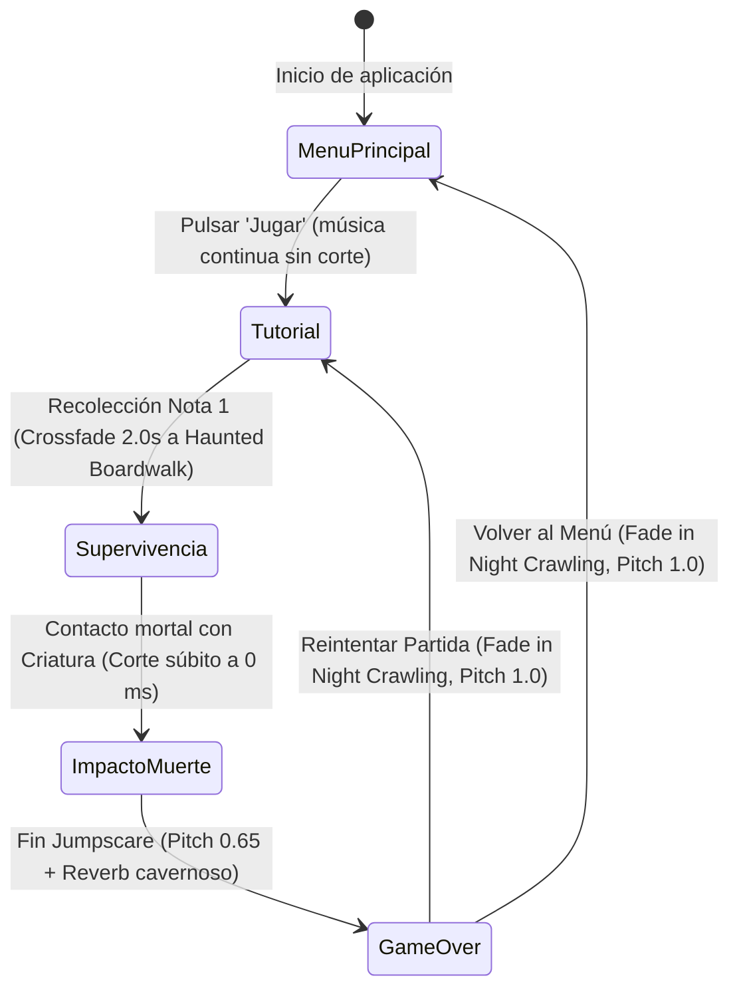

# Sistema de Música Interactiva

Este documento especifica la arquitectura, diseño reactivo, catálogo de pistas, máquina de estados sonoros y directrices de implementación para el **Sistema de Música Interactiva** de **Vosque**.

> 🎧 **Buses generales y efectos:** [Audio y Feedback Sensorial](audio_y_feedback.md)  
> 🖥️ **Flujo de pantallas e interfaces:** [Pantallas y Menús](pantallas_y_menus.md)  
> 🏛️ **Orquestación de escenas:** [Gestor de Escenas](gestor_de_escenas.md)

---

## 1. Filosofía del Diseño Musical

En *Vosque*, el diseño sonoro está supeditado a la supervivencia. La música no actúa como un mero fondo estático ni como una fanfarria invasiva; cumple dos funciones clave:
1. **Barómetro Psicológico:** Subraya la pérdida de seguridad del jugador a medida que se adentra en el bosque y se enfrenta a lo desconocido.
2. **Subordinación al Radar Diegético (*Audio Ducking*):** Dado que la posición del monstruo se detecta principalmente mediante señales de audio 2D (respiración, estática, pisadas), la música **atenúa su presencia automáticamente** ante la proximidad de la criatura para no bloquear frecuencias críticas de alerta.

---

## 2. Catálogo de Pistas y Asignación de Roles

Las pistas musicales se encuentran alojadas en `res://sonido/musica/` en formato `.ogg`, aprovechando la importación con metadatos interactivos de compás y tempo de Godot 4.

| Archivo | Rol Escénico | Parámetros Godot (`.import`) | Función Psicológica y Comportamiento |
| :--- | :--- | :--- | :--- |
| `Night Crawling - BadBalloon.ogg` | **Menú Principal + Tutorial** | BPM: `112.0`, Compás: 4/4, `loop = true`, `beat_count = 380` | Ritmo ágil e intrigante. Acompaña la exploración inicial con linterna en el menú y el aprendizaje seguro en el Sector Central. **Persiste sin reiniciarse** al pulsar "Jugar". |
| `Haunted Boardwalk - BadBalloon.ogg` | **Loop de Supervivencia** (Notas 1 a 8) | BPM: `100.0`, Compás: 4/4, `loop = true`, `beat_count = 298` | Tempo más lento, pesado y espectral. Se activa tras recolectar la Nota 1, marcando el fin de la zona segura y el inicio del acecho. |

---

## 3. Máquina de Estados y Flujo de Transiciones

El estado de la música evoluciona según el ciclo de juego y las interacciones del protagonista:



### 3.1. Continuidad Menú $\rightarrow$ Tutorial
* Al pulsar *"Jugar"* en el Menú Principal, `Night Crawling` continúa reproduciéndose fluidamente a través del fundido a negro y durante la carga del Sector Central.
* Evita el efecto artificial de cortar la música para reiniciarla desde el segundo cero segundos después.

### 3.2. Detonante del Loop de Supervivencia (*Trigger de Nota 1*)
* **Condición de Disparo:** El jugador interactúa con la **Nota 1** situada en el Sector Central.
* **Transición Musical:** Se ejecuta un fundido cruzado (*crossfade*) de **$2.0\text{ segundos}$** mediante `create_tween()`:
  * Fade out de `Night Crawling` (volumen de $-8\text{ dB} \rightarrow -80\text{ dB}$, seguido de `stop()`).
  * Fade in de `Haunted Boardwalk` (iniciando en $-80\text{ dB} \rightarrow -8\text{ dB}$).
* **Compensación de Tempo:** El crossfade de $2.0\text{ s}$ difumina la transición métrica entre $112\text{ BPM}$ y $100\text{ BPM}$ de forma orgánica.

### 3.3. Comportamiento en Partida Activa
* **Pitch Estático:** La reproducción mantiene invariablemente su escala original (`pitch_scale = 1.0`) durante el sprint o agotamiento de estamina, preservando la nitidez de la pista y reservando el juego de tonos para la derrota.
* **Atenuación por Proximidad (*Audio Ducking*):**
  * Cuando la distancia lineal de la criatura al personaje cae por debajo de $800\text{ px}$:
    $$\text{Volumen Bus Musica} = \text{lerp}(-8.0\text{ dB}, -20.0\text{ dB}, 1.0 - \frac{\text{distancia}}{800.0})$$
  * Si el monstruo entra en el cono de visión directa, la música cede casi por completo para destacar el zumbido de estática y los crujidos.

### 3.4. Secuencia de Muerte y Efecto Game Over (*Nightmare Decay*)
1. **Fotograma de Impacto (Jumpscare):**
   * En el instante del contacto letal, la música se corta instantáneamente a **$0\text{ ms}$** (`stop()` o volumen $-80\text{ dB}$ en $0.05\text{ s}$).
   * El sonido del jumpscare y el flash visual reciben el impacto acústico total y seco.
2. **Entrada a Pantalla de Game Over ($0.5\text{ s}$ post-impacto):**
   * `Haunted Boardwalk` reanuda su reproducción en bucle con modificaciones en tiempo real:
     * **Ralentización de Cinta:** `pitch_scale = 0.65` (emulando un tocadiscos desacelerándose o una mente desvaneciéndose).
     * **Reverberación Cavernosa:** Se activa el efecto `AudioEffectReverb` en el bus `musica` (`room_size = 0.85`, `wet = 0.65`, `damping = 0.7`).
3. **Restauración:**
   * Al pulsar *Reintentar* o *Volver al Menú*, el sistema desactiva el reverb (`bypass_fx = true`), restablece `pitch_scale = 1.0` y transiciona suavemente a la pista correspondiente.

---

## 4. Arquitectura de Código: Autoload `GestorMusica`

Para mantener la persistencia entre cambios de escena (`menu_inicio.tscn`, `maain.tscn`, `game_over.tscn`), el control de la música se centraliza en un **Singleton Autoload** (`GestorMusica.gd`).

### 4.1. Estructura de Nodos del Singleton
```text
GestorMusica (Node) [Autoload: res://scripts/gestor_musica.gd]
├── ReproductorA (AudioStreamPlayer) [bus: "musica"]
└── ReproductorB (AudioStreamPlayer) [bus: "musica"]
```

### 4.2. API y Métodos Principales

```gdscript
class_name GestorMusica extends Node

enum Pista { NINGUNA, NIGHT_CRAWLING, HAUNTED_BOARDWALK }

const PISTAS: Dictionary = {
	Pista.NIGHT_CRAWLING: preload("res://sonido/musica/Pac Man World 2 Soundtrack - Night Crawling - BadBalloon.ogg"),
	Pista.HAUNTED_BOARDWALK: preload("res://sonido/musica/Pac Man World 2 Soundtrack - Haunted Boardwalk - BadBalloon.ogg"),
}

const VOLUMEN_BASE_DB: float = -8.0
const VOLUMEN_DUCKING_DB: float = -20.0
const INDICE_BUS_MUSICA: int = 2

## Inicia o continúa Night Crawling para Menú o Tutorial
func reproducir_menu_o_tutorial() -> void

## Ejecuta crossfade de 2.0s a Haunted Boardwalk al recoger la Nota 1
func transicionar_a_supervivencia() -> void

## Aplica ducking dinámico al bus según la distancia a la criatura
func actualizar_ducking_amenaza(distancia_px: float) -> void

## Silencia instantáneamente la música al impactar el jumpscare
func detener_por_jumpscare() -> void

## Activa el efecto de pesadilla (pitch 0.65 + Reverb) para la pantalla de Game Over
func activar_modo_game_over() -> void

## Restaura pitch a 1.0 y desactiva el reverb del bus
func restaurar_parametros_normales() -> void
```

---

## 5. Consideraciones para WebAudio y Rendimiento

* **Compatibilidad con `threads = false`:** En compilaciones HTML5/WebAudio, el procesamiento DSP en tiempo real es costoso para la CPU.
* **Aislamiento del Reverb:** El `AudioEffectReverb` del bus `musica` solo se activa cuando el juego está en la **Pantalla de Game Over**, momento en el que el árbol de físicas (`maain.tscn`) está congelado o descargado, garantizando que el navegador nunca sufra pérdidas de fotogramas ni crepitaciones (*audio crackling*) por saturación de mezcla.
