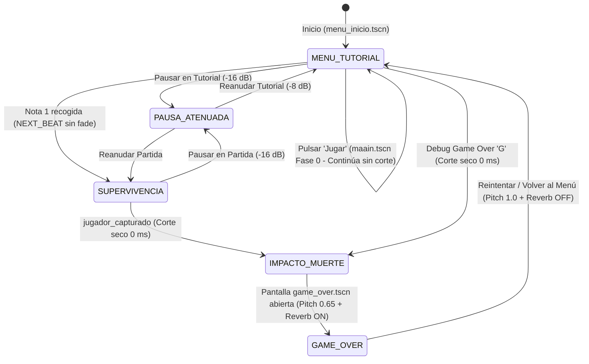

# Sistema de Música Interactiva

Este documento especifica la arquitectura, diseño reactivo, catálogo de pistas, máquina de estados sonoros y directrices de implementación para el **Sistema de Música Interactiva** de **Vosque** mediante **`AudioStreamInteractive`** nativo de Godot 4.7.

> 🎧 **Buses generales y efectos:** [Audio y Feedback Sensorial](audio_y_feedback.md)  
> 🖥️ **Flujo de pantallas e interfaces:** [Pantallas y Menús](pantallas_y_menus.md)  
> 🏛️ **Orquestación de escenas:** [Gestor de Escenas](gestor_de_escenas.md)

---

## 1. Filosofía del Diseño Musical

En *Vosque*, el diseño sonoro está supeditado a la supervivencia. La música no actúa como un mero fondo estático ni como una fanfarria invasiva; cumple dos funciones clave:
1. **Barómetro Psicológico:** Subraya la pérdida de seguridad del jugador a medida que se adentra en el bosque y se enfrenta a lo desconocido.
2. **Subordinación al Radar Diegético (*Audio Ducking*):** Dado que la posición del monstruo se detecta principalmente mediante señales de audio 2D (respiración, estática, pisadas), la música **atenúa su presencia automáticamente** ante la proximidad de la criatura para no bloquear frecuencias críticas de alerta.

---

## 2. Catálogo de Pistas y Recurso `AudioStreamInteractive`

Las pistas musicales se encuentran alojadas en `res://sonido/musica/` en formato `.ogg` con metadatos de sincronización e importación (`bpm`, `beat_count`, `bar_beats`). Se orquestan mediante un recurso nativo **`AudioStreamInteractive`** (`res://sonido/musica/musica_interactiva.tres`).

### 2.1. Pistas Base

| Archivo | Clip Interactivo | Parámetros Godot (`.import`) | Función Psicológica y Comportamiento |
| :--- | :--- | :--- | :--- |
| `Night Crawling - BadBalloon.ogg` | `&"menu_tutorial"` | BPM: `112.0`, Compás: 4/4, `loop = true`, `beat_count = 380` | Ritmo ágil e intrigante. Acompaña la exploración inicial con linterna en el menú y el aprendizaje seguro en el Sector Central. **Persiste sin reiniciarse** al pulsar "Jugar". |
| `Haunted Boardwalk - BadBalloon.ogg` | `&"supervivencia"` | BPM: `100.0`, Compás: 4/4, `loop = true`, `beat_count = 298` | Tempo más lento, pesado y espectral. Se activa tras recolectar la Nota 1, marcando el fin de la zona segura y el inicio del acecho. |

### 2.2. Configuración de Transiciones en `AudioStreamInteractive`

Para garantizar un corte limpio pero musicalmente perfecto al recolectar la primera nota, la matriz de transiciones del recurso se configura de la siguiente forma:

| Origen | Destino | Modo Disparo (`from_time`) | Destino (`to_time`) | Tipo Fade (`fade_mode`) | Duración Fade (`fade_beats`) |
| :--- | :--- | :--- | :--- | :--- | :--- |
| `CLIP_ANY` | `&"supervivencia"` | `NEXT_BEAT` (1) | `START` (1) | `FADE_DISABLED` (0) | `0.0` |
| `CLIP_ANY` | `&"menu_tutorial"` | `IMMEDIATE` (0) | `START` (1) | `FADE_DISABLED` (0) | `0.0` |

> [!NOTE]
> Al utilizar `NEXT_BEAT` con `FADE_DISABLED`, la transición al recolectar la Nota 1 no introduce ningún fundido cruzado artificial, sino que conmuta limpiamente en el siguiente pulso rítmico métrico ($\le 0.5\text{ s}$ a 112 BPM), respetando el tempo sin sensación de desfase.

---

## 3. Máquina de Estados y Modulación Dinámica

El estado musical evoluciona según el ciclo de juego, las amenazas del entorno y el foco de la linterna:



### 3.1. Continuidad Menú $\rightarrow$ Tutorial
* Al pulsar *"Jugar"* en el Menú Principal, el clip `&"menu_tutorial"` continúa reproduciéndose fluidamente a través del iris y durante la carga del Sector Central.
* Si el reproductor ya se encuentra activo en `&"menu_tutorial"`, la llamada a `reproducir_menu_o_tutorial()` es no-destructiva (no reinicia la pista al segundo 0).

### 3.2. Detonante de Supervivencia (*Trigger de Nota 1*)
* **Disparo:** El jugador interactúa con la primera nota en el Sector Central (`Maain._on_nota_recolectada()`).
* **Acción:** `reproductor.set("parameters/switch_to_clip", &"supervivencia")`. El motor realiza el cambio instantáneo pero métricamente alineado en el siguiente beat.

### 3.3. Audio Ducking de Doble Capa y Suavizado
El volumen de la música se modula dinámicamente mediante el bus `musica` en `AudioServer` para priorizar los sonidos hostiles:
1. **Capa 1: Distancia Radial ($d < 800\text{ px}$):**
   $$\text{Vol}_{\text{prox}}(d) = \text{lerp}(-8.0\text{ dB}, -20.0\text{ dB}, \text{clamp}(1.0 - \frac{d}{800.0}, 0.0, 1.0))$$
2. **Capa 2: Enfoque de Linterna con Visión Directa:**
   Si la criatura está dentro del haz luminoso ([`ControladorLinterna._esta_enfocando_monstruo`](file:///c:/Proyectos/vosque/scripts/entidades/personaje/controlador_linterna.gd#L27)) **y** existe línea de visión sin muros intermedios ([`Enemigo.tiene_linea_vision`](file:///c:/Proyectos/vosque/scripts/entidades/enemigo/enemigo.gd#L39)):
   $$\text{Vol}_{\text{objetivo}} = \text{Vol}_{\text{prox}}(d) - 8.0\text{ dB} \quad (\text{alcanzando hasta } -28.0\text{ dB})$$
3. **Interpolación Temporal Suavizada:**
   Para prevenir chasquidos o cortes abruptos al girar la linterna, el volumen efectivo del bus se interpola en `_process(delta)` hacia `Vol_objetivo` a una tasa de $8.0\text{ dB/s}$.

### 3.4. Comportamiento en el Menú de Pausa
* Al entrar al Menú de Pausa (`GestorDeEscenas.pausar()` o pérdida de foco web), `GestorMusica` continúa procesando (`process_mode = Node.PROCESS_MODE_ALWAYS`).
* Aplica una atenuación fija adicional de $-8.0\text{ dB}$ (situando el bus en **$-16.0\text{ dB}$**), manteniendo la atmósfera tensa de fondo sin detener el compás.
* Al reanudar, el bus vuelve suavemente a su nivel operativo nominal.

### 3.5. Secuencia de Muerte y Efecto Game Over (*Nightmare Decay*)
1. **Impacto Letal ($0\text{ ms}$):**
   * En el fotograma del contacto (`Enemigo.jugador_capturado`), se invoca inmediatamente `GestorMusica.detener_por_jumpscare()`, ejecutando `reproductor.stop()` en seco.
   * Esto garantiza el silencio instantáneo antes de comenzar la animación de jumpscare o el fundido a negro.
2. **Pantalla de Game Over (Post-Iris):**
   * Al cargarse y activarse [`game_over.tscn`](file:///c:/Proyectos/vosque/escenas/game_over.tscn), se llama a `GestorMusica.activar_modo_game_over()`.
   * Se limpian los niveles residuales de ducking, se ajusta `reproductor.pitch_scale = 0.65`, se activa el efecto `AudioEffectReverb` en el bus `musica` (`bypass_fx = false`) y se reanuda `&"supervivencia"`.
3. **Restauración:**
   * Al pulsar *Reintentar* o *Volver al Menú*, `restaurar_parametros_normales()` desactiva el reverb (`bypass_fx = true`), regresa `pitch_scale = 1.0`, repone el volumen a $-8.0\text{ dB}$ y conmuta al clip `&"menu_tutorial"`.

---

## 4. Arquitectura de Código: Autoload `GestorMusica`

El control musical se centraliza en un Singleton Autoload registrado en `project.godot`:

### 4.1. Estructura de Nodos del Singleton
```text
GestorMusica (Node) [Autoload: res://scripts/gestor_musica.gd, PROCESS_MODE_ALWAYS]
└── ReproductorInteractivo (AudioStreamPlayer) [stream: musica_interactiva.tres, bus: "musica"]
```

### 4.2. API y Métodos Principales

```gdscript
class_name GestorMusica extends Node

enum EstadoMusical {
	SILENCIO,
	MENU_TUTORIAL,
	SUPERVIVENCIA,
	GAME_OVER
}

const RUTA_RECURSO_INTERACTIVO: String = "res://sonido/musica/musica_interactiva.tres"
const CLIP_MENU_TUTORIAL: StringName = &"menu_tutorial"
const CLIP_SUPERVIVENCIA: StringName = &"supervivencia"

const VOLUMEN_BASE_DB: float = -8.0
const VOLUMEN_MAX_PROXIMIDAD_DB: float = -20.0
const VOLUMEN_MAX_LINTERNA_DB: float = -28.0
const ATENUACION_PAUSA_DB: float = -8.0
const VELOCIDAD_SUAVIZADO_DB: float = 12.0

var estado_actual: EstadoMusical = EstadoMusical.SILENCIO

## Inicia o mantiene el loop de menú y tutorial
func reproducir_menu_o_tutorial() -> void

## Conmuta en NEXT_BEAT al loop de supervivencia
func transicionar_a_supervivencia() -> void

## Modula el bus según distancia y enfoque de linterna
func actualizar_amenaza(distancia_px: float, enfocado_con_vision: bool = false) -> void

## Aplica o remueve el offset de pausa (-8 dB)
func establecer_pausa(en_pausa: bool) -> void

## Silencia en seco a 0 ms para jumpscare
func detener_por_jumpscare() -> void

## Inicia modo Nightmare Decay (pitch 0.65 + Reverb)
func activar_modo_game_over() -> void

## Restaura pitch a 1.0, volumen a -8 dB y apaga Reverb
func restaurar_parametros_normales() -> void
```

---

## 5. Salvaguardas Técnicas, WebAudio y Verificación

### 5.1. Prevención de Fallos Comunes
1. **Resolución Dinámica de Buses:** El script localiza los índices mediante `AudioServer.get_bus_index(&"musica")` y `AudioServer.get_bus_index(&"Master")` en `_ready()`, evitando errores si se reordenan los buses.
2. **Inmunidad a la Pausa:** Gracias a `process_mode = Node.PROCESS_MODE_ALWAYS`, la música y el suavizado de volumen continúan ejecutándose cuando `SceneTree.paused = true`.
3. **Cero Race Conditions:** Al no usar `Tweens` manuales sobre múltiples nodos, el cambio de estado mediante `AudioStreamInteractive` es atómico y libre de fugas de volumen tras reinicios acelerados.
4. **Reseteo en Reinicio Rápido:** Si el jugador muere o reinicia inmediatamente desde el menú de pausa, los parámetros del bus se fuerzan a valores por defecto en el mismo frame.

### 5.2. Compatibilidad Web (`threads = false`)
* En compilaciones HTML5 WebAudio, los efectos continuos en tiempo real sobrecargan la CPU del navegador. Por diseño, el `AudioEffectReverb` del bus `musica` permanece en **bypass total** durante el gameplay activo y **solo** se habilita en la pantalla de Game Over cuando la escena del escenario está pausada o destruida.

### 5.3. Suite de Pruebas Automatizadas (`tests/test_gestor_musica.gd`)
El sistema cuenta con pruebas automatizadas que cubren:
* Detección correcta de los 5 buses y efectos en `default_bus_layout.tres`.
* Conmutación no-destructiva en `reproducir_menu_o_tutorial()`.
* Cambio a `&"supervivencia"` con configuración `NEXT_BEAT`.
* Ducking matemático: distancia ($< 800\text{ px} \to -20\text{ dB}$), linterna/visión ($\to -28\text{ dB}$) y pausa ($\to -16\text{ dB}$).
* Corte a $0\text{ ms}$ en jumpscare y restauración de pitch/reverb post Game Over.
