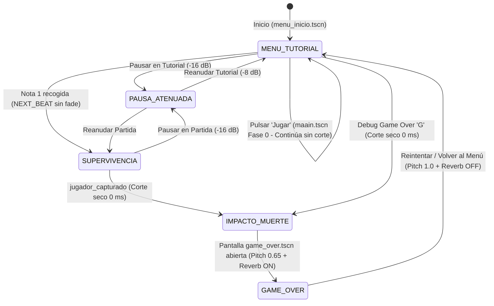

# Sistema de Música Interactiva

Este documento especifica la arquitectura, diseño reactivo, catálogo de pistas, máquina de estados sonoros y directrices de implementación para el **Sistema de Música Interactiva** de **Vosque** mediante **`AudioStreamInteractive`** nativo de Godot 4.7.

> 🎧 **Buses generales y efectos:** [Audio y Feedback Sensorial](audio_y_feedback.md)  
> 🖥️ **Flujo de pantallas e interfaces:** [Pantallas y Menús](pantallas_y_menus.md)  
> 🏛️ **Orquestación de escenas:** [Gestor de Escenas](gestor_de_escenas.md)

---

## 1. Filosofía del Diseño Musical

En *Vosque*, el diseño sonoro está supeditado a la supervivencia. La música no actúa como un mero fondo estático ni como una fanfarria invasiva; cumple una función primordial:
* **Barómetro Psicológico:** Subraya la pérdida de seguridad del jugador a medida que se adentra en el bosque y se enfrenta a lo desconocido, pasando de un ritmo intrigante en el tutorial a una atmósfera pesada y hostil al recoger la primera nota.

---

## 2. Catálogo de Pistas y Recurso `AudioStreamInteractive`

Las pistas musicales se encuentran alojadas en `res://sonido/musica/` en formato `.ogg` con metadatos de sincronización e importación (`bpm`, `beat_count`, `bar_beats`). Se orquestan mediante un recurso nativo **`AudioStreamInteractive`** (`res://sonido/musica/musica_interactiva.tres`) que se edita visualmente desde el panel inferior del Editor de Godot.

### 2.1. Pistas Base

| Archivo en Disco (`res://sonido/musica/`) | Clip Interactivo | Parámetros Godot (`.import`) | Función Psicológica y Comportamiento |
| :--- | :--- | :--- | :--- |
| `Pac Man World 2 Soundtrack - Night Crawling - BadBalloon.ogg` | `&"menu_tutorial"` | BPM: `112.0`, Compás: 4/4, `loop = true`, `beat_count = 380` | Ritmo ágil e intrigante. Acompaña la exploración inicial con linterna en el menú y el aprendizaje seguro en el Sector Central. **Persiste sin reiniciarse** al pulsar "Jugar". |
| `Pac Man World 2 Soundtrack - Haunted Boardwalk - BadBalloon.ogg` | `&"supervivencia"` | BPM: `100.0`, Compás: 4/4, `loop = true`, `beat_count = 298` | Tempo más lento, pesado y espectral. Se activa tras recolectar la Nota 1, marcando el fin de la zona segura y el inicio del acecho. |

### 2.2. Configuración de Transiciones en `AudioStreamInteractive`

En el Inspector de Godot (o mediante el editor de `AudioStreamInteractive`), se define `initial_clip = 0` (`&"menu_tutorial"`) y la matriz de transiciones se configura de la siguiente forma:

| Origen | Destino | Modo Disparo (`from_time`) | Destino (`to_time`) | Tipo Fade (`fade_mode`) | Duración Fade (`fade_beats`) |
| :--- | :--- | :--- | :--- | :--- | :--- |
| `&"menu_tutorial"` | `&"supervivencia"` | `NEXT_BEAT` (1) | `START` (1) | `FADE_DISABLED` (0) | `0.0` |
| `CLIP_ANY` | `&"menu_tutorial"` | `IMMEDIATE` (0) | `START` (1) | `FADE_DISABLED` (0) | `0.0` |

> [!NOTE]
> Al configurar la transición de `&"menu_tutorial"` a `&"supervivencia"` con `NEXT_BEAT` y `FADE_DISABLED`, la conmutación al recolectar la Nota 1 no introduce ningún fundido cruzado artificial, sino que salta limpiamente en el siguiente pulso rítmico métrico ($\le 0.5\text{ s}$ a 112 BPM), mientras que si se invoca `&"supervivencia"` desde estado detenido (ej. en Game Over) entra de forma inmediata.

---

## 3. Máquina de Estados y Modulación Dinámica

El estado musical evoluciona según el ciclo de juego, las amenazas del entorno y el foco de la linterna:



### 3.1. Continuidad Menú $\rightarrow$ Tutorial
* Al pulsar *"Jugar"* en el Menú Principal, el clip `&"menu_tutorial"` continúa reproduciéndose fluidamente a través del iris y durante la carga del Sector Central.
* Si el reproductor ya se encuentra activo en `&"menu_tutorial"`, la llamada a `reproducir_menu_o_tutorial()` es no-destructiva (no reinicia la pista al segundo 0).

### 3.2. Detonante de Supervivencia (*Trigger de Nota 1*)
* **Disparo:** El jugador interactúa con la primera nota en el Sector Central (`Maain._on_nota_recolectada()`).
* **Acción:** `reproductor.set("parameters/switch_to_clip", &"supervivencia")`. El motor realiza el cambio instantáneo pero métricamente alineado en el siguiente beat.

### 3.3. Comportamiento en el Menú de Pausa (Offset Aditivo)
* Al entrar al Menú de Pausa (`GestorDeEscenas.pausar()` o pérdida de foco web), `GestorMusica` continúa procesando (`process_mode = Node.PROCESS_MODE_ALWAYS`).
* Aplica un offset aditivo `config.atenuacion_pausa_db` (por defecto $-8.0\text{ dB}$) sobre el volumen base ($\text{Vol}_{\text{objetivo}} = \text{config.volumen\_base\_db} + \text{config.atenuacion\_pausa\_db} = -16.0\text{ dB}$), manteniendo la música atenuada de fondo durante la pausa.
* La transición de volumen se interpola suavemente con `move_toward` a razón de `config.velocidad_suavizado_db` (por defecto $12.0\text{ dB/s}$).
* Al reanudar, el bus remueve el offset y vuelve suavemente a `config.volumen_base_db` ($-8.0\text{ dB}$).

### 3.4. Secuencia de Muerte y Efecto Game Over (*Nightmare Decay*)
1. **Impacto Letal ($0\text{ ms}$):**
   * En el fotograma del contacto (`Enemigo.jugador_capturado`), se invoca inmediatamente `GestorMusica.detener_por_jumpscare()`, ejecutando `reproductor.stop()` en seco.
   * Esto garantiza el silencio instantáneo antes de comenzar la animación de jumpscare o el fundido a negro.
2. **Pantalla de Game Over (Post-Iris):**
   * Al cargarse y activarse [`game_over.tscn`](file:///c:/Proyectos/vosque/escenas/game_over.tscn), se llama a `GestorMusica.activar_modo_game_over()`.
   * Se limpian los niveles residuales de ducking, se ajusta `reproductor.pitch_scale = config.pitch_game_over` (por defecto `0.65`), se activa el efecto `AudioEffectReverb` en el bus `musica` (`AudioServer.set_bus_effect_enabled(bus_idx, 0, true)`) y se reproduce `&"supervivencia"`.
3. **Restauración:**
   * Al pulsar *Reintentar* o *Volver al Menú*, `restaurar_parametros_normales()` desactiva el reverb (`set_bus_effect_enabled(bus_idx, 0, false)`), regresa `pitch_scale = 1.0`, repone el volumen a `config.volumen_base_db` ($-8.0\text{ dB}$) y conmuta al clip `&"menu_tutorial"`.

---

## 4. Arquitectura Editable en Godot: Escena Autoload + Recurso `ConfiguracionMusica`

Para garantizar que todo el sistema musical sea **100% editable desde el Inspector de Godot** sin necesidad de modificar código GDScript (siguiendo el mismo patrón de [`ConfiguracionIluminacion`](file:///c:/Proyectos/vosque/scripts/mundo/configuracion_iluminacion.gd) y [`ConfiguracionNiebla`](file:///c:/Proyectos/vosque/scripts/mundo/configuracion_niebla.gd)), la arquitectura se divide en un **Recurso Tipado Reactivo (`.tres`)** y una **Escena Autoload (`.tscn`)**.

> [!IMPORTANT]
> **Prevención de colisión de nombres en Godot 4:** El Singleton Autoload se registra en `project.godot` bajo el nombre `GestorMusica` apuntando a `res://escenas/gestor_musica.tscn`. Por tanto, el script `res://scripts/core/gestor_musica.gd` utiliza `class_name ControladorMusica` (o prescinde de `class_name` idéntico al Autoload) para evitar el error de compilación *"Class 'GestorMusica' hides an autoload singleton"*.

### 4.1. Recurso Tipado `ConfiguracionMusica` (`res://scripts/core/configuracion_musica.gd`)
Se guarda como preset por defecto en `res://recursos/audio/config_musica_defecto.tres`. Al ser `@tool` y emitir `changed` en cada *setter*, cualquier ajuste realizado con los deslizadores del Inspector de Godot actualiza la música en vivo:

```gdscript
@tool
class_name ConfiguracionMusica
extends Resource

## Recurso de configuración reactivo para volúmenes, clips y estados de GestorMusica.

@export_group("Recurso y Clips Interactivos")
@export var stream_interactivo: AudioStreamInteractive = preload("res://sonido/musica/musica_interactiva.tres"):
	set(val):
		stream_interactivo = val
		emit_changed()

@export var nombre_bus: StringName = &"musica":
	set(val):
		nombre_bus = val
		emit_changed()

@export var clip_menu_tutorial: StringName = &"menu_tutorial":
	set(val):
		clip_menu_tutorial = val
		emit_changed()

@export var clip_supervivencia: StringName = &"supervivencia":
	set(val):
		clip_supervivencia = val
		emit_changed()

@export_group("Volúmenes y Suavizado")
@export_range(-40.0, 6.0, 0.5, "suffix:dB") var volumen_base_db: float = -8.0:
	set(val):
		volumen_base_db = val
		emit_changed()

@export_range(1.0, 40.0, 0.5, "suffix:dB/s") var velocidad_suavizado_db: float = 12.0:
	set(val):
		velocidad_suavizado_db = val
		emit_changed()

@export_group("Pausa y Game Over (Nightmare Decay)")
@export_range(-30.0, 0.0, 0.5, "suffix:dB") var atenuacion_pausa_db: float = -8.0:
	set(val):
		atenuacion_pausa_db = val
		emit_changed()

@export_range(0.2, 1.5, 0.05) var pitch_game_over: float = 0.65:
	set(val):
		pitch_game_over = val
		emit_changed()
```

### 4.2. Estructura de Nodos de la Escena Autoload (`res://escenas/gestor_musica.tscn`)
Al abrir `res://escenas/gestor_musica.tscn` en el Editor de Godot, el árbol de nodos es directamente inspeccionable y editable:

```text
GestorMusica (Node) [Autoload: res://escenas/gestor_musica.tscn, script: res://scripts/core/gestor_musica.gd, PROCESS_MODE_ALWAYS]
└── ReproductorInteractivo (AudioStreamPlayer) [stream: musica_interactiva.tres, bus: &"musica"]
```

### 4.3. API del Controlador (`res://scripts/core/gestor_musica.gd`)

```gdscript
@tool
class_name ControladorMusica
extends Node

enum EstadoMusical {
	SILENCIO,
	MENU_TUTORIAL,
	SUPERVIVENCIA,
	GAME_OVER
}

@export var config: ConfiguracionMusica = preload("res://recursos/audio/config_musica_defecto.tres"):
	set(val):
		if config != null and config.changed.is_connected(_on_config_changed):
			config.changed.disconnect(_on_config_changed)
		config = val
		if config != null and not config.changed.is_connected(_on_config_changed):
			config.changed.connect(_on_config_changed)
		_aplicar_configuracion_en_vivo()

@onready var reproductor: AudioStreamPlayer = $ReproductorInteractivo

var estado_actual: EstadoMusical = EstadoMusical.SILENCIO

## Inicia o mantiene el loop de menú y tutorial (no-destructivo si ya suena)
func reproducir_menu_o_tutorial() -> void

## Conmuta en NEXT_BEAT al loop de supervivencia
func transicionar_a_supervivencia() -> void

## Aplica o remueve el offset aditivo de pausa (`config.atenuacion_pausa_db`)
func establecer_pausa(en_pausa: bool) -> void

## Silencia en seco a 0 ms para jumpscare
func detener_por_jumpscare() -> void

## Inicia modo Nightmare Decay (`config.pitch_game_over` + Reverb ON en bus)
func activar_modo_game_over() -> void

## Restaura pitch a 1.0, volumen a `config.volumen_base_db` y apaga Reverb
func restaurar_parametros_normales() -> void
```

---

## 5. Plan de Implementación para Edición en el Editor de Godot y Menú Debug (F3)

Para llevar a cabo esta arquitectura asegurando cero errores de edición y máxima comodidad en el flujo de trabajo con las herramientas MCP de Godot (`godot-ai`), se establece el siguiente plan por fases:

### Fase 1: Layout de Buses y Recurso `AudioStreamInteractive` (vía MCP)
1. **Verificación y expansión de [`res://default_bus_layout.tres`](file:///c:/Proyectos/vosque/default_bus_layout.tres):**
   - Asegurar en la raíz del proyecto que el bus `&"musica"` cuente con el efecto `AudioEffectReverb` en el slot `0` desactivado por defecto (`enabled = false`).
2. **Creación de `res://sonido/musica/musica_interactiva.tres`:**
   - Mediante `resource_manage` (nunca editando `.tres` en crudo), instanciar `AudioStreamInteractive`.
   - Asignar los 2 clips reales (`Pac Man World 2 Soundtrack - Night Crawling - BadBalloon.ogg` como `&"menu_tutorial"` y `Pac Man World 2 Soundtrack - Haunted Boardwalk - BadBalloon.ogg` como `&"supervivencia"`).
   - Configurar la transición `&"menu_tutorial"` $\to$ `&"supervivencia"` en modo `NEXT_BEAT` sin fade, permitiendo que cualquier ajuste futuro de tiempos o fundidos pueda hacerse haciendo doble clic sobre `musica_interactiva.tres` en el panel inferior del Editor de Godot.

### Fase 2: Recurso `ConfiguracionMusica` y Preset `.tres`
1. **Crear [`res://scripts/core/configuracion_musica.gd`](file:///c:/Proyectos/vosque/scripts/core/configuracion_musica.gd):**
   - Implementar la clase `@tool class_name ConfiguracionMusica extends Resource` con los tres `@export_group` (`Recurso y Clips Interactivos`, `Volúmenes y Audio Ducking`, `Pausa y Game Over`).
2. **Crear el preset `res://recursos/audio/config_musica_defecto.tres` (vía MCP):**
   - Instanciar el recurso mediante las herramientas MCP de Godot para que cualquier diseñador pueda abrir `config_musica_defecto.tres` en el Inspector y mover los sliders con sufijos `dB`, `px` y `dB/s`.

### Fase 3: Escena `gestor_musica.tscn` y Registro Autoload
1. **Crear [`res://scripts/core/gestor_musica.gd`](file:///c:/Proyectos/vosque/scripts/core/gestor_musica.gd):**
   - Implementar `ControladorMusica` con soporte `@tool`, conexión a `config.changed` para recarga en caliente de volúmenes/pitch y resolución dinámica del índice del bus (`AudioServer.get_bus_index(config.nombre_bus)`).
2. **Crear la escena `res://escenas/gestor_musica.tscn` y registrar Autoload (vía MCP):**
   - Usar `scene_manage` y `node_create` para crear el nodo raíz `GestorMusica` (`Node`, `process_mode = PROCESS_MODE_ALWAYS`) y su hijo `ReproductorInteractivo` (`AudioStreamPlayer`).
   - Registrar `GestorMusica` en `project.godot` usando `autoload_manage` apuntando a `*res://escenas/gestor_musica.tscn`.

### Fase 4: Integración en `TabSistema` del Menú de Debug In-Game (<kbd>F3</kbd>)
1. **Sección de Audio y Música en `TabSistema` ([`debug_system_controller.gd`](file:///c:/Proyectos/vosque/scripts/debug/debug_menu/debug_system_controller.gd)):**
   - **Telemetría en vivo:** Etiqueta con el `EstadoMusical` actual, clip activo y volumen instantáneo del bus `&"musica"` en `dB`.
   - **Botones de disparo rápido:** Botones para forzar en un clic `Menú/Tutorial`, `Supervivencia (NEXT_BEAT)`, `Corte Jumpscare (0 ms)` y `Game Over (Nightmare Decay)`.
   - **Sliders vinculados a `ConfiguracionMusica`:** Deslizadores para `volumen_base_db`, `atenuacion_pausa_db` y `pitch_game_over` que modifican directamente el recurso activo para escuchar los cambios en tiempo real mientras se juega.

---

## 5. Salvaguardas Técnicas, WebAudio y Verificación

### 5.1. Prevención de Fallos Comunes
1. **Resolución Dinámica de Buses:** El script localiza los índices mediante `AudioServer.get_bus_index(config.nombre_bus)` y `AudioServer.get_bus_index(&"Master")` en `_ready()`, evitando errores si se reordenan los buses.
2. **Inmunidad a la Pausa:** Gracias a `process_mode = Node.PROCESS_MODE_ALWAYS`, la música y el suavizado de volumen continúan ejecutándose cuando `SceneTree.paused = true`.
3. **Cero Race Conditions:** Al no usar `Tweens` manuales sobre múltiples nodos, el cambio de estado mediante `AudioStreamInteractive` es atómico y libre de fugas de volumen tras reinicios acelerados.
4. **Reseteo en Reinicio Rápido:** Si el jugador muere o reinicia inmediatamente desde el menú de pausa, los parámetros del bus se fuerzan a valores por defecto en el mismo frame.

### 5.2. Compatibilidad Web (`threads = false`)
* En compilaciones HTML5 WebAudio, los efectos continuos en tiempo real sobrecargan la CPU del navegador. Por diseño, el `AudioEffectReverb` del bus `musica` permanece en **bypass total** durante el gameplay activo y **solo** se habilita en la pantalla de Game Over cuando la escena del escenario está pausada o destruida.

### 5.3. Suite de Pruebas Automatizadas (`tests/test_gestor_musica.gd`)
El sistema cuenta con pruebas automatizadas que cubren:
* Detección correcta de los 5 buses y efectos en `default_bus_layout.tres`.
* Conmutación no-destructiva en `reproducir_menu_o_tutorial()`.
* Cambio a `&"supervivencia"` con configuración `NEXT_BEAT`.
* Atenuación en pausa ($\to -16\text{ dB}$).
* Corte a $0\text{ ms}$ en jumpscare y restauración de pitch/reverb post Game Over.
