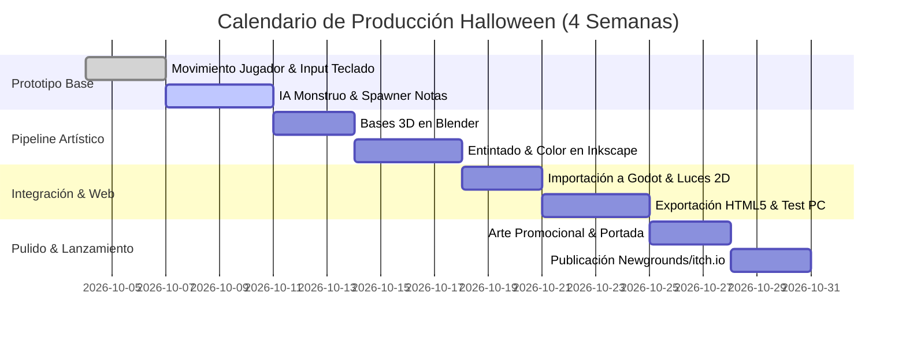

# Roadmap e Hitos de Producción

Este documento detalla el cronograma de desarrollo acotado a 4 semanas para alcanzar la meta de lanzamiento en Halloween (31 de Octubre).

---

## 1. Cronograma General (Gantt)

---

## 2. Entregables Clave por Semana

| Periodo | Objetivo Principal | Entregables Clave |
| :--- | :--- | :--- |
| **Semana 1** | Base funcional (Graybox) | Movimiento fluido, IA básica del monstruo con colisiones, sistema de spawn de notas y Game Over funcional en Godot. |
| **Semana 2** | Pipeline Artístico (Blender + Inkscape) | Modelado de volúmenes base en Blender, entintado vectorial en Inkscape, exportación de sprites y efectos de sonido. |
| **Semana 3** | Adaptación Web y Test PC | Optimización de exportación a HTML5, pruebas directas en navegadores de escritorio y balanceo de velocidad y dificultad. |
| **Semana 4** | Pulido, Promo y Lanzamiento | Arte promocional (portada tenebrosa), miniaturas, publicación en Newgrounds e itch.io, y videos cortos (devlogs). |
