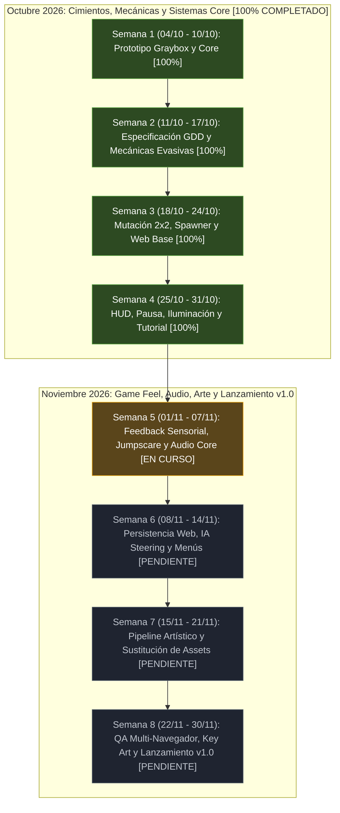

# Roadmap e Hitos de Producción

Este documento detalla el cronograma de desarrollo integral de *Vosque*, reflejando el progreso técnico real consolidado del sprint fundacional de Octubre y la planificación operativa de 4 semanas para **Noviembre de 2026** hacia el lanzamiento final v1.0 en *itch.io* y *Newgrounds* a fecha de **1 de Noviembre de 2026**.

---

## 1. Visión Temporal y Flujo de Hitos (8 Semanas)

---

## 2. Estado de Producción por Semana

### Semana 1 (04/10/2026 – 10/10/2026): Base Funcional (Graybox) — **[100% COMPLETADA]**
* **Objetivo:** Establecer la base de físicas, cámara, ciclo de pantallas y herramientas del desarrollador.
* **Entregables Concluidos:**
  - [x] Movimiento fluido en 8 direcciones con aceleración (`5000 px/s²`), fricción y freno seco (`stop_threshold = 15.0 px/s`) en [`personaje.gd`](../../scripts/personaje.gd).
  - [x] Suavizado y centrado dinámico de [`camara.tscn`](../../escenas/camara.tscn).
  - [x] HUD de telemetría en tiempo real [`debug_info.gd`](../../scripts/debug_info.gd) con alternancia vía tecla `F3`.
  - [x] Plugin de editor contextual [`addons/personaje_tools`](../../addons/personaje_tools) para calibración de presets (`Sigilo`, `Normal`, `Sprint`).
  - [x] Arquitectura de ciclo de juego [`gestor_escenas.gd`](../../scripts/gestor_escenas.gd) con transiciones por fundido a negro entre [`menu_inicio.tscn`](../../escenas/menu_inicio.tscn), [`maain.tscn`](../../escenas/maain.tscn) y [`game_over.tscn`](../../escenas/game_over.tscn).
  - [x] IA elemental de persecución con cálculo vectorial y rotación visual continua hacia el jugador en [`enemigo.gd`](../../scripts/enemigo.gd).

---

### Semana 2 (11/10/2026 – 17/10/2026): Especificación Técnica y Mecánicas Evasivas — **[100% COMPLETADA]**
* **Objetivo:** Formalizar el GDD modular, diseñar habilidades de evasión arcade de alto riesgo, delimitar el mapa modular, especificar los subsistemas clave (Notas, Spawner, Game Director, Audio y Cámara) y definir el pipeline artístico óptimo de ~30 piezas.
* **Entregables Concluidos:**
  - [x] Especificación técnica de **Salto Libre** (arco Z simulado en $0.45\text{ s}$ superando obstáculos bajos) y **Salto de Plancha (*Dive*)** con vulnerabilidad de $0.6\text{ s}$ en suelo en [`personaje_y_habilidades.md`](../gameplay/personaje_y_habilidades.md).
  - [x] Especificación de **Sprint y Barra de Estamina** nativa con retardo de recarga de $0.8\text{ s}$ y umbral de seguridad de fatiga ($30\%$).
  - [x] Diseño topológico de la **Arena 2x2 ($4320 \times 4320$ px con cuadrantes de $2160 \times 2160$ px)**, sub-escenas de variantes, franjas seguras de $160\text{ px}$ en intersecciones y algoritmo de mutación de los 3 sectores lejanos en [`mapa_y_sectores.md`](../gameplay/mapa_y_sectores.md).
  - [x] Matriz de capas de física (Capa 1: `Mundo_Alto`, Capa 2: `Obstaculos_Bajos`, Capa 3: `Jugador`, Capa 4: `Monstruo`, Capa 5: `Interactuables`).
  - [x] Especificación técnica de **Sistema de Notas y Spawner** con filtros espaciales ($R_{\min} \ge 600\text{ px}$) y baliza luminosa en [`sistema_de_notas_y_spawner.md`](../gameplay/sistema_de_notas_y_spawner.md).
  - [x] Diseño de arquitectura de partida y Game Director con persistencia dual de *High Score* en [`arquitectura_de_partida_y_director.md`](../gameplay/arquitectura_de_partida_y_director.md).
  - [x] Especificación de **Cámara y Game Feel** con modelo de sacudida por trauma cuadrático ($T^2$) en [`camara_y_game_feel.md`](../gameplay/camara_y_game_feel.md).
  - [x] Catálogo consolidado de arte de ~30 piezas en [`guia_estilo_y_assets.md`](../arte/guia_estilo_y_assets.md).
  - [x] Diseño de arquitectura del **Menú de Pausa** como `CanvasLayer` en `layer=50` en [`controles_y_hud.md`](../interfaz_y_audio/controles_y_hud.md).

---

### Semana 3 (18/10/2026 – 24/10/2026): Integración en Motor, Mutación 2x2 y Web Base — **[100% COMPLETADA]**
* **Objetivo:** Trasladar las mecánicas documentadas al código GDScript de Godot 4, habilitar la mutación continua de cuadrantes y validar la primera compilación funcional en navegador.
* **Entregables Concluidos:**
  - [x] Implementar la máquina de estados de Salto Libre, Plancha (*Dive*) y simulación de elevación en eje Z en [`personaje.gd`](../../scripts/personaje.gd).
  - [x] Implementar la lógica de Estamina y fatiga en [`personaje.gd`](../../scripts/personaje.gd).
  - [x] Crear la estructura modular de [`escenas/escenario.tscn`](../../escenas/escenario.tscn) con valla perimetral fija y las sub-escenas de variantes con corredores de paso seguros.
  - [x] Programar la lógica de mutación de los 3 sectores lejanos, niebla de transición (`EfectoNieblaMutacion`) vía shaders con fase continua y reposicionamiento anti-atascamiento del monstruo.
  - [x] Crear la entidad coleccionable [`escenas/nota.tscn`](../../escenas/nota.tscn) con baliza luminosa y recolección arcade instantánea.
  - [x] Implementar el orquestador Game Director en [`scripts/maain.gd`](../../scripts/maain.gd) conectando las señales de recolección, mutación y el algoritmo de Spawner con exclusión espacial.
  - [x] Implementar el escalado de velocidad del enemigo según el modelo cuantitativo acotado ($500 \to 920\text{ px/s}$) e hibernación en Nota 0 en [`enemigo.gd`](../../scripts/enemigo.gd).
  - [x] Implementar suite de telemetría y menú unificado de diagnóstico in-game en [`escenas/debug_menu.tscn`](../../escenas/debug_menu.tscn) con persistencia vía Autoload `DebugConfig`.
  - [x] Configurar preset de exportación Web en [`export_presets.cfg`](../../export_presets.cfg) (`gl_compatibility`, `threads = false`).

---

### Semana 4 (25/10/2026 – 31/10/2026): HUD, Menú de Pausa, Iluminación y Tutorial — **[100% COMPLETADA]**
* **Objetivo:** Desarrollar los sistemas de interfaz in-game, retroalimentación diegética, control de pausa desacoplado, sistema de luz desacoplado y tutorial contextual sin fricción.
* **Entregables Concluidos:**
  - [x] Diseñar el HUD in-game ([`escenas/hud.tscn`](../../escenas/hud.tscn)) con contador elástico de notas (*Scale Punch* $1.3 \to 1.0$) y flash reactivo.
  - [x] Implementar el indicador diegético de estamina ([`escenas/ui/indicador_estamina.tscn`](../../escenas/ui/indicador_estamina.tscn)) como anillo procedural anclado a la cabeza del personaje, con titileo en fatiga y auto-ocultamiento.
  - [x] Implementar el sistema de iluminación desacoplado en $360^\circ$ ([`docs/gameplay/sistema_de_iluminacion.md`](../gameplay/sistema_de_iluminacion.md)) con `HaloCorporal`, `LinternaFrontal` cónica procedimental orientada por ratón/movimiento y `CanvasModulate` con oscurecimiento reactivo en [`escenario.tscn`](../../escenas/escenario.tscn).
  - [x] Integrar el Menú de Pausa ([`escenas/menu_pausa.tscn`](../../escenas/menu_pausa.tscn)) con arquitectura híbrida (`SceneTree.paused = true` + `PROCESS_MODE_ALWAYS` en UI), triple blindaje anti-salto (<kbd>Espacio</kbd>), auto-pausa por pérdida de foco web y soporte de mando/teclado.
  - [x] Desarrollar el tutorial contextual flotante ([`escenas/ui/tutorial_cabeza.tscn`](../../escenas/ui/tutorial_cabeza.tscn)) con progresión escalonada, badges vectoriales y acelerador (*Fast-Path*) para jugadores veteranos.
  - [x] Diseñar el Menú Principal diegético ([`escenas/menu_inicio.tscn`](../../escenas/menu_inicio.tscn)) con parallax en 3 planos y enfoque de linterna sobre las opciones.

---

### Semana 5 (01/11/2026 – 07/11/2026): Feedback Sensorial, Jumpscare y Audio Core — **[EN CURSO]**
* **Objetivo:** Conectar el impacto físico y auditivo del juego mediante retroalimentación táctil de cámara y orquestación audiovisual dramática.
* **Entregables Clave:**
  - [ ] Implementar el sistema de sacudida por trauma (*Camera Shake*) en [`escenas/camara.tscn`](../../escenas/camara.tscn) con modelo de trauma cuadrático ($T^2$), decaimiento lineal e impulsos por caída de plancha ($+0.35$), proximidad y muerte ($+1.0$).
  - [ ] Implementar la orquestación de Game Over en [`escenas/game_over.tscn`](../../escenas/game_over.tscn) mediante `AnimationPlayer` con track multicanal de zoom de jumpscare, flash carmesí, trauma de cámara y audio de impacto.
  - [ ] Crear el Singleton Autoload `GestorMusica` ([`scripts/gestor_musica.gd`](../../scripts/gestor_musica.gd)) con crossfade fluido de $2.0\text{ s}$ de `Night Crawling` a `Haunted Boardwalk` al recolectar la Nota 1, atenuación por proximidad de la criatura (*audio ducking*) y corte súbito en derrota.
  - [ ] Configurar buses de audio en `default_bus_layout.tres` (`Master`, `sfx`, `musica`) con filtros de ambiente (reverberación cavernosa post-derrota y filtro pasa-bajos en fatiga).
  - [ ] Integrar biblioteca de SFX esenciales (pasos según velocidad sobre hojarasca, despegue de salto, golpe de plancha, rasgado de nota y zumbido/alarma de la criatura).

---

### Semana 6 (08/11/2026 – 14/11/2026): Persistencia Web, IA Steering y Menús — **[PLANIFICADA]**
* **Objetivo:** Asegurar la retención de progreso del jugador en navegadores, afinar la navegación del monstruo en la arena y completar el flujo de menús secundarios.
* **Entregables Clave:**
  - [ ] Implementar persistencia de High Score en Web mediante `user://` (IndexedDB en Godot Web) y fallback a `JavaScriptBridge` (`localStorage`).
  - [ ] Presentar estadísticas de fin de partida (páginas recolectadas vs récord histórico) en la pantalla de Game Over.
  - [ ] Programar vector de desatasco tangencial (*steering*) en [`scripts/enemigo.gd`](../../scripts/enemigo.gd) para sortear obstáculos convexos sin perder agresividad.
  - [ ] Conectar las sub-pantallas de Opciones y Créditos a las señales de [`escenas/menu_inicio.tscn`](../../escenas/menu_inicio.tscn).
  - [ ] Añadir controles de calibración en vivo para linterna y trauma de cámara en [`escenas/debug_menu.tscn`](../../escenas/debug_menu.tscn).

---

### Semana 7 (15/11/2026 – 21/11/2026): Pipeline Artístico y Sustitución de Assets — **[PLANIFICADA]**
* **Objetivo:** Sustituir los placeholders geométricos por el catálogo visual definitivo de ~30 piezas vectorizadas/renderizadas bajo el pipeline híbrido (Blender + Inkscape).
* **Entregables Clave:**
  - [ ] Crear estructura de directorio `assets_raw/` con `.gdignore` para archivos fuente de Blender e Inkscape.
  - [ ] Exportar los 15 frames definitivos del protagonista (caminar 3 perspectivas, salto en aire, plancha aerodinámica, recuperación y sombra).
  - [ ] Integrar sprite cenital del monstruo con garras y máscara de ojos brillantes/emisivos.
  - [ ] Sustituir los tiles y obstáculos modulares (suelo hojarasca, árboles secos/frondosos, rocas asimétricas, troncos caídos y vallas de estacas).
  - [ ] Producir la ilustración final de impacto de jumpscare ($512 \times 512$ px) para el `AnimationPlayer` de Game Over.

---

### Semana 8 (22/11/2026 – 30/11/2026): QA Multi-Navegador, Key Art y Lanzamiento v1.0 — **[PLANIFICADA]**
* **Objetivo:** Asegurar la robustez técnica en navegadores, generar el material de difusión y publicar la versión 1.0.
* **Entregables Clave:**
  - [ ] Validar compatibilidad y rendimiento en Chrome, Firefox y Edge bajo `gl_compatibility` y `threads = false`.
  - [ ] Verificar políticas de desbloqueo de AudioContext Web API en el primer clic de usuario en el lienzo.
  - [ ] Diseñar el Key Art promocional, banners de cabecera y capturas de pantalla para las plataformas de distribución.
  - [ ] Empaquetar la compilación web optimizada `.zip` y publicar oficialmente el juego en *itch.io* y *Newgrounds*.

---

## 3. Matriz de Riesgos y Mitigaciones

| Riesgo Identificado | Impacto | Probabilidad | Estrategia de Mitigación |
| :--- | :---: | :---: | :--- |
| **Bloqueo de AudioContext en Web** | Alto | Alta | Desbloquear automáticamente los buses de sonido al registrar la primera interacción de ratón o teclado en el canvas HTML antes de disparar pistas críticas. |
| **Sobrecarga en el pipeline de 30 sprites** | Alto | Media | Catálogo congelado a un máximo estricto de ~30 piezas; priorizar silueta y ojos de la criatura y animación procedural complementaria (escala de respiración, rotación matemática 360°). |
| **Problemas de CORS/COOP en Web** | Crítico | Baja | Mantener hilos desactivados (`threads = false`) en el preset Web; de este modo el juego corre en cualquier iframe sin requerir cabeceras HTTP especiales en itch.io/Newgrounds. |
| **Atascamiento del monstruo al mutar** | Alto | Baja | Algoritmo anti-atascamiento con `test_move()`, reubicando a la criatura al `Marker2D` libre más cercano y excluyéndolo del sorteo de la nueva nota. |
| **Pérdida de foco del teclado en iframe** | Medio | Alta | Script en contenedor HTML (`canvas.focus()`) y anulación de propagación de teclas (`preventDefault` para Espacio y Flechas), respaldado por auto-pausa de motor. |
