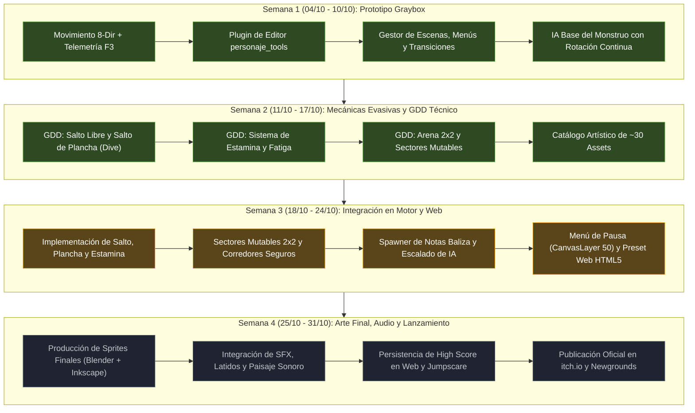

# Roadmap e Hitos de Producción

Este documento detalla el cronograma de desarrollo acotado a 4 semanas para alcanzar el objetivo de lanzamiento en Halloween (31 de Octubre de 2026), reflejando el progreso técnico real del proyecto a fecha de **17 de Octubre de 2026**.

---

## 1. Visión Temporal y Flujo de Hitos (4 Semanas)

---

## 2. Estado de Producción por Semana

### Semana 1 (04/10/2026 – 10/10/2026): Base Funcional (Graybox) — **[100% COMPLETADA]**
* **Objetivo:** Establecer la base de físicas, cámara, ciclo de pantallas y herramientas del desarrollador.
* **Entregables Concluidos:**
  - [x] Movimiento fluido en 8 direcciones con aceleración (`5000 px/s²`), fricción y freno seco (`stop_threshold = 15.0 px/s`) en [`personaje.gd`](../../scripts/personaje.gd).
  - [x] Suavizado y centrado dinámico de [`camara.tscn`](../../escenas/camara.tscn).
  - [x] HUD de telemetría en tiempo real [`debug_info.gd`](../../scripts/debug_info.gd) con alternancia vía tecla `F3`.
  - [x] Plugin de editor contextual [`addons/personaje_tools`](../../addons/personaje_tools) para calibración de presets (`Sigilo`, `Normal`, `Sprint`).
  - [x] Arquitectura de ciclo de juego [`gestor_escenas.gd`](../../scripts/gestor_escenas.gd) con transiciones por fundido a negro entre [`menu_inicio.tscn`](../../escenas/menu_inicio.tscn), [`maain.tscn`](../../escenas/maain.tscn) y [`game_over.tscn`](../../escenas/game_over.tscn).
  - [x] IA elemental de persecución con cálculo vectorial y rotación visual continua hacia el jugador en [`enemigo.gd`](../../scripts/enemigo.gd).

---

### Semana 2 (11/10/2026 – 17/10/2026): Especificación Técnica y Mecánicas Evasivas — **[ACTUAL: 95% COMPLETADA]**
* **Objetivo:** Formalizar el GDD modular, diseñar habilidades de evasión arcade de alto riesgo, delimitar el mapa modular y definir el pipeline artístico óptimo de 30 piezas.
* **Entregables:**
  - [x] Especificación técnica de **Salto Libre** (arco Z simulado en $0.45\text{ s}$ superando obstáculos bajos) y **Salto de Plancha (*Dive*)** con vulnerabilidad de $0.6\text{ s}$ en suelo en [`personaje_y_habilidades.md`](../gameplay/personaje_y_habilidades.md).
  - [x] Especificación de **Sprint y Barra de Estamina** nativa con retardo de recarga de $0.8\text{ s}$ y umbral de seguridad de fatiga ($30\%$).
  - [x] Diseño topológico de la **Arena 2x2 ($2160 \times 2160$ px)**, sub-escenas de variantes, franjas seguras de $160\text{ px}$ en intersecciones y algoritmo de mutación de los 3 sectores lejanos en [`mapa_y_sectores.md`](../gameplay/mapa_y_sectores.md).
  - [x] Matriz de capas de física (Capa 1: `Mundo_Alto`, Capa 2: `Obstaculos_Bajos`, Capa 3: `Jugador`, Capa 4: `Monstruo`, Capa 5: `Interactuables`).
  - [x] Catálogo consolidado de arte de ~30 piezas (15 cuadros jugador, 2-3 criatura, 3 menú, 6 entorno, 2 notas, 1 jumpscare) en [`guia_estilo_y_assets.md`](../arte/guia_estilo_y_assets.md).
  - [x] Diseño de arquitectura del **Menú de Pausa** como `CanvasLayer` en `layer=50` en [`controles_y_hud.md`](../interfaz_y_audio/controles_y_hud.md).

---

### Semana 3 (18/10/2026 – 24/10/2026): Integración en Motor, Mutación 2x2 y Web — **[EN CURSO / PRÓXIMO HITO]**
* **Objetivo:** Trasladar las mecánicas documentadas al código GDScript de Godot 4, habilitar la mutación continua de cuadrantes y validar la primera compilación funcional en navegador.
* **Entregables Clave:**
  - [ ] Implementar la máquina de estados de Salto Libre, Plancha (*Dive*) y simulación de elevación en eje Z en [`personaje.gd`](../../scripts/personaje.gd).
  - [ ] Implementar el sistema de Estamina, fatiga y vincularlo con el `ProgressBar` nativo del HUD.
  - [ ] Crear la estructura modular de [`escenas/escenario.tscn`](../../escenas/escenario.tscn) con valla perimetral fija y las sub-escenas de variantes con corredores de paso seguros.
  - [ ] Programar la lógica de mutación de los 3 sectores lejanos y reposicionamiento anti-atascamiento del monstruo.
  - [ ] Crear la entidad coleccionable [`escenas/nota.tscn`](../../escenas/nota.tscn) con halo tenue (`PointLight2D`), recolección arcade instantánea y escalado de velocidad del enemigo.
  - [ ] Integrar el nodo de menú de pausa en [`gestor_escenas.gd`](../../scripts/gestor_escenas.gd) pausando solo el subárbol de la partida activa.
  - [ ] Configurar el preset de exportación Web (HTML5) con renderer Compatibility y generar la primera build de prueba para navegador.

---

### Semana 4 (25/10/2026 – 31/10/2026): Arte Final, Audio, Pulido y Lanzamiento — **[PENDIENTE]**
* **Objetivo:** Sustituir placeholders y graybox por los assets finales ilustrados (Blender + Inkscape), integrar diseño sonoro, afinar balance y publicar para Halloween.
* **Entregables Clave:**
  - [ ] Generar los renders 3D base en Blender y vectorizar en Inkscape los sprites del jugador (15 frames) y criatura (2-3 frames).
  - [ ] Ensamblar el Menú Principal en 3 capas con efecto de paralaje reactivo al ratón.
  - [ ] Integrar efectos de sonido (pasos en hojarasca, jadeo tras plancha, proximidad gutural/estática, rasgado de notas, jumpscare orquestal).
  - [ ] Implementar persistencia de High Score en Web (`user://` sobre `IndexedDB` y fallback a `localStorage`).
  - [ ] Probar compatibilidad en navegadores principales (Chrome, Firefox, Edge).
  - [ ] Diseñar portada promocional (*Key Art*), banners y capturas.
  - [ ] Publicar y verificar el juego en Newgrounds e itch.io el **31 de Octubre de 2026**.

---

## 3. Matriz de Riesgos y Mitigaciones

| Riesgo Identificado | Impacto | Probabilidad | Estrategia de Mitigación |
| :--- | :---: | :---: | :--- |
| **Cuello de botella en dibujo de sprites** | Alto | Media | Catálogo congelado a un máximo estricto de ~30 piezas; uso de animación procedural (escala de respiración, aceleración de ciclo para sprint, rotación matemática 360° del monstruo). |
| **Problemas de CORS/COOP en Web** | Crítico | Media | Mantener hilos desactivados (`threads = false`) en el preset Web; de este modo el juego corre en cualquier iframe sin requerir cabeceras HTTP especiales en itch.io/Newgrounds. |
| **Atascamiento del monstruo al mutar** | Alto | Baja | Algoritmo anti-atascamiento con `test_move()`, reubicando a la criatura al `Marker2D` libre más cercano dentro del sector recién instanciado. |
| **Pérdida de foco del teclado en iframe** | Medio | Alta | Script en contenedor HTML (`canvas.focus()`) y anulación de propagación de teclas (`preventDefault` para Espacio y Flechas). |
